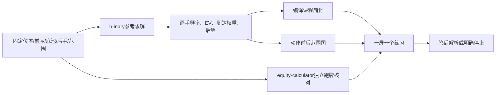

# 116｜仓库能力到训练器的首手范围交接合同

```json
{
  "parentDocument": "111_参考策略到简化课包的编译验收.md",
  "routeNode": "repository_to_first_hand_bridge",
  "evidenceLevel": "research_and_bridge_schema",
  "opensChildren": ["repo-to-course-first-hand-bridge.json", "44_开源仓库能力审查_从GTO参考到课程简化训练.md", "97_翻前翻后交接覆盖审计与缺帧补位.md"],
  "returnTo": "翻后教学系统_统一总纲.md",
  "currentStatus": "repository_capabilities_mapped_bridge_contract_not_runtime"
}
```

## 这两个仓库分别解决什么

`gto-wizard/equity-calculator`公开的是精确权益计算：输入具体手牌、公共牌、死牌，枚举合法跑牌，输出单独获胜、平局和分池权益。它适合做牌力、听牌、跑牌和独立结算的交叉核对；它不接收带权重范围、行动历史或下注树，也不输出下注频率和动作EV。因此不能出现“权益低于某数就必须下注/弃牌”的自动跳步。

`b-inary/postflop-solver`是作者侧翻后参考候选：在双方加权范围、牌面、底池、后手、抽水和有限行动树都固定后，用Discounted CFR求解，能够产生逐手动作频率、动作EV、到达权重、行动历史和后继牌。它的六人桌支持主要是弃牌者的bunching；一个正在求解的节点仍是两名未弃牌玩家。它还标明开发暂停，接口可能在不改版本号时变化，并采用AGPL-3.0，不能直接把源码复制进闭源EXE而跳过授权审查。

`wasm-postflop`和`desktop-postflop`的价值主要在表达：浏览器/桌面运行、范围矩阵、具体组合、节点和新牌查看。这些界面可以参考，但显示中的舍入、按当前最大值缩放或很小到达权重截断不能直接拿来判分。训练器的判分输入必须是作者侧保留的原始数据，页面只显示经过合同编译的当前一步。

## 正确的接入顺序



第一层固定输入。必须保存六人现金桌、有效筹码、抽水、位置、所有前序动作、公共牌、双方起始范围、行动尺寸和输入指纹。第二层只在这些输入相同的情况下取得参考策略。第三层把课程规定的纯动作、50%或100%动作、范围小注等编成独立的 `course_policy`，不能把它覆盖回 `reference_policy`。第四层分别生成动作前范围、动作后范围、公共牌物理排除和动作筛选，颜色只表示变化身份。最后才生成用户看到的题目。

## 首手真正缺的桥

翻前图表并不会自动变成翻后范围。用户实际需要看到五个连续画面：

1. 在翻前图表中确认位置、前序和具体格子。
2. 选择这一格在当前课程版本里的动作，并保存动作身份。
3. 把这个动作变成带分母的起始范围快照，保存父快照和输入指纹。
4. 把自己的底牌和公共牌造成的实体冲突从同一坐标图中划掉；这一步只回答“哪些组合不可能”，不回答“对手因为动作弃掉了哪些牌”。
5. 带着同一历史、底池、后手和快照进入翻后第一帧，先做位置/行动者识别，再进入牌面、范围和比较。

现有 `a72-range-handoff-candidate.json` 和首手 `S03` 的结构关系已经可以核对：两者都是 BTN 开池、SB 3bet、BTN 跟注；英雄都是 SB 的 `AcQd`；翻牌都是 `Ah 9c 2h`。A72候选的100BB是初始有效筹码，首手翻牌帧的双方各剩90BB，是双方翻前到10BB后由账本推导的后手。这个换算是事实层桥接，不代表已经取得动作条件后的对手范围。

因此当前结论是“结构上同路线、还没有策略接线”。要真正接上，必须再有：相同图表身份和完整历史、逐组合动作权重、联合相容分母、父快照能恢复S03、以及后续参考或明确的事实停止点。任何一项缺失，页面可以教物理事实或账本，但不能把题目判成精确翻后策略题。

## 训练器中用户应该看到什么

用户不需要看求解器的参数面板，而是按下面的单屏交接：

| 屏幕 | 用户看到 | 用户做什么 | 错误后回哪里 |
|---|---|---|---|
| 翻前格子 | 桌面、位置、前序、169格和当前格 | 说出格子来源与动作 | 回到图表坐标 |
| 动作确认 | 当前格允许的课程动作及权重身份 | 点选并保存动作 | 回到动作确认 |
| 起始范围 | 固定坐标的动作前/后范围 | 指出谁的范围被更新、分母是什么 | 回到起始范围 |
| 物理过滤 | 自己底牌、公共牌、冲突组合 | 点出“不可能”的具体组合 | 回到物理事实 |
| 翻后第一帧 | 六人桌、位置、底池、后手、行动者 | 先判断谁先动，再进入p1 | 回到翻后上下文 |

正确的视觉顺序是先让图表“交接”发生，再让牌面“变化”发生。不要把完整求解器矩阵、权益、阻挡牌、行动频率和后继树同时平铺；它们只有在当前父帧要求时才打开。

## 当前可用和不可用的身份

可用的是仓库职责研究、实体牌物理过滤、已有首手的账本、位置和行动顺序，以及一份可复核的交接字段合同。尚不可用的是首手六个策略节点的匹配完整参考、动作条件范围、课程简化损失、连续后继闭合、真实初学者试读和NL50目标证据。文档把桥写出来，不能把桥已经通车写出来。

来源： [equity-calculator](https://github.com/gto-wizard/equity-calculator)、[postflop-solver](https://github.com/b-inary/postflop-solver)、[wasm-postflop](https://github.com/b-inary/wasm-postflop)、[desktop-postflop](https://github.com/b-inary/desktop-postflop)。机器合同见 [repo-to-course-first-hand-bridge.json](repo-to-course-first-hand-bridge.json)。
