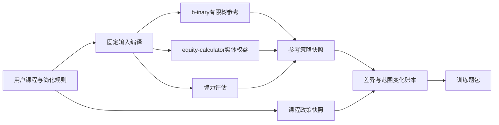

# 140｜指定仓库最新能力与训练器接入边界

```json
{
  "parentDocument": "44_开源仓库能力审查_从GTO参考到课程简化训练.md",
  "routeNode": "repository_current_capability_and_training_boundary",
  "evidenceLevel": "web_recheck_2026_10_22_not_integrated",
  "opensChildren": ["repository-current-capability.json", "repository-training-bridge.json"],
  "returnTo": "翻后教学系统_统一总纲.md",
  "currentStatus": "capability_rechecked_author_side_boundary_locked"
}
```

## 这次核对的结论

这些仓库已经把“计算事实”和“求解参考”分成了几层，但没有一个仓库直接交付“本课程的简化训练器”。因此正确的工程关系是：



“仓库能算”只证明一段底层能力存在；只有输入、版本、行动树、输出索引和课程规则都锁定，才可以变成一道可判分练习。

## 各仓库现在实际做到了什么

| 仓库 | 已确认能力 | 对训练器的明确用途 | 不能替代的部分 |
|---|---|---|---|
| `gto-wizard/equity-calculator` | 对具体手牌、公共牌和死牌枚举合法跑牌，返回 `win`、`tie`、分池 `equity`；公开README说明是精确枚举而非抽样 | 读牌、最佳五张、听牌跑牌、权益与跟注结算的物理交叉检查 | 不接收加权范围、行动历史或下注树，不输出下注频率、范围更新或动作EV |
| `b-inary/postflop-solver` | Rust翻后有限行动树求解库；README说明它是网页／桌面GUI的后端，并明确开发已暂停、版本可能有破坏性变化；可在固定范围、牌面、底池、后手、抽水和动作树下产生策略参考 | 作者侧生成逐手动作频率、动作EV、到达权重、行动后范围和后继节点快照 | 不是课程规则；不是自动恢复用户资料里的隐藏配置；有限树也不代表所有现实下注尺寸 |
| `b-inary/wasm-postflop` | 同一方向的浏览器版GTO求解界面，使用WebAssembly路线；仓库标明开发暂停 | 借鉴浏览器中的节点切换、范围矩阵、具体组合和新牌查看方式 | 不能直接当作本项目训练流程，也不能把界面上的舍入值当精确判分数据 |
| `b-inary/desktop-postflop` | Vue/Tauri桌面求解与查看应用；和求解器配套，适合桌面节点导航与结果展示 | 借鉴桌面训练器的密度、范围矩阵、动作分层、节点返回与结果查看 | 展示层不是教学层；不能照搬全部求解器控制项，更不能把显示归一化当策略事实 |
| `b-inary/holdem-hand-evaluator` | Rust快速牌力分类器，MIT许可；README给出最佳牌力分类与牌面输入约束 | 实体牌力、牌型顺序、摊牌比较和读牌练习的底层事实 | 不计算权益、范围、策略或下注尺寸 |
| `b-inary/poker-cfr` | Rust CFR+研究实现，含多线程、预计算单挑权益，以及Kuhn、推弃和翻前示例；BSD-2-Clause | 用于理解CFR与小型游戏的算法验证 | 不是当前翻后三街求解器，也不是本课程的策略数据库 |

## README中对求解器本体的几个关键限制

`postflop-solver` 的 README 明确写出它使用 Discounted CFR，不做一般抽象，但会合并转牌和河牌的同构跑牌；多数数值使用 32 位浮点、求和临时使用 64 位浮点，并提供 16 位压缩选项。它还支持六人桌最多四名已弃牌玩家的 bunching effect。更关键的是，作者说明这是 WASM／Desktop GUI 的后端，开发从 2023 年 10 月起暂停，且可能在没有版本号变化时产生破坏性变更。因此它适合生成带提交身份的作者侧快照，不能让运行时直接跟随 `main` 分支或把浮点显示值当成课程答案。[postflop-solver README](https://github.com/b-inary/postflop-solver#readme)

`wasm-postflop` 是浏览器版同一求解路线，`desktop-postflop` 是用 Tauri 封装的桌面版；两者解决的是“怎样运行和查看求解结果”，不是“怎样把结果教给初学者”。Desktop Postflop 的公开路线图甚至把 GTO training mode 列为未来项目，这说明我们仍需另建顺序教学、单问题判分、错误回退和迁移验收层。[WASM Postflop README](https://github.com/b-inary/wasm-postflop#readme) · [Desktop Postflop README](https://github.com/b-inary/desktop-postflop#readme)

上述能力来自本轮对官方仓库页面、README和已固定源码候选的交叉核对：[equity-calculator](https://github.com/gto-wizard/equity-calculator)、[b-inary主页](https://github.com/b-inary)、[postflop-solver](https://github.com/b-inary/postflop-solver)、[wasm-postflop](https://github.com/b-inary/wasm-postflop)、[desktop-postflop](https://github.com/b-inary/desktop-postflop)、[holdem-hand-evaluator](https://github.com/b-inary/holdem-hand-evaluator)和[poker-cfr](https://github.com/b-inary/poker-cfr)。当前网页再次显示 `postflop-solver`、`wasm-postflop` 和 `desktop-postflop` 都标注开发暂停；这意味着必须固定提交和输入输出合同，不能只依赖浮动的 `main`。

## 对我们的系统最有价值的三件事

### 1. 把“牌面事实”和“策略原因”彻底分开

先由牌力评估器与权益计算器回答：当前成牌是什么、哪些补张合法、具体手牌在给定对手手牌下的胜率和分池权益是多少。再由翻后求解器回答：在固定范围和行动树中，哪些动作有多少频率和EV。最后才将课程规则写成一个独立的0／50／100或单一主动作政策。

这样用户看见“这张转牌使顺子完成”，和看见“这个节点课程选择下注”，不会被错误地合并成“成顺就一定下注”。

### 2. 让每次行动后的范围图有真实来源

训练器应保存三张不同身份的图：

1. `rangeBefore`：进入当前行动前的合法范围及权重；
2. `referenceAfter`：完整参考策略按具体动作筛选后的范围；
3. `courseAfter`：课程简化政策按同一动作筛选后的范围。

答题时只判课程图；答后才按需显示参考图与差异图。三张图必须固定分母、保留实体手牌身份、标出观察者视角和物理撞牌过滤。界面可以采用13×13矩阵和具体花色拆分，但不能用按当前最大值重新拉满的颜色直接当作数量。

### 3. 把完整求解变成作者侧快照，而不是让用户等待求解

完整求解需要冻结输入：位置、翻前动作、双方起始范围、公共牌、底池、后手、抽水、下注／加注选项、迭代参数和提交身份。求解完成后导出不可变快照；运行时只读取快照和课程编译结果，按首遍七步逐层提问。这样既能保留参考的数学身份，也不会让练习页面变成求解器控制台。

## 接入边界已经锁定

### 可以进入作者侧研究管线

- `equity-calculator`：作为具体牌对权益、合法跑牌、分池权益的独立核对器；不能仅凭它决定下注。
- `postflop-solver`：作为匹配输入下的翻后参考求解候选；每次导出必须固定提交、行动树和索引；结果要经过独立金额／牌力／范围检查。
- `holdem-hand-evaluator`：作为牌力事实候选；可与本地独立实现交叉测试。
- `wasm-postflop`、`desktop-postflop`：作为范围图、动作列表、节点树和新牌报告的表达参考；不把其显示层接进判分内核。
- `poker-cfr`：作为算法教学与小型CFR验证参考，不作为正式翻后数据源。

### 目前不能直接进入发布的训练运行时

- 未完成许可审查的求解器源码或二进制，尤其是AGPL项目；不能未经决定就塞进闭源EXE。
- 没有完整输入身份的策略数字；不能用“看起来像课程”的相邻节点填空。
- 桌面／浏览器界面上的舍入、截断、相对缩放颜色；不能直接当答案。
- 只做了单点权益复算、没有行动后继的案例；不能生成连续线路题。
- 求解器自身的“收敛”或锁定模型误差；不能直接证明课程简化无损或达到NL50。

## 一条可落地的研究到练习流水线

1. **固定研究问题**：例如“SB开池、BB跟注、100BB、A♠7♥2♦、SB翻牌第一行动”，所有未知输入显式标记。
2. **编译范围和牌面**：从用户翻前图取得起始范围，进行实体去重、死牌过滤和观察视角记录。
3. **运行两类核对**：用牌力／权益组件核对事实；用翻后求解器生成完整参考，保留策略、EV、到达权重与后继。
4. **写出课程政策**：只在资料明确支持的动作上量化0／50／100或主尺寸；把删掉的尺寸、后继和适用边界写入差异账本。
5. **生成范围变化图**：同一分母下分别保存参考后范围和课程后范围，图上说明“谁因为哪个动作离开”。
6. **编译成训练帧**：首遍只显示必要输入、一个变化图和一个问题；答后显示课程解释，按需展开参考差异。
7. **验证再开放**：先做事实、单步、连续状态、相邻迁移和低基础试读；任何一个环节缺证据，节点保持未发布。

## 当前项目状态

本轮只完成了仓库能力再核对和接入边界的更新，没有声称已经得到A72完整三街策略，也没有把任何仓库源码接入应用。当前仍然缺少：完整匹配参考、35项单元的逐项来源与后继、真实低基础用户试读、运行时验证以及NL50对标证据。下一步应优先闭合一个输入完全明确的首课案例，再把同一条“参考—简化—范围变化—练习”链复制到其它牌面。

<!--
{
  "parentDocument": "44_开源仓库能力审查_从GTO参考到课程简化训练.md",
  "routeNode": "repository_current_capability_and_training_boundary",
  "evidenceLevel": "web_recheck_2026_10_22_not_integrated",
  "opensChildren": ["repository-current-capability.json", "repository-training-bridge.json"],
  "returnTo": "翻后教学系统_统一总纲.md",
  "currentStatus": "capability_rechecked_author_side_boundary_locked"
}
-->
