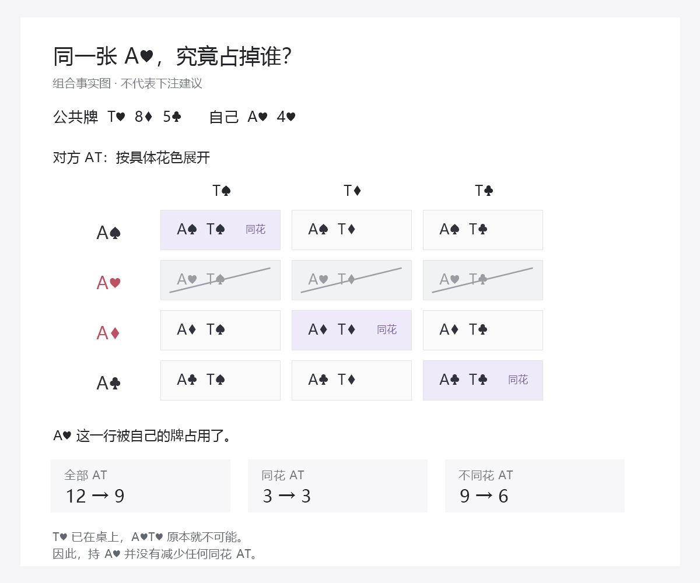

# 阻挡与后门：从看见一张牌，到知道它怎样影响当前选择

总入口：[统一总纲](../../翻后教学系统_统一总纲.md)。本篇把Nevir 2.1的A4、Q7讨论细化为一条有视觉操作、错误诊断和迁移要求的教学链。它挂在“看清／比较／更新”里，不增加一个必须先读完的理论目录。

## 1. 这次要让初学者真的看懂什么

用户最后能说清并实际指出：

> 我拿着这张牌，对方就少了一些可能的牌。先看这些牌本来会怎样行动，再看少了它们对我现在的选择有没有帮助。

同时分清另一件事：

> 后门说的是我的牌以后可能怎样变好；阻挡说的是对方哪些牌不可能在。它们会同时存在，但不是同一条理由。

不以会说“我有A阻挡”“我有后门”作为通过。要点得出具体组合、分得清当前比较对象，最后回到过／打或弃／跟／加的选择。也不能先认一个“好阻挡”，再替它找下注理由。

后续另补[完整BB范围的四张连续图稿](44_开源仓库能力审查_从GTO参考到课程简化训练.md#16-把完整范围接回一条能顺着看的教学)：先摆输入表、排除自己底牌、观察自己的下注不改变所见BB范围，再按对手给定跟注规则筛选。它使用完整单方输入与具体花色，避免只用五张候选小卡代表全部范围；但候选策略未达精度，只教物理和给定规则运算，不补造最佳行动答案。该图段按需挂在原S09，不能替代本篇后门或其它阻挡用途。

## 2. 先用原材料中的A4，展示实际少了什么

Nevir 2.1 §3.3讨论T85彩虹上A4的进攻理由，提到它占用AT、A8、A5，又讨论可能退出或继续的其他牌。这里选T♥8♦5♣、自己A♥4♥作为**作者指定的合法示意**，不称已恢复原视频截图。

第一屏只放自己的两张牌与公共牌。点A♥，再展开对方AT的实体组合。含A♥的牌依次打叉。其余格子不移动；不先涂成“应该下注”的颜色。

| 对方牌组 | 只知公共牌时的实体组合 | 再知道自己A♥4♥后 | 这一步实际证明什么 |
|---|---:|---:|---|
| AT | 12 | 9 | 一部分顶对候选被占用 |
| A8 | 12 | 9 | 一部分8对子候选被占用 |
| A5 | 12 | 9 | 一部分5对子候选被占用 |
| A7 | 16 | 12 | 同时也占用一部分目前赢自己的A高牌 |

这些只是物理组合数，不是概率，也不是已经跟注过的范围。看见前面三行减少9种，不能立即点“所以A4必下”。A也会占用别的牌；被占掉的牌是否会继续、会弃、会加，仍要接当前模型。

在这块牌面，A4当前输给AT、A8、A5、22、A7，当前赢QJ、J9、97。这需要先让不会比牌的人亲手比较；“更差的牌跟注”是相对自己说的，不能只看QJ有两张高牌就以为比A高大。

这组牌型事实仍不等于未来权益。QJ、J9、97可能反超；AT也可能被A4反超。课程讨论哪些对象会退出或继续，属于策略与响应层，不能由当前胜负自动生成。

## 3. 接上当前决定：三种用途要分别教

仍然只打开当前需要的一行，其余不永久放在屏幕旁。

| 当前正在决定什么 | 这次要看哪些被占用的牌 | 对选择可能有什么影响 | 必须同时检查 |
|---|---|---|---|
| 我想下注迫使更好牌退出 | 对方会继续／加注的牌，以及本来会弃的目标 | 少一些继续牌可能有利；少一些弃牌目标可能不利 | 自己被继续的权益、成本、过牌机会与未来 |
| 我想下注让差牌付款 | 愿意付款的差牌，以及会让我付更多钱的强牌 | 占掉付款对象可能少收钱；占掉强端也可能减少风险 | 大小尺寸的响应与过牌替代收益 |
| 我面对下注或加注 | 能赢我的下注牌，以及我能赢的下注牌 | 少一些价值可能有利；少一些诈唬可能不利 | 先确认自己到底赢哪些、价格与后续分支 |

这不是三条机械口诀。A4有未来改善、不是零权益诈唬；对方也可能加注。要比较完整选择，不能只数一次“少了价值牌”。

面对进攻时，也不能先把自己的牌叫“抓诈牌”：如果还能赢一些对方正常价值下注，判断就不同。外部机制核对同样强调实际价值／诈唬分布、改善与对手倾向；有阻挡也不保证盈利跟注。[The Art of Bluff Catching](https://blog.gtowizard.com/the-art-of-bluff-catching-2/)。本篇不移植其具体牌局动作表。

## 4. “少了很多”还要继续拆：花色、权重、重复计数

这三处不是首次体验同时讲完。用户在相应错误处才展开，补完回原决定。

### 4.1 A不一定占掉对方的同花AT

在T♥8♦5♣上，ATs原有A♠T♠、A♦T♦、A♣T♣三种。A♥T♥因为T♥已经在桌上，本来就不可能。



自己持A♥，AT总组合12→9，但ATs仍是3→3；减少的是ATo。若当前真正会继续的只有ATs，“有A就少了AT跟注”这句粗话会算错对象。

操作上先展开AT格，再切换“同花／不同花”层，不另换一张全新表。未知的继续策略不自动填入。

### 4.2 半频率不能当整组合的一票

按用户BB对BTN开池2.5BB的“普通中”图，只取翻前跟注权重：此示意牌面上A8的未归一质量从7.5到5.5，A5从1.5到1。它们不是12到9那样每种等权。

初学先看到实体卡片，再让50%格子显示半份权重。无需心算小数，但应知道颜色一格不等于相同的可能性。真实翻后响应还要继续乘动作概率。

### 4.3 两张底牌的移除不能直接相加

只知公共牌时，A4有16种。A♥排除4种，4♥也排除4种，但A♥4♥被两次点中，实际只删一次：最后剩9种，不是8种。

先让用户把两次高亮叠在同一张小卡上，再合并。公式`16−4−4+1=9`在作者层；初学只需要看见“这手已经被划掉了”。

## 5. 后门要用变化讲，不用一个标签讲

另开一个明确的“换一手对照”，仍用T♥8♦5♣：Q♥7♥与Q♠7♠。它不修改主牌局的底牌或前序。

1. **现在：** 两者都没有成同花，不能把“有后门”误读成“已经听一张花”。
2. **翻2♥：** Q♥7♥现在合计四张红心，成为一张牌可成的同花听牌；仍没成花。
3. **河牌再来红心：** 这条分支才有五张红心。若转牌没建立足够花色，下一张就不可能补齐同花。
4. **Q♠7♠对照：** 翻牌没有黑桃，未来只剩两张公共牌，最多合计四张黑桃；不能靠这两张跑成同花。
5. **回到原决定：** 后门提供了某些有用的后续分支，不自动证明现在下注最好；遇到新下注仍要看价格、响应与后手。

在未知牌均匀、未按对手范围和行动再条件化的演示中，Q♥7♥的1081种两张跑牌里有45种完成同花，约4.16%；Q♠7♠没有完成任何同花的跑牌。这个数字只放详情，不让初学者背，也不是赢池概率。

Nevir原文在该T85选牌讨论里，用有无后门同花简化Q7s的选择。课程条款执行题可以明确问“按刚才给定简化选哪项”，按原文精度反馈；不能因此把所有无后门手牌都判过牌，或把所有牌面有后门都判下注。它与完整最优动作测试分别计结果。

这里改变花色也会改变阻挡对象。解释时要逐项指出，不能把动作差异都归因于后门，也不能都归因于阻挡。如果要证明谁贡献多少EV，需要对应策略模型，而不是由动画分配一个百分比。

## 6. 到河牌，要把这条关系重新放回面对下注

另一手独立示意：K♥9♥2♣7♦4♠，比较Q♥9♠与Q♣9♠。两手当前最佳五张相同：99、K、Q、7；河牌也没有未来改善。

现在切到对方的“两张红心”候选层：前者允许45种，后者允许55种。用户点Q♥，看见10种含Q♥的候选被划掉。不是让用户先选跟注。

然后必须问：“这些被划掉的牌，哪些实际沿此前序下注了？哪些我能赢？”两张红心没成同花，仍可能有对子或其他摊牌价值；不能把45／55直接叫作诈唬数量，更不能当作诈唬率。

有依据的下注策略若用其中一些牌诈唬，Q♥也可能同时占掉那些诈唬。若只看“我有一张相关花色，所以更适合抓”，就会漏掉这一边。它是否同时占用价值，必须看这条具体历史里的价值范围，不能套另一块牌面的同花阻挡口诀。

此处只检查同牌力、不同移除；最后跟、弃、加的题仍要有完整对应范围和价格。若未取得，作者不能把这个示意混入最优动作考试。

## 7. 发现的范围拼接问题，必须在作者层解决

同一份材料里有两种来源身份，不能悄悄拼成一张精确策略表：

| 项目 | Nevir讨论举例 | 用户BB对BTN 2.5BB简化图 | 对教学数据的影响 |
|---|---|---|---|
| A7o | T85上A4可能赶走的更好牌 | 翻前弃牌100%，跟注质量0 | 不能把A7o加入这套图的翻后弃牌目标 |
| QJ | 举作较差继续对象的粗牌名 | QJs翻前加注100%；QJo跟注100% | 不能把QJ无差别扩成16种跟注组合 |
| J9、97 | 粗牌名的继续候选 | 同花和不同花分别处理，权重不同 | 先拆实体与前序，再讨论响应 |

原课程未给齐此例开池尺度与完整起始范围，所以这不是证明课程错误；它证明**目前不能假定两者相同**。也不证明课程所有方向对用户图失效，是否仍适用需要对应条件或稳健性依据。

作者在生成每个内容单元前固定：范围来源与版本、翻前路线、牌面关系、前序尺寸与响应、任务精度。来源不匹配时可以：

- 保留为课程原理解释或明确课程条款练习，披露其情境身份。
- 使用用户图训练可验证的事实与组合，不偷接未匹配的后街处方。
- 取得匹配响应或重新求解后，才开放该图下的完整动作判分。

不擅自修改用户翻前图，也不为了凑齐题库，把原文中的候选组补到一条本来不会到达的线路。普通初学者不必每天审查两份资料；这些是作者的发布条件。

## 8. 学习过程怎样组织，避免又变成七个散练菜单

入口仍是一手正在比较选择的牌。局部链如下，完成后回原决定：

```text
我现在在比较什么
      ↓
我实际拿着什么、当前赢谁
      ↓
我占掉了哪些具体候选
      ↓
这些候选原本在当前行动里扮演什么角色
      ↓
同时检查有利与不利的一边
      ↓
回到同一份方案比较；有可靠答案时执行
```

第一遍逐张揭示；第二遍让用户补一个未高亮的组合；再固定牌改响应角色，检查他是否仍一口咬定“A永远是好阻挡”；随后给新牌做实体排除；最后在有足够依据的题里收起原理标题，直接完成动作与更新。

相对比例那一小步先让用户作预测，再把两组条带中被占用的部分打叉、重新排成100%。系统计算并显示比例变化，不要求先背第9节公式。若连条带表示什么都不理解，就退回少量明牌和一份一份的权重，不增加心算负担。

首次跟练不强迫每个人数全范围。先会几个明确候选，再展开同类全部实体；熟了收掉中间计数。当前如果主要卡在五张，不进入阻挡理由辩论，补五张后回原处。

独立题不能只换花色重复：还应覆盖相同移除但响应角色不同、移除更多价值却更少适合跟注、当前成牌相同但未来机会不同、花色变化不影响当前关键对象、前序排除了原目标等关系。策略答案须有依据；事实变化与策略变化分别检查。

详细作者合同见[blocker-lesson-contract.json](blocker-lesson-contract.json)。它记录任务与返回，不是新软件功能或已经取得的学习结果。

## 9. 作者层的数学：为什么只数价值牌会算错

严格限定为河牌纯抓诈：赢所有诈唬、输所有价值、无平分，固定对手策略，仅作牌张条件化。下注范围中诈唬质量B、价值质量V，自己占掉b、v后：

`原权益 = B/(B+V)`

`新权益 = (B−b)/(B+V−b−v)`

在分母为正时，新权益提高当且仅当`B×v > V×b`。换句话说，要比较被移除的相对份额，不能只比较移除的绝对数量。

反例：B=20、V=80，移除4份诈唬、8份价值。价值确实少得更多，但它只减少10%，诈唬减少20%，自己的赢面从20%降到约18.18%。这些是作者为检验逻辑给定的数，不是Nevir人群统计。

跟注还需价格。当前池P已含对手下注、待补C、无未来行动且无抽水时，`EV跟 = 权益×(P+C)−C`。即使权益改善，仍可能不够价格；有加注选项时也尚未证明跟注是全部合法动作中最好。

主动下注和前街不能直接套这条纯抓诈公式。零权益、被继续必输的单街诈唬，才可按弃牌／继续质量写简化EV；A4有权益、有未来、有反击，须完整比较。面向初学者的简洁不能以删掉这些实质条件换来。

## 10. 当前完成与未完成

`node scripts/research-nevir-blockers.mjs`生成[可复算数据](blocker-teaching-evidence.json)：实体移除、花色分拆、半频质量、重复移除、当前五张、后门跑牌、同牌力河牌对照与范围身份冲突。它不修改应用或原材料。

现在补出了这条能力的具体教学操作、机制边界和可验证输入。尚缺与用户图完全匹配的翻后响应与全动作参考，也未进行真实初学者试学。不能用本单元的组合算对，宣称已经会作所有阻挡决策或达到NL50。

## 11. 10月21日：从移除候选走到诈唬再加的完整当前节点

本节补3.5的计算输入，尚未编成逐帧课程。原材料关于A4、同花与不同花候选的讨论帮助定位要观察的关系，但不提供下述范围或52%弃牌率。以下是明确指定的作者模型，不是课程原解、NL50人群统计，也不把资料缺失的节点开放成普通最优策略评分题。

### 先把当前牌、钱与行动讲清

六人100BB的合法观察历史：BTN开2.5，SB加到10，BB弃、BTN跟，池21；翻牌K♥9♥2♣，SB下7、BTN跟，池35、双方83；转牌7♦双方过；河牌4♠，SB下17.5，BTN加到45。

现在自己SB已下17.5、后手65.5，对手已下45、后手38，眼前池97.5，跟需27.5。比较A♥Q♥与A♣Q♣：两手当前最佳五张同为A、K、Q、9、7高牌，且都是河牌，已经没有下一张听牌机会。对方本模型所有候选均有一对K，跟注都输。

当前加注范围先指定为全部公共牌合法的AKs与KQo，每个实体组合权重1，再排除自己占用的牌。不是先从对方真实底牌挑出一个适合故事的组合，也不声称这些组合必按用户翻前图走到这里。

### 不把“有A阻挡”当成一句统一结论

只知公共牌时，AKs有3种，KQo有9种。K♥已经在桌上，A♥K♥本来就不可能；自己拿A♥不会再删除一手AKs。A♣则占掉仍可能的A♣K♣。Q♥会删除3种KQo，Q♣只删2种，因为K♣Q♣本来属于同花组合、不在KQo中。

| 只在对照里替换自己的牌 | 留下AKs | 留下KQo | 当前成牌 |
|---|---:|---:|---|
| A♥Q♥ | 3 | 6 | 同一A高 |
| A♣Q♣ | 2 | 7 | 同一A高 |
| A♥Q♣，只改Q的花色 | 3 | 7 | 同一A高 |
| A♣Q♥，只改A的花色 | 2 | 6 | 同一A高 |

先只显示前两手；后两手是按需展开的单牌控制，防止把同时换A、Q两张花色的差异全归因于某一张。它们不代表同一手牌真的中途换了底牌，也不补造不同同花／不同花起手牌的翻前入池许可。

### 再加不只有全下，先核最小合法金额

上一笔完整加注增量是45−17.5＝27.5，因此自己普通再加至少到72.5，最大到83。此处按当前有效深度，连续数学区间为[72.5,83]；实际平台的筹码最小单位另定。最小完整加注和不足额全下的概念另对照[PokerStars规则](https://www.pokerstars.com/help/articles/poker-rules-master/217425/)核实，规则来源不为本模型范围或概率背书。

固定引擎实际建树也确认：72.49被拒、72.5合法、83为全下。自己到72.5后，对手仍能用剩余38全下到83，只增加10.5；自己面对这一不足额全下只需处理跟／弃。见[实际规则输出](bluff-reraise-rules-runtime.json)。这一小树没有分配策略存储或进行求解，不等于之前的A72三街参考已经跑通。

### 把对手回应明确给定，才能计算

对任何合法再加总额R，作者假定：AKs总继续；KQo以指定频率弃牌，其余继续。R小于83时，“继续”是对手全下到83；R等于83时，“继续”是跟38。这个回应被假定不随再加大小改变，属于本实验的关键限制；现实里若随大小变化，就必须重新比较，不能沿用下述最小额结论。

自己被继续时没有胜出份额。若还剩筹码，面对对手全下就弃；不是先看对手隐藏底牌再择优。当前弃牌EV为0，直接跟27.5的EV为−27.5。令F为按当前已知两张牌条件化后的整体弃牌比例：

`EV再加到R = F×97.5 − (1−F)×(R−17.5)`

在这个大小不影响回应的给定模型中，R越大，继续支多亏越多，退出支收入不变。因此所有合法再加中72.5最好，而非先将全下当唯一再加选项。对连续区间的结论由线性公式推导；0.01BB网格的1051个金额只作交叉核对，不冒充实际NL50平台筹码单位或连续证明。任何包含72.5的合法筹码网格，在该假设下都会得到相同的最优再加额。

具体账本也能看见：加到72.5新增55，自己剩10.5，池152.5。对手若弃，退自己未匹配27.5，再收匹配池125，自己到163，相对此刻65.5净得97.5。对手若全下，池190.5、自己待补10.5；自己弃，对手退回未匹配10.5再收池180，自己保留10.5，相对此刻净损55。不会因之前已经下17.5，就把它再扣一次。

### 同牌力可以得到不同选择，但不能发明现实弃牌率

指定KQo有52%弃牌，仅用于让关系差异可观察；52不是测得或推荐的人群频率。AKs始终全继续。独立按终局余额复核后：

| 自己手牌 | 整体退出比例F | 再加72.5 EV | 直接全下83 EV | 当前比较结果 |
|---|---:|---:|---:|---|
| A♥Q♥ | 34.667% | −2.133 | −8.993 | 弃牌0较高 |
| A♣Q♣ | 40.444% | +6.678 | +0.424 | 再加72.5较高 |
| A♥Q♣ | 36.4% | +0.510 | −6.168 | 再加72.5较高 |
| A♣Q♥ | 39% | +4.475 | −1.930 | 再加72.5较高 |

不是看“A”就知道适合诈唬，也不是占掉的总数越多越好。A♣Q♣相对A♥Q♥少留一手全继续的AKs、多留一手可能退出的KQo，归一化后整体退出比例改变，动作才由明确价格与回应推出来。

另设KQo弃牌率55%的保持对照：两手同花AQ都选择再加72.5，说明移除不同不一定改动作；但A♥Q♥若只允许全下，会看到−5.733，而其较小合法再加仍有+0.917。只做弃／跟／全下三按钮的模型，会在此漏掉一个正收益方案。这个反例是检查动作覆盖，不是宣称现实中应按55%下任何结论。

### 教学怎样展开，而不是一开始背整张表

依次安排：先比当前五张→确认河牌无未来改善→算新待补与最小再加→展开一组可能候选→点自己的A、Q删冲突→看这些候选原本怎样回应→预演被弃与被全下的账本→合并选择→关闭对照恢复原牌局与参考。单牌控制和55%保持对照放在里面按需展开，不新建首页栏目，也不让用户同时盯四手牌。

演示可以先用明确模型给出结果，随后收掉高亮和EV，让用户按完整输入计算；但当前仅补模型与操作次序，尚无逐帧题包、陌生变体检查或真人试读。候选卡始终写“可能”，不标成已经看见对手真实底牌；互斥分支不串进实际历史。

`node scripts/research-nevir-bluff-reraise.mjs`核对4手牌的实体排除、相同当前五张、所有候选都胜出、3种回应版本、连续金额公式和每版1051个网格金额。`node scripts/verify-nevir-bluff-reraise.mjs`另按终局余额和手工分数复核4组52%例，并对实际引擎的非法／合法边界和不足额全下输出核对。见[模型](bluff-reraise-model.json)与[复核记录](bluff-reraise-verification.json)。

它补3.5的完整给定当前节点比较输入，不补完整GTO博弈、实际对手范围与频率，更不填入课程缺失处当原始真值。最优响应只在所声明的回应模型内成立；NL50目标、完整教学及真实迁移仍须各自验证。

## 12. 10月21日后续：诈唬再加接成21帧，三类对照放里面

原整手结束后回看S13，先完成其它河牌回顾，再明示换另一手已经下注遭加的AcQc模型。本段从“面对加注”进入，原S13的AcQd仍是未取得完整策略的另一手牌，不用本例补原策略。结束恢复完整S13，后续选择S18回顾，不重打原来已经结束的牌局。

### 默认一条实际路线，预演不改牌钱

| 帧 | 当前只做什么 |
|---|---|
| Z01 | 确认当前A高、已是河牌，无下一张改善机会 |
| Z02 | 自己17.5、对手45，算待补27.5 |
| Z03 | 从上次完整增量27.5推出最小再加到72.5，而非默认全下 |
| Z04 | 先看仅排公共牌的候选模板，辨认AhKh早已不可能 |
| Z05 | 点自己的Ac，划掉本来合法的AcKc |
| Z06 | 点自己的Qc，划掉KQo里的KdQc、KsQc |
| Z07 | 继承2手AKs、7手KQo，并按KQo52%弃而非全部弃计算 |
| Z08 | 保留直接跟注的替代，当前给定范围全赢自己，EV为−27.5 |
| Z09 | 预演加到72.5，新增55、自己留10.5、池152.5 |
| Z10 | 预演对手弃，退自己27.5后匹配池125；退出净增量为97.5 |
| Z11 | 预演对手短全下到83，自己仍有补10.5的跟弃决定 |
| Z12 | 按新范围和价格比较，不能因前面已投入55就继续 |
| Z13 | 关闭预演，回真实65.5后手和原97.5底池 |
| Z14 | 合并弃、跟、最小再加和全下；给定模型中选72.5 |
| Z15 | 此时才真实放55，轮到BTN回应 |
| Z16 | 对手这次实际全下到83，重算待补10.5 |
| Z17 | 在新决定按当前无胜出份额选择弃牌 |
| Z18 | 对手未匹配10.5退回，匹配池180，不算自己又输10.5 |
| Z19 | 派彩后自己10.5、对手190.5，不翻开对手真实底牌 |
| Z20 | 整手100到10.5净输89.5，区别当前再加决定损失55 |
| Z21 | 保留事前全部分支比较，不凭这次失败改判再加必错 |

Z04必须写清“仅按公共牌展开的删除模板”。AcKc此时不能被标为当前合法范围：自己的Ac已经知道，只是先展示原格再划除，帮助看见移除过程。Z07以后只显示移除后的当前候选。候选卡始终是“可能”，不是实际摊牌信息。

还必须先给足本例的回应条件：AKs全继续、KQo52%弃，其余继续；从72.5到83这一段，对手概率暂时不随金额变化。这个限定才允许用较小再加与全下代表完整区间的比较。缺少大小不变条件时不能直接缩菜单，52%也不让初学者自行从一段动画猜出来。

Z14显示完整EV是答案帮助，不记成独立求解成功。若首答错或不知道，解释后继续示范路线要明示“下面按示范加到72.5继续”，不能把用户的错误提案当实际行动又偷偷改历史。Z17同理，当前决定与前面的投入分开，首答错误不被后续讲解覆盖。

### 只在需要时打开三种对照

三个轻入口都在Z14反馈里，关闭后回Z14同一反馈，继续才进Z15，不重复计分或放钱：

- H01—H03：换成同牌力AhQh、仍52%回应，剩3／6候选，较小再加也负，弃较高；指出AhKh本已因Kh排除，关闭恢复AcQc的2／7及原参考。
- O01—O03：以AhQh为明确对照起点，一次只改A或Q的花色，分别看AKs与KQo怎样变化；关闭恢复主AcQc。它不是同时换两张牌后把全部差异归给一张。
- T01—T02：另开完整版本AhQh且KQo55%弃，只在本版本内部比较较小再加+0.917与全下−5.733，说明遗漏金额会漏好方案；不把它与主版本的差异归给单一变量。关闭恢复AcQc、52%回应及全部原输入。

八个可选帧不并入默认21帧，也不假定每个用户都看过。主线实际选择对手继续的正概率失败分支，不是抽样证明频率；没有把任何实际对手的牌翻出来。被继续后的两类候选都仍有质量，不能误以为“有弃牌概率的KQo”全部从继续范围消失。

### 当前证据和下一阶段

`node scripts/research-nevir-guided-bluff-reraise-sequence.mjs`生成[题面](guided-bluff-reraise-sequence-prompts.json)和[教师包](guided-bluff-reraise-sequence-packet.json)，核对21主帧、8可选帧、预演与实际状态、600BB守恒、未揭对手底牌以及原S13完整父帧恢复。已有数学验证和真实小树规则核验继续分别保留，本脚本不重新宣称完成正式A72求解。

这使35项都能指到至少一个相关局部操作，仍不能叫35项教会。下一阶段要检查同一项在不同位置、街数、历史、范围、价格与回应中的适用边界，补完整匹配参考，再撤掉答案帮助并进行未曝光连续检查。当前尚无这套课程的真实初学者试读、完整能力通过或NL50结果。
