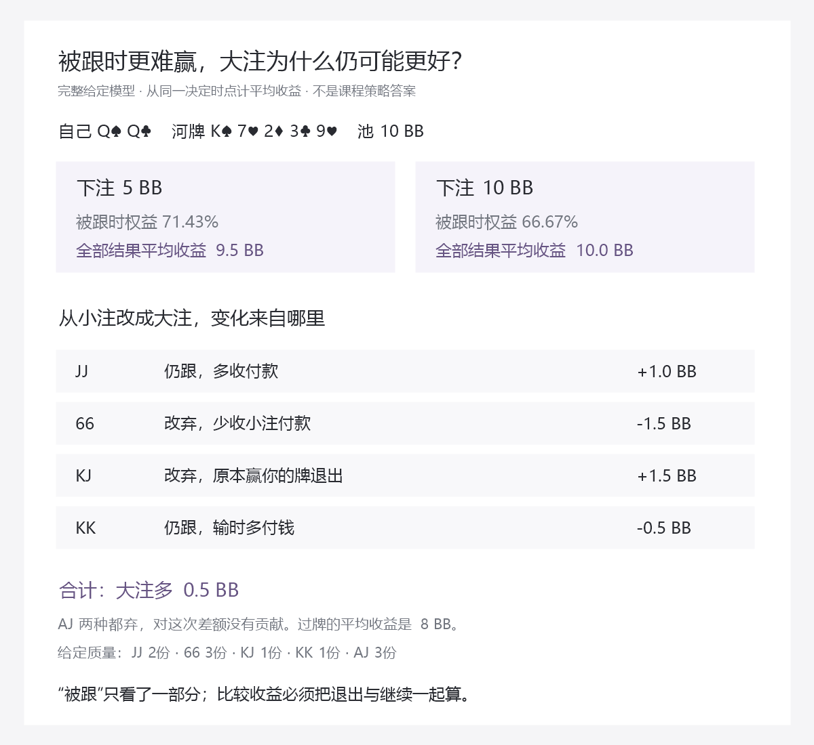

# 下注尺寸：把“用多大”教成能看见、能比较、能执行的选择

2026年10月19日。总入口：[统一总纲](../../翻后教学系统_统一总纲.md)。本篇补“比较选择／过牌与下注”，对应内部覆盖1.1—1.8，尤其是1.8。数学实验是原理工具；课程处方、完整策略参考仍保留各自身份。

## 1. 这一步究竟要教会什么

用户看见一个尺寸以后，不只知道它叫小注、大注，而能指出：

> 对方哪些牌还会付钱，哪些牌会退出；我多收了什么，又多付了什么；与过牌相比，这笔投入到底多得到什么。

最后在依据充分的局面中点动作和金额。单独认对25／40／67，不等于会判断手里的牌应不应该下注；知道一手愿意付款，也不等于已经比较完所有选择。

完整学习的顺序是：看见一个回应的结果 → 与不投入比较 → 加入另一类回应 → 只改变尺寸看回应变化 → 汇总 → 接课程与当前手牌 → 撤提示 → 行动后更新。每次只展开当前需要的部分。

## 2. 原课程在讲什么，哪些不能升级成算法

Nevir2.2先区分不同范围分工，再用T72等具体牌面比较主尺寸：中间牌也能取得较差牌付款时，小注可能容纳更宽的下注范围；中间牌更多保留、强牌和适合进攻的牌进入另一端时，主尺寸和频率会不同。

原文还问“下大以后被跟，我高不高兴”。它帮助观察继续范围，但单靠被跟权益降低，不能判定大注EV更低。还要计入退出分支、投入、其他尺寸与过牌。

因此来源数据要拆成四件事：

| 字段 | 能回答什么 | 不能回答什么 |
|---|---|---|
| 某例主尺寸 | 准备采用该课程下注方案时用多大 | 这手牌一定要下注 |
| 范围下注频率 | 整体多少质量进入进攻 | 每个实体组合都按同样比例下注 |
| 单手动作或倾向 | 指定条件下这手怎样分工 | 任意不同花色、历史、对手也同样执行 |
| 响应与后续 | 谁继续、怎样继续、以后怎样处理 | 缺失响应可以按牌型强弱自动补齐 |

正文“约2/3”、导入字段67和训练按钮固定值，也要有身份。可以按用户现有简化表固定执行67%，但这是练习的执行取值；不能声称近似措辞证明了66%、67%及精确2/3中只有一个数学最优。金额题按题设明确的执行值和舍入规则算。

## 3. 尺寸变了，至少要看四种变化

先不展示EV公式，只让用户观察一个对象与一笔钱。

| 对方这一组牌 | 小注到大注时发生什么 | 怎样让用户看见 |
|---|---|---|
| 我能赢，而且两种都跟 | 可能多收钱 | 同一组牌不动，多出的筹码移到这一分支 |
| 我能赢，但大注时退出 | 可能失去小注本能收的钱 | 这组移到退出，原先那笔付款消失 |
| 我会输，但大注让它退出 | 可能把原本输的池拿走 | 先比五张，再显示对方退出；不能只看被跟的组 |
| 我会输，而且两种都跟 | 被继续时可能多付钱 | 对方牌保留，多投入的筹码标成成本 |

这些效果会同时发生。一次只观察一组，最后回到同一份方案比较；不能哪行先出现，就把那行当成最终动作。

平分也要保留：让本来平分的牌退出，可能取得另一半底池；双方跟注到底仍平分时，额外的对称投入本身不增加净收益。没有跟注分支时，条件权益显示“本模型无人跟”，不是0%。

## 4. 一个完整可复算的反例：被跟权益下降，大注仍更好

这是**作者给齐全部输入的河牌机制实验**，不是Nevir原解算数据，也不作为NL50处方。自己在BTN，Q♠Q♣；公共牌K♠7♥2♦3♣9♥；对方已过牌，池10BB、双方后手95.25BB。不计抽水；只比较过牌、下注5、下注10；本实验对手只跟或弃，没有加注。

这是一条合法可到达的金额历史：初始100BB，BTN开2.5、BB跟、SB死盲0.5；翻牌BB过牌、BTN下2.25、BB跟；转牌双方过牌；河牌BB过牌。历史是观察到的教学前序，不宣称每个动作最优或符合用户某张范围图。

对手的候选及响应完整给定：

| 候选实体牌 | 相对质量 | 下注5时 | 下注10时 | 当前胜负 |
|---|---:|---|---|---|
| J♠J♦ | 2 | 跟 | 跟 | 我赢 |
| 6♠6♥ | 3 | 跟 | 弃 | 我赢 |
| K♣J♣ | 1 | 跟 | 弃 | 我输 |
| K♥K♦ | 1 | 跟 | 跟 | 我输 |
| A♠J♣ | 3 | 弃 | 弃 | 我赢 |

这些质量合计10份，是相对可能性，不是同一实体组合复制了几副。候选相互排斥，不会同时持有。过牌直接摊牌；任意未给定的现实响应不混入此实验。

从当前决定时点计，三种选择的平均收益为：过牌8BB、小注9.5BB、大注10BB。大注被跟时只剩JJ与KK，权益为2/3；小注被跟时为5/7。**66.67%低于71.43%，但10BB仍高于9.5BB。**

原因不是权益不重要，而是“被跟时”只看了全部结果中的一部分。大注多收JJ的钱、赶走KJ，同时失去66的小注付款、对KK多付钱。将小注改成大注，各组对平均收益的变化是：

| 变化来源 | 对平均收益的影响 |
|---|---:|
| JJ继续，多付5 | +1BB |
| 66从跟变弃，少收小注付款 | −1.5BB |
| KJ从跟变弃，改为赢当前池 | +1.5BB |
| KK继续，输时多付5 | −0.5BB |
| AJ两种都弃 | 0 |
| 合计 | +0.5BB |

EV是从现在算的平均净收益，不是一次收回的总筹码，也不是整手相对初始100BB的利润。已经入池的筹码不重复扣除；被跟获胜时扣掉本次自己的投入后，净结果才是P+B。

这张图先用于预测与解释。无提示动作检查时不能先显示三种EV，再把“会选最大数字”说成已经能独立推导策略。

本篇模型的候选与响应以此表为准；它与其他篇章相近牌面的局部实验分别存放，不沿用另一组范围的EV答案。回看实验结束后恢复原牌局快照，不能把示意里的跟弃写进真实历史。

## 5. 不是再记住这一道：生成关系变化，而不是只换牌皮

同一完整模型中，让六类候选的相对质量各取0、1、2、3，排除全0，共4095组；第六类QQ用于平分。脚本逐组比较过牌、小注、大注，出现了全部七种非空最优集合，包括单独最优和各种并列。

这些4095组不代表4095种真实牌局或完整扑克覆盖。它们的作用是检查教学规律在明示条件变化时是否仍正确，并产生能反转结论、不能反转结论、恰好并列的原理练习。

| 必配变化 | 要学会什么 |
|---|---|
| 差牌始终付款占比提高 | 大注可能增加取值，不把大注固定当诈唬 |
| 小注才付款的差牌增加 | 小注可能更好，不把多收单次金额当全局结论 |
| 能被赶走的更好牌增加 | 不只盯被跟权益 |
| 不肯退出的更好牌增加 | 不因有一个好目标就忽略失败成本 |
| 河牌只赶走本来就赢的牌 | 赢下底池不一定比过牌多赚 |
| 两种动作并列 | 接受全部支持答案，不编一个唯一正确 |
| 原本平分的牌改为大注时弃 | 另一个明示响应模型，观察半个底池怎样转为整池 |
| 某尺寸无人跟 | 不展示伪造条件权益，不把它当0% |

改变一组质量后，需要重新归一；不能口头说“其他概率完全不变”却让总和超过100%。改变响应时也要明确这是另一个模型，不偷偷把回看分支接成原来发生过的历史。

改变题面点数、位置、前序或对手范围，则需重新核对全部条件。4095组的一致性不能授权将原答案移植到任意新牌面，更不能叫作NL50策略数据库。

## 6. 为什么翻牌赶走落后牌，有时又有价值

河牌的AJ在这个实验里输给QQ，两种尺寸都弃；即使成功拿走池，也没有比过牌摊牌多赚。这个区别不能漏，否则用户会把每次对手弃牌都当作下注的新增收益。

在另一个明确的翻牌实验中：K♠7♥2♦，QQ对A♠J♣，先固定双方以后都不再下注、只发牌摊牌。剩45张，两张跑牌共990种，QQ赢856种、输134种，权益约86.46%。

若此时池5.5BB，强制过牌到底的收益约4.756BB；若对手立即退出，可得5.5BB，差约0.744BB。这是消除其未来反超机会、相对**强制过牌到底**的条件收益差。

它没有证明真实过牌以后没人下注，也没有证明下注多少会让AJ退出。现实还需对手回应、自己被跟或被加时的成本、后续行动。因此：“保护完全没价值”和“看见保护就下大”都不能作为流程规则。

视觉上先把那134种失去池的跑牌作为一条可能分支显示，再比较退出以后该分支消失。数字由系统计算，初学者先理解“对手现在落后，仍可能以后赢”。成牌概率、获胜概率与动作收益继续分别标记。

## 7. 怎样接回课程T72等牌面

先用牌张事实确认对照发生了什么，再按课程精度练动作：

| 课程场景 | 事实操作 | 课程记录与训练边界 |
|---|---|---|
| 有位置3bet、T72彩虹与两同花 | 对方K♠Q♠从后门同花变成直接同花听牌 | 原例主尺寸约2/3与约40%；事实不独自推导精确比例 |
| 有位置3bet、T52彩虹、自己AA | 点出原文列出的较差继续候选 | 原文用75%说明付款；完整响应未给，不补逐手概率 |
| 有位置3bet、J98两同花、自己AA | 点出对子兼听牌、强听牌与弱继续对象的差别 | 原文小注25的讨论，不把一条被跟权益规则外推全部局面 |
| 842彩虹、66／77／A4 | 先问中间牌是否真有较差付款、能否保留摊牌 | 保留“更多过牌”的精度，不因主尺寸67就让每手下注 |

比如T♠7♥2♦与T♠7♥2♠，给定对方K♠Q♠、自己A♥A♣时，前者仅有后门同花，后者有9张可在下一张完成同花的实体牌。它们确实不同，但这9张不等于9张稳赢补牌，也不说明对手一定跟注。课程的40／约67来自具体策略条件，不能只靠数花色反解。

同一块牌面也必须分开“整范围主要用什么尺寸”和“当前手牌怎样行动”。固定对手响应求这手的最佳回应，也不等于让自己全范围都独立这样选后仍构成均衡；对手可能针对整体范围调整。

这一段现有9项可追溯内容记录在[size-comparison-evidence.json](size-comparison-evidence.json)的courseLesson：T72两种纹理先示范，T82作相邻边界，T62的彩虹／两同花作为教学内新增点数对照，再混T98、842；最后检查“842的77更多过牌”与“356听花本例先过牌”，避免每题都被迫挑一个下注尺寸。

其中7项只练主尺寸，1项练课程先过牌简化，1项练手牌倾向解释。它们不是9张完整逐手策略表，也不是已经冻结的陌生测试集。T98的图示花色与原文具体解算花色身份保留，不由此授权任意变花色。原文未给齐某例响应，就不能声称已把“为什么恰是40”完整求解。

金额任务可在给定合法账本中执行指定百分比：池18BB，固定67%应下12.06BB；若题设明确写精确2/3，则是12BB。题目必须先固定口径。给定百分比的金额练习不证明改变翻前尺度后原策略仍最优。

## 8. 尺寸还会改变下一街的钱，不能只换一个按钮

另一个只核对账本的合法例：六人100BB，CO开2.5、BTN加到8.25、CO跟，SB／BB死盲合计1.5；池18BB，CO和BTN各剩91.75BB。CO过牌，比较BTN两种下注且都被跟的**互斥分支**：

| 本次下注 | 跟后池 | 双方后手 | 后手／池 |
|---|---:|---:|---:|
| 40%，7.2BB | 32.4 | 84.55 | 约2.61 |
| 2/3，12BB | 42 | 79.75 | 约1.90 |

两条都守恒，但下一街池和可投入比例不同，实际跟注范围也需各自更新。不能把两条线接同一份未变的转牌图，或只改历史文字、仍给相同底池和后手。

这是合法金额展示，不宣称8.25是原课程最优3bet值。也不将抽水前金额叫作某平台净收益。

## 9. 用户实际怎样跟着学

本单元在当前“比较选择”内展开，结束返回原牌局与原任务。

| 学习停点 | 用户只做的一件事 | 出错后补哪里 |
|---|---|---|
| 1 先不投入 | 看河牌过牌会赢谁、输谁、平分谁 | 最佳五张与当前对象 |
| 2 放一个尺寸 | 看一组对手跟注或退出后的钱 | 本次新增投入，不重复扣过去的钱 |
| 3 与过牌比较 | 点出这笔钱比不投入多得到或多失去什么 | 基点与互斥分支 |
| 4 换尺寸 | 先预测哪组改变回应，再揭示 | 响应必须随尺寸，不能只放大同一EV |
| 5 合起来 | 逐组汇总，保留并列 | 退出与继续都看，权重正确 |
| 6 接课程 | 分清主尺寸、当前牌分工与条件 | 来源版本和精度 |
| 7 收提示行动 | 在依据充分的新题中自己比较并执行金额 | 错在哪一层，只补哪一层 |
| 8 带到下一街 | 等实际回应、更新范围和账本再发牌 | 不换成一手无关题 |

前三个停点先用少量明牌；后面才增加候选、权重、隐藏信息。第4节完整表是作者与进阶详情，不在第一屏一次摊开。

若提供了所有EV结果再让用户点击，只检查读数和选择；若计算工具直接代算了全部方案，也标有帮助。慢想可以使用中性算术工具、筹码线和自己选择展开的输入，但不能把答案工具当无提示能力。真实牌局最终靠已理解的模式与匹配处方压缩调用，不要求人脑实时穷举全部组合。

正确轻反馈后继续；错误与不知道停解析，补完回原任务。中途补教与首答分开，遵守[首次检查的反馈边界](15_第一遍结构检查_可直接试读稿.md)。每张图始终只有一个当前主任务，不新增尺寸理论仪表盘。

4095组模型、来源审查、精度字段和作者发布条件都不放到普通学习屏幕。用户只需看清当前这题在练什么；内部停点完成就回原桌面，不把本篇各节再铺成一排菜单。

## 10. 作者层数学与出题条件

以下仅在河牌后行动、对手已过牌，或明示强制后续无下注的模型里成立。P是决定前底池，B为本次新增下注；qᵢ是合法候选权重，cᵢ(B)为该尺寸下跟注概率，eᵢ为对应摊牌份额，含平分。无加注、无抽水：

`EV过 = P × Σ qᵢ eᵢ`

`EV下(B) = P × Σ qᵢ[(1−cᵢ)+cᵢeᵢ] + B × Σ qᵢcᵢ(2eᵢ−1)`

两者相减：

`新增收益 = P × Σ qᵢ(1−cᵢ)(1−eᵢ) + B × Σ qᵢcᵢ(2eᵢ−1)`

第一部分是退出相对基点的改变，第二部分是跟注分支的新增投资结果。一个分支不能既算全额弃牌收入，又把同一份未来权益重复加一次。选择最好方案时比较全部受支持菜单，不先固定下注再替它找理由。

OOP过牌还可能面对对手下注；前街跟注后可能继续下注或加注；实际存在抽水、全下、返还时也需按真实终局处理。这些情境不能直接套上式。完整树的最终收益可统一从叶子回算，但叶子和响应需要有依据，公式不生产缺失策略。

第6节的990种跑牌还可用另一种组合计数核对：对方获胜的互斥情形为“有A而无Q”123种、“两张J”3种、“Q与T使AJ成最高顺”8种，合计134；余856种自己赢，无平分。计数为`C(43,2)−C(40,2) + C(3,2) + 2×4 = 134`。这是该确切牌张的交叉核验，不是对任意对局只数干净补张的通用公式。

课程尺寸题、给定模型最优题、匹配参考动作题分别判分。区间或近似尺寸若需固定执行值，记录来源区间、项目取值、舍入与适用任务；不利用容忍值掩盖来源冲突。模型并列接受全部并列，不为做题方便强造纯动作。

## 11. 当前证据和发布边界

`node scripts/research-nevir-size-comparison.mjs`生成[size-comparison-evidence.json](size-comparison-evidence.json)：给齐条件的实验、4095组有限模型核对、反例、990种跑牌、牌面听牌事实与互斥账本。它没有修改软件策略。

这补上了尺寸教学的具体机制、对照家族和计算依据，不能补掉完整NL50参考、真实翻后响应与真实学习迁移。源码与图卡可检查事实和给定模型；初学者是否真的看懂、能在陌生牌局使用，仍需实际试读与匹配参考验证。

## 12. 10月21日：把已有模型接成14帧操作链

首次整手已经走完后，回看S05“现在比较过牌与下注”，明确换成本篇河牌QQ示意。原S05是SB的AQ翻牌，这里是BTN的QQ河牌；位置、前序和参考都换了，不能把本例下10当成原AQ的策略答案。完成后恢复原S05的完整题面并停在回顾态。

| 帧 | 当前只让用户判断什么 | 怎样看见理由 |
|---|---|---|
| B01 | 当前比较过／打，还是跟／弃？ | BB已过，自己无待补；先确定决定类型 |
| B02 | QQ对JJ和KJ，谁大？ | 分别拼出一对Q、一对J、一对K |
| B03 | JJ两种都跟，哪种多收？ | 5变10，多收5 |
| B04 | 66跟小弃大，哪种多收？ | 小注净得15，大注只拿当前池10 |
| B05 | KJ跟小弃大，大注改变了什么？ | 当前输给KJ；从小注损失5变为令其退出后净得10 |
| B06 | KK两种都跟，大注多付多少？ | 从亏5变亏10，保留强端成本 |
| B07 | AJ本来就输且两种都弃，多赚了吗？ | 河牌过牌也赢10；不能把自己的下注当额外收入 |
| B08 | 能只看JJ的好处吗？ | 将五种互斥候选按给定份额合并，而非只盯一行 |
| B09 | 按完整比较选哪项？ | 8、9.5、10支持下10；明确是有答案帮助的跟练 |
| B10 | 被跟胜率低就代表大注差吗？ | 小注5/7、大注2/3，对照整体收益而不漏退出分支 |
| B11 | 示范下10后等谁？ | 实际只扣一次10，池20，交给BB |
| B12 | BB跟完后下一步是什么？ | 池30，河牌行动关闭，准备摊牌 |
| B13 | 这次才亮JJ，谁赢？ | QQ赢JJ，前面候选不等于提前知道实际牌 |
| B14 | 整手净赢多少？ | 自己95.25到115.25，本段得20，整手初始100，净赢15.25 |

每次只开一组候选和一笔钱，B08以后才出现整体。两尺寸用同一行的按钮切换，不加两张并排活桌。给定份额与响应可主动查看，不能把必需题设藏起来。所有作答处有“我不知道”，首次按错误处理，解析后可继续或在原处拆小步。

B09可选打开三种权重对照：只剩给定JJ时大注最好，只剩66时小注最好，只剩KK时过牌最好。这不是三手实际连续发出的牌，也不是读到了真实底牌；只改变明确给定的假设。关闭后恢复原五组质量、8／9.5／10比较和首答锁，回B09反馈，继续才进B10。三个对照帧不计入14主帧。

主线在B10之后才执行下注10，BB随后实际跟10；实际JJ只在B13揭示，B14派彩。用JJ演示获胜是作者选定结果，不是一次抽样证明大注正确。收回30、本段净得20、整手净赢15.25、事前平均收益10，四者不能混用。还需有依据的失败对照与无提示新题，现有公开题不能当陌生考试。

`node scripts/research-nevir-guided-size-sequence.mjs`读取原模型，生成[题面](guided-size-sequence-prompts.json)与[教师包](guided-size-sequence-packet.json)。按终局双方余额重新核对原8例、3动作、6候选的144个分支及平均收益，核对实体五张、600BB守恒、14主帧、3可选帧、延后揭牌和完整父帧返回。余额检查不是独立求解器；没有补齐现实加注回应、前街未来或NL50策略，也没有真实学习者试读结果。

## 13. 10月21日：主动下注不能只讲保护或听牌的好处

复读Nevir2.1中T85的A4／Q7和A72的保护讨论后，仍须区分课程特定条件与通用机制。原文提到拒绝较差牌的权益、后门与阻挡，不等于任意当前领先牌都应下注，也不等于有改善机会就适合进攻。

本轮为1.2和1.4补两个明确给定的主动计划模型，见[输入与全部结果](active-plan-models.json)。两者都从SB对BTN、100BB合法观察历史开始：BTN开2.5、SB加到10、BB弃、BTN跟；翻牌K♠7♠2♦双方过，池21、双方90；转牌3♦，SB尚未行动。候选与响应是作者指定，不是恢复的课程解或真实人群频率。两模型的自己手牌、候选和过牌后策略分别给定，不互相搬答案。

### 领先时：拒绝权益确实有价值，但不必覆盖其它成本

自己Q♠Q♣，对手A♠J♣三份、K♥K♦一份。QQ当前赢AJ、输三条K；对AJ，44张河牌只有3张A会输，另外41张赢。对KK，44张均输。

比较两个完整限定计划：过牌后对手也过，河牌双方都过；或现在下10.5，KK再全下、自己按当前新范围弃牌，AJ按给定版本弃或跟。若AJ跟，河牌双方仍过。这是固定计划的比较，不是保证现实对手让你免费摊牌，也未比较所有河牌主动策略。

| 明确计划或版本 | 当前起算EV，BB | 解释 |
|---|---:|---|
| 给定过牌计划 | 14.676136 | 带着AJ的反超机会走到摊牌，也保留输KK的分支 |
| 下注，AJ全弃、KK再全下 | 13.125 | 得到保护收益，却付出碰到强端的下注成本 |
| 下注，AJ全跟、KK再全下 | 18.852273 | 同一AJ愿意付钱，使这个下注计划改变结论 |

AJ退出的保护收益按整个范围贡献约+1.073864；碰到KK再全下后弃牌的成本贡献−2.625，净效果−1.551136。因此保护确实产生正面效果，但这版下注仍低于给定过牌计划。不能教成“保护没有用”，也不能只画AJ退出就把下注判对。

教学时先只画AJ的3张反超A，再让它退出；此时先不显示最终动作。然后加入KK这一组与自己无法收回的10.5，最后才合并比较。再让AJ从弃改为跟，检查用户是否能指出变的是付款，而不是自己的QQ突然变强。正式逐帧题和未见检查仍需另编，不能把本表直接当作用户已经学会。

### 弱牌时：未来改善保留，但遇到反击会失去兑现机会

自己换成A♠Q♠，候选KK／KJ／JT为4／16／1。三个候选各44张河牌分别赢7／12／38张，沿用已经独立核对的实体集合；这些事实不随着对手对下注的回应改变。

现在从尚未过牌的节点比较过牌和下注10.5。过牌后BTN总下10.5，继续按原`pressure`防守树比较，其菜单内最佳值为0。主动下10.5后的三种回应另行给定，不能把它们与对过牌加注的回应当同一个节点。

| 主动下注后回应版本 | 下10.5的EV | 与给定过牌计划比较 |
|---|---:|---|
| KK、KJ、JT全再全下 | −10.5 | 在新全下范围和价格下弃牌，损失这笔首注；过牌较高 |
| 只将KJ改为一半弃、一半跟，其余仍再全下 | +5.863636 | 所有退出、跟注未来与再全下后果合并后，下注较高 |

第二版的贡献为：KJ退出+8、KJ跟注后约+0.363636、KK／JT再全下后弃牌−2.5。跟注分支保留全部44张河牌：自己先过，KJ领先时下21、自己弃；自己领先时KJ过。此支只有KJ能到达，所以依据可见历史采用统一回应，没有先看隐藏牌再择优。

该特定KJ单一候选支的结算恰与免费摊牌数值相同，但不能因此把所有跟注支都当免费摊牌。另一组已有防守模型已经展示未来压力会改变EV。再全下支的决定则按整个新范围统一比较，不能对KK弃、对JT跟后再平均，制造不可执行的收益。

教学上应先点出KJ当前赢自己而可能退出，再分别预演跟注和再全下；关闭预演回原未下注节点，才合并选择。听花牌在第一版仍有相同的改善事实，却因为反击失去兑现机会而不适合这条下注计划。它补的是具体机制，不是一个新的“听牌下注频率”表。

### 验证边界

脚本`node scripts/research-nevir-active-plan-models.mjs`从两个真正尚未下注的节点计算计划，而非把面对下注的防守结果换名。它核对AJ仅3张A反超、原听牌7／12／38集合、600BB终局余额、公共再全下节点统一决策及上述精确分数。零概率跟注支不填虚假的条件EV。

这些模型为1.2和1.4补了比较输入，尚未补其逐帧序列、所有合法行动或完整目标策略。课程的A72、T85动作仍按各自来源，不移植本例下注10.5；样本范围与回应未经现实验证，不能由本表称NL50策略或初学者掌握。材料身份现在可列局部模型，学习通过仍为空。

## 14. 10月21日后续：保护比较已经接成小步视觉链

第13节之后，先将保护这一支编成17帧，弱牌主动进攻支仍待另接。入口是尺寸段已经完成后回看B09的方法；明示换成另一手转牌QQ模型，不重打原尺寸例。退出恢复B09原河牌、完整候选和8／9.5／10比较，不能把本例较高的过牌计划留到原题。

### 不先把两种范围、所有EV和反例铺出来

先只看AJ，画44张合法河牌的计数格，圈出3张会使AJ反超的A。此时只承认保护有好处，不给最终推荐。再把原模型中占1/4的KK放回来，显示下注碰到它的成本。最后才打开两条完整计划的比较。

接着才打开[第二张：加入强端成本](figures/protection-step-2.png)，最后打开[第三张：合并计划收益](figures/protection-step-3.png)。它们是顺序阅读的作者说明图，不是同时挂在桌面上的三个面板。三张均已渲染并逐张打开检查；没有据此声称初学者看懂，也不是新页面已做出来。

### 每次只完成一个眼前操作

| 帧 | 当前任务 |
|---|---|
| P01 | 确认当前无待补，比较过牌与下注 |
| P02 | QQ和候选AJ比五张，指出当前领先者 |
| P03 | 找出AJ会反超的3张A，而非把所有高牌都圈成危险牌 |
| P04 | 只看AJ时承认退出能消除这部分反超机会 |
| P05 | 补回完整给定范围里的1份KK，不遗漏强端 |
| P06 | 看下注10.5后遭KK再全下并弃牌，首注不会退回 |
| P07 | 将强端成本按1/4计为−2.625，而非混用条件与整体数值 |
| P08 | 合并保护贡献约+1.074和强端成本−2.625 |
| P09 | 在明确给定两条计划中比较，过牌14.676高于下注13.125 |
| P10 | 此时才实际过牌，等待BTN回应 |
| P11 | BTN也过，关闭转牌后才发牌 |
| P12 | 实际来A♥，仍先轮到SB，不直接结算 |
| P13 | 按已给定河牌计划过牌，交给BTN |
| P14 | BTN也过后才进入摊牌 |
| P15 | 此时才揭真实A♠J♣，其一对A赢自己一对Q |
| P16 | 整手100到90净输10，区别本段没有新增损失与对手收池21 |
| P17 | 保留事前完整比较，不能因这次被反超就判保护必然更好 |

P09给出EV是教学帮助，不是独立策略考试；前序和河牌自己的动作也按明示计划执行，不把执行正确混记成自行找到最优动作。实际A♥是作者选定的正概率失败示范，不是随机统计。候选AJ在P15之前只是可能牌，不能用“实际AJ”标记泄露结局。

### 同一处再看一项改变，而非再背一条相反口诀

P09的可选轻入口“如果AJ愿意付钱”展开T01—T03：只改AJ全跟10.5，KK仍再全下，下注计划18.852高于相同过牌计划14.676；让用户指出变的是对手愿付钱，不是自己QQ变强。关闭后恢复原AJ全弃版本、13.125比较和P09反馈，再继续P10。三帧可选不计入默认17帧，不提前执行下注。

正确继续、错和不知道原处解释、可主动拆小步，沿用统一反馈合同。实际跟练有两种不同返回：本层的小版本比较回P09；整层保护学习结束回原B09，再关闭尺寸回顾层回原S05。后两者都是回顾，不重放已结算的B10—B14。

`node scripts/research-nevir-guided-protection-sequence.mjs`生成[逐帧题面](guided-protection-sequence-prompts.json)和[教师包](guided-protection-sequence-packet.json)，检查17主帧、3可选帧、P15才揭牌、600BB守恒及原B09完整父帧恢复。`scripts/render-nevir-protection-cards.ps1`读取相同模型生成三张说明图。作者材料走查通过不等于UI、学习效果或NL50验证；1.2的更多牌型与后续仍须补齐，当前只是一个有明确依据的局部教学段。

## 15. 10月21日后续：弱牌主动下注接成17帧

同样从尺寸段完成后的B09回顾进入，但这是另一手转牌AsQs模型：手牌、候选和过牌后计划都明确更换，不用它与上一手QQ的差异证明“只因为听牌”。本段内部再只改对下注的回应，才可比较该项输入的影响。

### 先分清是在下注，还是已经面对下注后加注

本段开始池21、双方90，轮到SB，无待补，比较过牌与下10.5。另一段半诈唬加注开始时对手已经下10.5，眼前池31.5，自己待补10.5，才会比较跟、弃、加到30。数字相近不能合并为同一节点，更不能把加到30直接贴到这里。

本例过牌计划也不等于直接放弃或免费摊牌：自己过后BTN给定下注10.5，接原压力防守模型完整受限菜单，其最佳回应为弃，计划值0。主动下10.5后则沿本例的弃／跟／再全下回应继续。两种“面对首注”与“面对过牌加注”的概率不是同一个条件，分别保留。

### 只沿眼前的一条问题链展开

| 帧 | 当前任务 |
|---|---|
| W01 | 看清当前无待补，正在比较过牌和主动下注 |
| W02 | 看当前仍是高牌，听花是未来机会；不把7／12／38当通用补张数 |
| W03 | 点出KJ是当前赢自己、又可能被迫退出的目标 |
| W04 | 预演首注10.5，池31.5、自己79.5，仍待对手回应 |
| W05 | 预演KK／JT再全下，按新范围和79.5／201价格比较，不因听花而必跟 |
| W06 | 预演KJ跟完后的池42、双方79.5，保留河牌计划与费用 |
| W07 | 关闭预演回原决定，自己仍90，不重复收费 |
| W08 | 合并三种回应，与完整过牌计划比较，得到本模型主动下注较高 |
| W09 | 此时才实际下10.5，交给BTN |
| W10 | BTN实际跟完，才关闭转牌并更新当前候选 |
| W11 | 实际发4♣，先识别仍轮到SB |
| W12 | 按给定河牌计划过牌，不自动摊牌 |
| W13 | BTN下21，按本题平跟支只剩KJ及当前牌力比较，弃牌 |
| W14 | 退回对手未匹配的21，不当作自己又输21 |
| W15 | 派匹配池42，自己79.5、对手121.5 |
| W16 | 区分转牌段−10.5与整手100到79.5的−20.5 |
| W17 | 单次平跟分支亏钱，不足以推翻事前全部分支的比较 |

预演中面对再全下，KK／JT新比例4:1，给定胜出份额30%，补79.5后池201，跟的当前增量−19.2、弃0，因此这支弃、从首注前计损失10.5。不能把另一段已经加到30后的补60价格搬来；同样30%赢面不代表相同动作。

被跟支只有题设KJ会到达，河牌自己过，KJ领先时下21、自己弃，自己领先时KJ过。这个特定分支的结算恰与摊牌EV相同，不说明所有跟注都能免费兑现权益。本次实际走到4♣后KJ下注、自己弃的失败路线；对手实体底牌没有真实亮出，模型推断不升级成现实玩家范围证据。

### 先看哪个输入改变，再看结论反转

W08可选打开N01—N03：只将对下注的回应改为所有候选都再全下，过牌计划仍0，下注变成−10.5；花色、听牌事实和候选权重不变。要求用户指出变的是回应，关闭后恢复KJ一半弃、一半跟的原主模型和+129/22比较，回W08反馈，再继续W09。

主模型的+129/22来自退出贡献8、被跟贡献约0.364、再全下后弃牌贡献−2.5。它属于有限计划平均值；W08显示这些数是帮助，不是用户独立求得。后续还须收掉结论、换有依据的关系变体并测连续调用；公开17帧和换版本三帧不作为陌生保留考试。

### 返回与这次实际核对

结束恢复原河牌B09的完整题面、候选、原8／9.5／10比较和已曝光状态，再关闭尺寸回顾层回S05。不把本段转牌下注10.5带回原河牌，也不重放已结算的下注、跟注与派奖。

`node scripts/research-nevir-guided-weak-lead-sequence.mjs`读取既有主动计划，核对实际4♣支与原未来策略一致、17主帧和3可选帧、预演／真实阶段区分、所有状态600BB守恒、未翻开对手实际底牌及完整父帧恢复。见[题面](guided-weak-lead-sequence-prompts.json)与[教师包](guided-weak-lead-sequence-packet.json)。它补1.4的一段具体主动过程，仍是作者给定模型，不是课程原始策略、全动作最优、真实人群规律或NL50与学习效果证明。
