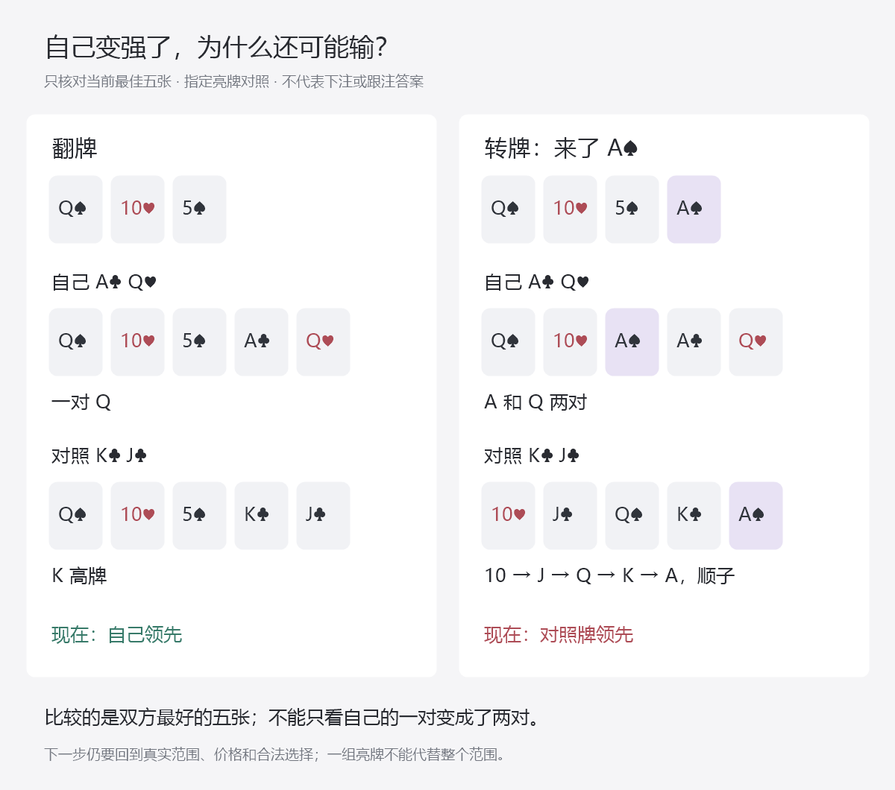

# 转牌怎样继承前序，再回到当前行动

总入口：[统一总纲](../../翻后教学系统_统一总纲.md)。本篇挂在“更新以后再来”，需要时展开，完成后回到同一手牌的“看清现在”。它不是新增十二个课程入口。

主要依据是Nevir 2.4、2.5、2.7笔记。所有实体牌、质量和账本算例可由`node scripts/research-nevir-turn-transfer.mjs`复算，数据见[转牌研究记录](turn-transfer-evidence.json)。没有改软件，也没有把下述教学模型当作真实对手策略。

## 1. 这一步到底教会什么

学习者看到第四张牌，不能只问“这是高牌还是低牌”。他应该能够慢慢完成这一句：

> 刚才走的是这条路线；因此现在面对的是这一批可能的牌。新牌让其中这些牌消失、这些牌变强。我的牌也要重新比较。接下来轮到谁？我现在比较哪些选择？

这是同一轮四步循环的交接处。前面的下注已经发生，但其成本不成为“必须继续打回来”的理由；前面的行动却仍然决定范围、底池、后手及下一位行动者，不能全部清空。

这一层要同时避免三种错误：把翻牌结论直接沿用到转牌；只按新牌点数选择动作；每到一街重新给一张与前序无关的范围图。

## 2. 先把“刚才怎么过来的”留在桌上

新牌出现前，桌面上方保留一条短历史。长历史可以展开，默认只突出刚结束的一轮。示例中三条路线互斥，不能连着播放成同一手牌：

| 实际历史 | 必须继承的不同内容 | 不能误接成什么 |
|---|---|---|
| 我下注，对手跟注 | 我的下注范围；对手对该尺寸的跟注范围；双方投入后的新池和后手 | 不能接到“翻牌双方过牌”的转牌条目 |
| 我过牌，对手也过牌 | 双方各自过牌的可能牌；原池未被这轮下注扩大 | 不能说对手已弃掉弱牌；没人弃牌 |
| 我过牌，对手下注，我加注，对手跟注 | 我的加注范围；对手下注后再跟加注的范围；更大的池与更小的后手 | 不能把对手最初的小注范围直接当成最后跟加注的范围 |

**双方都要继承。**如果我为了利用对手的错误，翻牌比原来多打了很多弱牌，转牌我的范围也变了。只画对手范围更新，自己的范围却沿用另一套标准策略，仍会把比较教错。自己这一手实体牌不变，不代表自己整批可能手牌没有变化。

来源：2.4的范围下注后转牌、2.5 §3.4的加注被跟、§3.5的双方过牌，分别讨论不同前序；已定位命题R19、R22、R23见[来源记录](source-claims.json)。具体概率未取得的部分仍是作者待补输入，不由路线名称自动生成。

## 3. 再看新牌：用“变化标记”，不用一张万能转牌表

翻牌六类可帮助定位；到了转牌，仅用六类或高低牌已经不够。同一张新牌可能同时有几个影响。默认画面只亮出本手真正发生的两三项，其他项收起。

| 看什么变化 | 图里具体显示什么 | 可直接核对什么 | 不能直接推出什么 |
|---|---|---|---|
| 新牌占用了实体牌 | 含这张牌的组合划除 | 不可能重复发牌 | 剩余组合该下注多少 |
| 公共牌成对 | 把配对两张连起来，必要时展开三条、葫芦、四条 | 谁的最佳五张是什么 | 成对总是有利于加注者 |
| 同花色增加 | 高亮同花的五张，区分第三张、第四张同花色 | 哪些具体手牌已成花或仍在听花 | 所有对手都成花；自己必须弃牌 |
| 顺子关系改变 | 将实际五个连续点数排在一起 | 哪个具体组合完成了顺子 | 所有连接牌都必须停枪 |
| 顶部点数改变 | 比较原先顶对和现在的对 | 原顶对是否被超越 | 所有A/K都适合第二枪 |
| 自己改善 | 自己前后两套最佳五张并排 | 一对变两对、两对变葫芦等事实 | 自己改善就一定适合做大底池 |

这是一组可同时成立的标记，不是六个互斥的练习大厅。特别是“空白牌”是相对于本次范围与手牌的简写；2♦对大部分高张很平静，对22却是重要改善牌，不能理解成“谁都没变”。

### 同一桌面，七种不同的变化

先固定翻牌Q♠ T♥ 5♠，自己A♣ Q♥。下表是七个独立的读牌对照，不是同一副牌连续发七张。亮出的对手牌仅用来核对五张关系，不表示实际对手亮牌，也不表示其跟注策略已经求出。

| 新牌 | 自己现在 | 用来对照的对手牌 | 对手现在 | 要看懂的关系 |
|---|---|---|---|---|
| 2♦ | 一对Q | K♣ J♥ | 高牌 | 可以核对当前领先；还没有核对未来跑牌 |
| 9♠ | 一对Q | J♠ 8♠ | 同花 | 具体两张黑桃听牌成花 |
| J♥ | 一对Q | K♣ 9♣ | K高顺 | 把9、T、J、Q、K直接排出来 |
| A♠ | A和Q两对 | K♣ J♣ | A高顺 | 自己确实改善，仍可能被超越 |
| Q♣ | 三条Q | Q♦ T♠ | Q满T葫芦 | 三条与葫芦要比完整五张 |
| 5♦ | Q和5两对 | 5♥ 5♣ | 四条5 | 同一张配对牌，对两家作用不同 |
| K♦ | 一对Q | K♣ J♣ | 一对K | 自己牌型名称没变，相对地位却变了 |

程序还从现有BB图对应的306个合法候选出发，遍历47张未见转牌，共13770个合法“对手组合—转牌”配对。**这是该起始图下的物理事实覆盖，不是13770道真实策略题。**没有加入中间过牌、下注、跟注的概率，所以不能将结果叫作实际跟注后的转牌范围。

逐转牌记录保存当前领先、持平、落后的质量；这些不是最终权益，也不是EV。若按这个明确起始分布模拟正常发牌，每张转牌的概率应按能与它共存的对手质量计算，不能不加说明地把47张都视为等概率。为了教学主动挑选某张牌，则另标为指定对照。

## 4. “他跟注了，所以变强”到底怎么理解

首先看哪些牌弃了、哪些牌加注离开跟注分支、哪些牌慢打留下。不能只按牌力从中间切一刀。

以下使用四个作者指定候选，每个起始质量1份，只为看清筛选。它不是从用户图反解出来的真实跟注范围。两套模型都明确给了弃、跟、加三种概率，合计为1；这里观察到的是跟注。

| 候选实体牌 | 模型一：跟注概率 | 跟注后的质量 | 模型二：跟注概率 | 跟注后的质量 |
|---|---:|---:|---:|---:|
| 5♦5♣ | 25%（其余加注） | 0.25 | 100% | 1 |
| Q♦J♣ | 100% | 1 | 100% | 1 |
| K♣J♥ | 50%（其余弃牌） | 0.5 | 25%（其余弃牌） | 0.25 |
| 2♦2♥ | 25%（其余弃牌） | 0.25 | 0%（全部弃牌） | 0 |
| 合计 |  | 2 |  | 2.25 |

同样看到一次跟注，55占比可以是12.5%，也可以是44.44%。两者都不能靠“他跟注了”这一个事实排除。模型一中55很多时候加注，**仍有0.25份留在跟注里，不能删成0**。

随后发2♦，模型一的22实体冲突，剩余总质量1.75，55占比变为1/7；其他组合仍保留刚才筛选后的0.25、1、0.5。不能发牌后又恢复成三家各1份。

视觉顺序固定为：**旧质量 → 实际行动筛选 → 新牌排除 → 对留下的牌重新比较**。数值未有依据时，不画貌似精确的宽度；普通完整决策题则必须先由作者补足输入。不能让学习者自己编这些概率，也不能让每道题都以“资料不足”结束。

Nevir 2.4中“我们打得很宽、对手跟下来的更扎实”的解释，要保留其对手和前序假设；它不是所有下注被跟的普遍定理。同理，2.5里加注利用过弃后被跟的分支，和针对下注过宽而加注的分支，需要分别更新。

## 5. 把2.4的转牌建议接回具体条件

课程中的例子不按“一个例子一个入口”保存。它们用来支持以下三个不同的判断关系，按本手需要展开。

| 要教的关系 | 原材料的对照 | 题目可以怎么问 | 目前不能怎么判 |
|---|---|---|---|
| 前序尺寸与范围决定后街起点 | 小注后KT5/QT5的空白牌讨论，与大注后962的讨论 | 显示历史，让用户指出应查哪一条前序；再说新牌改变了哪些对象 | 不能把小注、大注范围合并，再考任意手牌100%动作 |
| 同花色和顺子完成改变继续对象 | KT5单色后9♠/8♣；JT2后9♦/5♣ | 先点成牌所需的实体牌，再对照该段报告的总下注方向 | 不能把40%总下注率当成当前AQ有40%下注率 |
| 过牌后仍要处理对手动作 | 2.5中T83加注被跟后的转牌讨论 | 先回到自己过牌，随后对手下注时，重新进入跟、弃、加的比较 | 不能把过牌直接播放成弃牌；不能略过对手可以过回来的分支 |

原笔记存在三项不能绕过的边界：小注后空白低牌继续与末尾高低牌口诀作用范围冲突；SB对CO的donk例位置不相容；A72例重复出现同一张2♦。保留原文与疑点，不编造一个统一口诀来填平。

第四张黑桃的例子在翻牌已经是单色面，不能讲成“对手两张黑桃刚在转牌成花”。JT2前序25%与33%的版本差异也保留。正确读出笔记报告，不等于已取得其完整设置和精确策略。

外部补证仅支持一般机制：先前剥削会改变双方后街范围，利用某次过弃后被跟，可能需要降低后续进攻；该文章的具体例子是30BB，不能移作本项目100BB答案。[GTO Wizard后街调整说明](https://blog.gtowizard.com/adjusting-on-later-streets-after-exploiting-flop/)。

## 6. 2.5和2.7不能合并成“见小注就加注”

这里真正要教的是“对手用哪些牌下注，遇到加注又怎样反应”。过牌加注只是当前可比较的一种方案。按现有笔记，把相关内容组织为下表，来源原文定位存在[研究数据的sourceCases](turn-transfer-evidence.json)内。

| 条件 | 笔记实际讨论的内容 | 学习者需要比较什么 |
|---|---|---|
| 2.5，SB对BTN的3bet底池，T83、指定BTN过弃锁定模型 | 扩大过牌加注；8BB下注、加到22BB属于该设置 | 当前是否真是这个底池、这个价格和这个响应模型；不把该结果当成所有局面处方 |
| 2.5，相应统计中对手较大下注 | 跟得更强、再加注更多的解释，减少诈唬加注方向 | 诈唬成功率与被继续时的代价；不能仅看下注数字就认定具体牌 |
| 2.7，SB对BB单加注底池的总体统计段 | 面对过牌加注少弃牌 | 原先“靠过弃赚钱”的理由在此是否仍成立 |
| 2.7，所述紧弱/娱乐玩家下注偏强假设 | 区分价值加注和诈唬加注 | 哪些更弱牌能付款，哪些更好牌能被打走；跟注仍需另作比较 |
| 2.7，所述常规玩家过度下注假设 | 更多弱牌主动下注，可能提高诈唬加注吸引力 | 是否确实有该偏差，及其面对加注的响应；“常规玩家”称呼不能替代数据 |

这些是有条件的课程观察，不是当前所有对手的事实。2.7总体段与不同人群段可能在讨论不同样本；没有原始样本时不能合并、平均或挑喜欢的结论。

教学时先看当前路线，再打开匹配的这一行。不要让用户面对五行猜老师最喜欢哪一行。基准训练应事先指定可核验配置；对手调整练习另给明确模型或可靠观察，只变化一个条件，让用户看清变化为什么影响方案。

**跟注必须保留为正常候选。**2.5总结里“最大错误是过牌跟注”没有提供逐手、逐牌面的完整禁用依据。不能因此删去跟注按钮，也不能把“手牌有权益”直接当作跟注充分条件。要分别比较当前价格、对手下注范围、后续承压与加注的代价。

外部机制资料也要求比较过牌后的权益实现与下注后的整体价值，不能凭一个“有权益”的标签作动作判定。本篇不移植该文牌例的策略。[GTO Wizard权益保留说明](https://blog.gtowizard.com/protect-equity-and-prosper/)。

## 7. 如何从这个过程回到真的按钮

固定六人100BB、无前注；BTN开2.5，BB跟，SB留下0.5。翻牌BB过牌、BTN下注2、BB跟，池9.5，双方后手95.5。翻牌Q♠T♥5♠，自己A♣Q♥，转牌2♦。这是一条合法的事实账本，不宣称翻牌AQ必下注2。

从同一个转牌起点，分别查看两条回应，不能接在一起：

| 对手实际做了什么 | 现在池里 | 自己补多少才能跟 | 跟完后池里 | 此时正常比较 |
|---|---:|---:|---:|---|
| BB先下注6 | 15.5 | 6 | 21.5 | 弃、跟、加；没有免费过牌 |
| BB过牌，自己下注6，BB加到20 | 35.5 | 14 | 49.5 | 弃、跟、再加；补的是差额14 |

第二行自己的6已经在池里。不能把它再当未来多付6，也不能因为已经付了就必须跟。若跟注，双方后手75.5；这轮结束后才能发河牌。

两行的即时跟注价格分别约27.91%和28.28%。**转牌用摊牌权益直接对比这个数，不能单独决定真实最优动作**：还可能有河牌下注，跟注后不保证免费摊牌，当前也存在合法加注。只有相应模型确实关闭未来下注、且比较范围明确时，才可使用终局跟弃公式。原理与完整终局算例见[尺寸单元](16_下注尺寸怎样教成可比较的选择.md)。

正式动作题的答案必须来自匹配参考或完整给定树。在此之前，以上两题可准确考位置、历史、可选动作和金额，不冒充AQ转牌策略答案。补齐后，原有牌面、账本和嵌套步骤仍能使用，不必再造一套体验。

## 8. 学习者实际怎样跟着练

用户仍然只看到一手牌、一项当前任务。下表是作者的递进安排，不是学习者首页清单。共12个内容合同U01—U12，逐项输入、撤提示、判据与证据位置保留在研究数据内。

| 顺序 | 屏幕怎样变化 | 用户做什么 | 如何返回 |
|---|---|---|---|
| 第一次看见 | 暂停在翻牌结束，历史先亮一下；再发转牌 | 点刚才实际发生的“下注被跟” | 保留同一桌面，展开变化层 |
| 看懂变化 | 默认只开最相关的一项；同花/顺子由实际牌连成五张 | 先预测谁改善，再揭示五张 | 收起五张，回到转牌自己手牌 |
| 看懂范围 | 点击一组牌，看到旧质量、动作筛选、撞牌排除 | 只补其中一个没显示的步骤 | 回到当前范围摘要，不跳转到另一道题 |
| 比较选择 | 按实际行动者显示当前候选；未轮到自己时先等回应 | 查参考或完成给定模型的比较 | 保持原状态，提交本次动作 |
| 动作与回应 | 金额先核对，再播放对手实际回应 | 重新判断现在属于主动、面对下注还是面对加注 | 返回四步循环的“看清现在” |
| 逐渐独立 | 依次撤掉变化名称、被选对象、已算结果和预选分支 | 自己找到需要展开的层；允许慢想 | 原历史和必要信息一直可查 |

“不知道”计错并进入当前层的具体补教。答错后解释哪一个对象或前序被看错，再回原决定；答对可直接继续。成绩仍仅本次练习使用，不引入数据库或长期记录。

之后的练习不只换花色。至少要有四种成对变化：牌面一样而历史不同；历史一样而新牌影响不同；自己改善但对手改善更多；同一价格而对手范围不同。再加无关变化对照：全局一致地置换花色，不应凭空改掉牌的相对关系。只有有依据的策略等价才能沿用动作答案。

## 9. 怎样检查是不是真学会，而不只背了演示

先分开三类结果：

- **事实通过**：在未见实体组合中，独立找出最佳五张、撞牌、实际行动者和待补；七个展示例不能充当未见测试。
- **推理通过**：给足有效响应和树，学习者能保留前序、比较替代动作，说明改变哪个条件会改变结论；不是只会念“范围变强”。
- **连续执行通过**：在来源匹配的未见整手中，用户自己找层、返回原决定、执行并继续，后街不重置前序。此项仍需要补完整参考与真实试读。

检查不能先标题写“听牌完成应降频”，再问应不应降频；不能在牌图用答案色预选正确对象。允许“慢想”的检查保留非答案工具，另行标记是否查看过提示；即时补教后的表现不能冒充首次无提示迁移。

本轮实证限于：47张物理更新、7个五张对照、两套明示响应模型、两条账本与7组来源条件的内部核对。没有真实学习者完成数据，没有完整转牌/防守策略，也没有NL50能力证据。新文档解决的是具体教学与内容接口，未用算例数量缩小原目标或替代最终验证。
