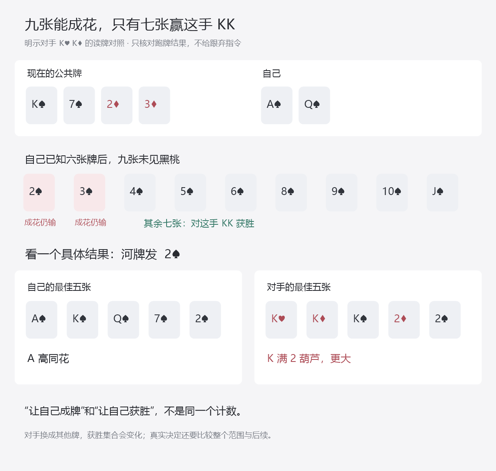

# 面对下注与加注：怎样从价格走到完整比较

总入口：[统一总纲](../../翻后教学系统_统一总纲.md)。本篇细化“比较 / 面对下注”和“比较 / 面对加注”，接在[转牌交接](18_转牌怎样继承前序并回到行动.md)后。不是新增一个平铺课程区。

这里的核心任务是：**当前这一手，弃、跟、加分别会经历什么；在同一信息、同一起点下，哪个更好。**价格只是其中一个输入，听牌名字也只是一个输入。

主要课程依据仍是Nevir 2.5、2.7。为了把后续分支真的算到头，本轮另给出一棵作者完全指定的有限研究树，见[计算记录](defense-tree-evidence.json)，命令为`node scripts/research-nevir-defense-tree.mjs`。树中的权重和响应不是课程、真实人群或求解器数据；不能将其答案移作实战处方。它验证比较方法，并暴露错误算法，不填充G01—G04缺失的真实策略。

## 1. 对用户只问这一句，再逐层打开

> 我这次要补多少？跟了之后，靠什么赢，还会遇到什么？如果加注，对方弃、跟、再加，我分别怎么办？

用户最初看到的是原桌面、实际下注、自己的牌，以及“弃 / 跟 / 加”三个候选。选择查看跟注，就只展开跟注后的这段；选择查看加注，再展开当前任务支持的尺寸与回应。不能第一屏同时摆价格表、九类牌型、对手类型、MDF、权益和整棵树。

完成一段比较就收起，原桌面上的状态不变；最后选定并执行后才更新。帮助完成的是当前决定，不能讲完原理另开一手不相干的题。

### 内部怎样分类，才能按原理迁移

这些分类是作者组织题目的条件，按实际局面嵌在两个父层内，不全部展示为菜单。

| 条件 | 当前最需要查什么 | 最常见的错误 |
|---|---|---|
| 跟注就结束所有下注 | 当前下注范围、自己的最终份额、待补、抽水/边池 | 混用下注前池与眼前池，漏掉平分 |
| 跟后仍有一街或多街 | 未改善也能赢的情况、成牌仍输的情况、未来下注及自己的回应 | 花一次钱便当作买到摊牌 |
| 加注可能被跟 | 对手继续范围、加注增量、后街池与后手 | 对手最初下注范围不经筛选直接拿到后街 |
| 加注可能被再加 | 再加范围、待补、合法回应、跟后是否全下 | 只看对手会弃多少，漏掉再加代价 |
| 对手已经全下 | 当前匹配金额、是否仍有其他行动、终局份额 | 给单挑无后续空间的局面添加虚构再加 |
| 依据只有倾向或区间 | 哪些比较在误差内仍成立，哪些需要匹配参考 | 把“喜欢跟”改成100%跟；把不确定概率当精确值 |

牌本身再按**在本次比较里的作用**归组：强成牌的付款与被反超风险；中等成牌的摊牌与承压；听牌的干净改善、未改善获胜和被迫放弃；成牌兼听牌的不同获胜途径；弱牌加注所需弃牌收益与被继续代价。同一手牌可以兼有几种作用，获胜叶子只能计一次。不能把“强牌跟、听牌跟、弱牌弃”作为完整分类。

## 2. 第一层：先看这次实际补多少钱

面对下注，先核对眼前池是否已经包含对手刚投入的钱，再看自己本街已投多少。面对加注，待补是对方总投入减自己本街投入，不能把“加到30”当成“在当前基础上再多30”。

弃牌的当前未来增量为0，过去的翻前和前街投入不重新扣一遍。若下一步又面对再加，重新以那个时点比较；之前刚加进去的钱此时已经是过去成本，不能用“都投这么多了”代替判断。

终局跟注的价格有精确意义：眼前池P、待补C时，需权益`C/(P+C)`才使跟注与当前弃牌持平，假设无后续下注、无抽水，份额含平分。前街不能只把原始权益塞进这个式子，就称比较已经完成。

## 3. 第二层：听成牌，是否真的赢

固定公共牌K♠ 7♠ 2♦ 3♦，自己A♠ Q♠。从自己知道的六张牌看，还有九张黑桃未见；它们是候选成花牌，不自动是九张获胜牌。

| 明示的对手候选 | 在其实体牌固定后合法河牌 | 自己最终赢多少种 | 为什么不只算“九张黑桃” |
|---|---:|---:|---|
| K♥K♦ | 44 | 7 | 2♠、3♠虽让自己成花，也让对手成葫芦 |
| K♣J♣ | 44 | 12 | 九张黑桃可赢；三个剩余A也可赢 |
| J♠T♠ | 44 | 38 | 对手占了两张黑桃；但自己很多未成花河牌仍以A高等牌力获胜；J/T的六张非黑桃河牌输 |

这三组不是完整真实范围，是刻意选择的对照候选。每组44张是已知双方底牌后的条件计数；不能拿一组的44当成不知道对手实体牌时的统一分母。

教学顺序先亮一个对照来学读牌，再把对手翻回去，让学习者面对整批可能牌。不能长期让他看着对手底牌练所谓实战判断。



## 4. 第三层：跟注后还要作决定，不能凭空买到摊牌

用一个合法账本固定当前起点：六人100BB、无前注，BTN开到2.5，SB加到10，BB弃牌，BTN跟。翻牌双方过牌，转牌SB过牌、BTN向21BB池下注10.5。自己是SB，拿上述A♠Q♠。

现在眼前池31.5，自己后手90，对手后手79.5。跟注需10.5，跟后池42、双方79.5，即时价格25%。这段历史只表示观察到的行动，不声称这些手牌的前序动作最优。

### 把未来关闭和把未来打开，得到的可能不是同一个答案

在作者基线模型中，对手当前三组候选的相对质量是KK 4份、KJ 16份、JT 1份。“份”表示相对概率质量，不是四副相同实体底牌。原始摊牌权益是43/154，约27.92%。

- **假设跟后强制免费摊牌**：从当前起点算，跟注EV是`42 × 43/154 − 10.5 = 27/22`，约+1.227BB。
- **按给定未来树继续**：自己河牌先过牌；对手根据下表选择过牌或下注21；自己在看见实际河牌与下注后选择跟或弃。正确汇总后，转牌跟注EV是`−7/44`，约−0.159BB。

未来响应是完全指定的作者模型：

| 对手候选 | 河牌公开信息下的固定行动 |
|---|---|
| KK | 除非河牌为非2♠/3♠的黑桃，否则下注半池 |
| KJ | 河牌任意黑桃或A时过牌，其余下注半池 |
| JT | 每个合法河牌下注半池 |

该策略只查对手自己的牌和公开河牌，不读取自己A♠Q♠。设计者选择它来让差别可计算；不是对某类真实对手的描述。

这个对照说明：**看见未来下注的选择会改变今天跟注的价值。**它不说明所有好听牌都该弃。实际还可能从对手后续付款、未成牌摊牌、诈唬或加注中获益；有没有这些收益要查对应分支，不能统一加一笔“隐含赔率奖金”。

对基线可另用互斥收益核对：免费摊牌的27/22，减去33种原本能赢JT但在实际信息下弃牌所失去的价值3/2，再加五种能跟注赢JT的河牌额外付款5/44，等于−7/44。这些是条件叶子的质量贡献，不是声称所有河牌等概率、或现实中有33张牌必弃。

## 5. 第四层：计算不能偷看底牌

例如河牌4♣，对手下注21。此时自己没有成花，只能看到本手历史、公共牌、自己的牌和这次下注。

在基线模型中，KK、KJ、JT在这张河牌都下注，因此观察下注后的相对质量仍是4、16、1。自己只赢JT，权益1/21；眼前池63，待补21，跟注相对当前弃牌的EV是`84/21 − 21 = −17BB`。此时弃牌更好，虽然实际底牌恰是JT时会弃掉领先牌。

**不能分别按“对手KK时弃、KJ时弃、JT时跟”，再把三个收益平均。**这些隐藏底牌对应同一个可见决定，玩家没有能力在其中辨认。

在全树中，错误偷看算法会把转牌跟注算成约+2.091BB；符合玩家实际信息的结果是约−0.159BB，差2.25BB。两个算法使用同一副牌、同一组权重和同一套对手响应，差别就是有没有提前知道隐藏牌。

作者计算规则必须是：先汇总同一可见历史中所有可能底牌，再比较该处的合法动作。不是对每个隐藏叶子单独取最大值。河牌本身也排除冲突候选；看到下注后，还要再乘相应下注概率，然后归一。没有质量的事件不生成一个虚假的答案。

这项要求也适用于实战解释：一次摊牌显示自己弃掉了最好牌，不能据此判当时的决定必错；要回到当时能看到的范围与价格。

## 6. 第五层：加注要把三种回应算全

本研究树给定两个转牌加注尺寸：加到30、加到90全下。它们在当前状态合法，但不是现实全部尺寸。用户先选“加”，再展开这两个研究候选；其他合法尺寸未研究，不能在正式完整动作题中冒称不存在。

| 加到30以后 | 接下来必须算什么 | 本账本的金额 |
|---|---|---|
| 对手弃牌 | 退还自己的未匹配部分，再结算 | 退19.5，匹配池42归自己；从原决定净增31.5 |
| 对手跟注 | 继承跟加注范围，重新发河牌并作决定 | 对手补19.5；池81，双方后手60 |
| 对手全下到90 | 先筛到再加范围，再比较弃/跟 | 眼前池141，自己补60；跟后池201 |

这里面对再加的价格是60/201，约29.85%，不能沿用最初的25%。如在“对加到30的特定响应”模型中，观察全下后只剩KK 80%、JT 20%，自己权益30%，则跟注比此时弃牌多0.3BB；跟注从最初转牌起点的EV仍是−29.7BB，弃牌是−30BB。**局部跟注优于弃牌，不表示前面的加注一定合理。**

对手全下后自己弃牌，对手未匹配的60退还，对手拿走匹配池81；自己留下60。若跟，201按最终份额结算。数据用600BB总筹码守恒复核，不把自己的退款当获利。

### 同一牌面，改变相关条件后，四种动作都可能成为给定树内最优

| 作者模型 | 相对基线只改什么 | 弃牌EV | 跟注EV | 加到30 EV | 全下EV | 树内选择 |
|---|---|---:|---:|---:|---:|---|
| 基线压力 | 初始设定 | 0 | −0.159 | −30 | −33.877 | 弃 |
| 更多JT | 当前权重从4:16:1改为4:16:4 | 0 | +0.398 | −19.193 | −19.193 | 跟 |
| 对30有弃牌 | KJ一半弃、一半跟；KK/JT再加全下 | 0 | −0.159 | +1.916 | −33.877 | 加到30 |
| 对全下有弃牌 | KJ/JT面对全下弃；KK跟 | 0 | −0.159 | −30 | +14.448 | 全下 |

基线的小加注回应设为全部再加全下，面对自己全下则全部跟注。模型之间未提到的响应保留基线。小加注被跟的分支，河牌仍使用上述公开信息策略、下注半池40.5。全下被跟则直接跑牌，不再虚构河牌下注。

**本表是完整指定的有限比较，不是四张新GTO处方。**它不覆盖其他转牌尺寸、河牌主动下注或河牌加注，也不求均衡；最优只限已给菜单和后续限制。它让作者及学习者检查条件变化怎样改变收益。真实训练仍需要来源匹配的完整策略，不能把表中一次“全下赢得多”总结成有坚果听花就推。

## 7. 原课程具体接在哪里

原文、行号、哈希及解释边界在研究数据的sourceLinks里，均可追到用户笔记。

| 原材料 | 用来教哪个问题 | 不扩大成什么 |
|---|---|---|
| 2.5 N5-L13，较大下注时的不同响应 | 对手下注与再加范围为何需要单独估计 | 见半池就认定是强牌；任意小注必诈唬 |
| 2.5 N5-L14，再加使部分有权益牌损失的讨论 | 加注可能让本可保留的权益付出代价，要比较跟注 | 所有好听牌禁止加注，或所有弱牌适合加注 |
| 2.5 N5-L22，加注被跟的转牌 | 分支需更新，过牌后仍可能面对下注 | 过牌就是弃牌，或每个后街继续范围相同 |
| 2.7 N7-L25，指定紧弱/娱乐玩家假设 | 价值加注与诈唬加注的对象不同 | 当前任何娱乐玩家都具有同一范围 |
| 2.7 N7-L27，指定常规玩家过度下注假设 | 更多弱牌下注可能改变对加注的收益 | “常规玩家”标签自动产生过弃概率 |

这些材料尚未提供完整逐手跟注表。2.5的“过牌跟注是最大错误”不能填成所有手牌禁跟，也不能用本研究的三个候选反过来证明原课具体动作错误。课程条款练习只考其明确作用范围；完整比较题使用完整数据，二者分别计分。

外部第一方材料补核一般机制：改善后未必赢、成牌后未必获得全部后手、未成牌也可能获胜；因此隐含赔率不能只估一次“中了能赢多少”。不移植其NL500例子的动作。[GTO Wizard隐含赔率辨析](https://blog.gtowizard.com/the-trouble-with-implied-odds/)。

MDF只在限定模型中约束总体继续，继续包括跟与加；它不是当前手牌跟注率，也不能在对手诈唬不足时强凑防守。加注还有对抗薄价值和半诈唬的作用，不能从总体继续比例反推出具体牌该跟。[MDF说明](https://blog.gtowizard.com/mdf-alpha/)，[防守中的加注](https://blog.gtowizard.com/round_out_your_defense_the_power_of_raising/)。

## 8. 实际教学怎样逐渐撤帮助

这段不要求初学者先学完概率论。先用可点的牌、筹码和回应，把完整比较的各部分放在同一手牌里；计算详情在需要时展开。

| 阶段 | 保留的帮助 | 用户这一步做什么 | 结束后回到哪里 |
|---|---|---|---|
| 看清钱 | 实际投入动画、眼前池、本街投入 | 点这次需补的筹码 | 原决定的三个候选 |
| 看清牌 | 一个指定对手亮牌、最佳五张可点 | 找出2♠为何不算对KK的获胜补牌 | 把对手牌翻回，恢复隐藏信息 |
| 看清跟注后 | 只展开一条未来回应，其他分支收起 | 先猜是否已经能摊牌，再看河牌还有决定 | 原跟注候选；汇总其全部后续 |
| 比较加注 | 弃/跟/再加三条边可逐一展开 | 补一条缺失回应，检查后手和范围 | 原加注候选；收起树 |
| 条件对照 | 同一牌面，只改变一项明确模型输入 | 预测受影响的是哪条分支，再比较 | 保持其他输入不动的原桌面 |
| 慢想新例 | 充分题设和可自行选择的非答案工具 | 自己开相关层，比较、执行、更新 | 下一位的实际行动，而非新抽独立题 |
| 连续检查 | 无原理标题、无预选分支、完整合法历史 | 在未见的来源匹配路线完成多步 | 保留前序继续；错处再补教 |

基线与另外三个公开模型是示范和作者算例，不能同时当陌生保留题。新例必须改变真正的关系，包括一些改变后答案不变的对照；不只是改花色或按钮顺序。新策略条件超出参考时先补作者输入，不让初学者永远练“资料不足”。

动作答错后先指出具体遗漏：价格、牌力、范围、未来、再加、信息还是金额。仅最终按钮错，不足以认定他不懂哪一个原理。“不知道”计错并进入对应补教；答对直接推进。本次成绩不持久化，不要求增加数据库或长期记录。

## 9. 怎样把方法用于其他局面，而不是保存四个例子

已有模型现接成[前街听牌16帧脚本](30_前街听牌怎样逐步走到跟弃_逐帧脚本.md)，具体到名义补牌、失效补牌、免费摊牌假设、跟注后的河牌压力、回原决定与实际退款。预演没有写入真实付款，公开对照不当陌生测试；这段不替代其他防守场景与完整目标参考。

真实数据单元使用统一合同。不能为每张牌面另写一个猜答案的if/else，也不能从这四个模型自动生成整套扑克策略。

| 输入 | 必须包含什么 | 为什么缺了不能发布完整动作题 |
|---|---|---|
| 当前状态 | 自己底牌、公共牌、位置、完整行动历史、行动者、池、双方后手及本街投入 | 相同牌面可能是不同决定；金额和合法菜单会变 |
| 策略来源 | 版本、配置、范围及前序、抽水、求解树与误差；或明确的固定策略模型身份 | 防止借用另一设置的响应，或把作者模型称课程答案 |
| 当前对象 | 对手各合法候选的权重及形成依据；必要的双方范围版本 | 不能用同一初始图跨过所有历史 |
| 当前菜单 | 合法动作及研究/参考实际覆盖的动作 | 树内最优不能冒充所有合法尺寸中的最优 |
| 后续 | 对手每个候选在对应历史下的响应，发牌条件概率、自己可作的后续决定 | 不能漏再加、免费补发，或在中途把权益当结算 |
| 终局 | 实际退款、抽水、匹配池与份额；统一的收益起点 | 避免把总底池当净利，或重复扣过去投入 |
| 答案精度 | 事实、方向、课程简化、固定策略最佳回应，或有误差的均衡参考 | 五种答案不能共用一个“唯一精确动作”的判据 |

对**固定对手策略、有限合法树**，作者算法按以下顺序工作：

```text
收到实际状态与有来源的当前候选质量
  → 检查实体牌、历史、金额和菜单兼容
  → 针对每个当前动作展开对手回应和条件发牌
  → 每次观察后：旧质量 × 观察概率，移除冲突，重新归一
  → 到自己的决定：先汇总同一个可见历史内的隐藏候选，再比较动作
  → 到终局：按实际筹码与份额结算
  → 将后续收益按条件概率回传到同一当前起点
  → 比较当前全部已覆盖候选，保留并列与误差
```

“同一个可见历史”的键至少保留自己的牌、按街次排列的公共牌、自己的已知行动、其他公开行动、位置与实际金额状态。不能含对手真实底牌；也不能仅凭牌面相同，就把小注被跟与加注被跟合并。前面的研究数据保存隐藏候选仅供教师计算，实际抽中的对手底牌在摊牌前不泄露给作答者。

这个流程是对已给策略的有限最佳回应计算，**不是求解双方均衡的方法**。若题目要求GTO答案，必须另有同配置的均衡参考及误差；不能把“对一套作者策略找了最佳回应”改称GTO求解。若范围或响应来自估计，结果也要保留估计身份，检查合理变化是否会改变当前选择。

其他成牌、听牌、街次与尺度使用同一合同接入。示范先少量候选以看清关系，随后扩展到来源匹配的完整范围和未见局面；小模型不继续充当最终训练数据。本篇的11项任务只是这段教学的内容接口，不能冒充全面防守能力已经覆盖。

## 10. 当前已经验证什么，还缺什么

脚本枚举三个实体候选各44种河牌，在同一可见信息内统一取动作；四个响应模型分别完成弃、跟、小加注、全下比较及后续账本。主验证另用点数/花色规则核对全部获胜集合，并用基线的互斥收益分解和再加门槛复算，防止生成器与验证器重复同一个错误。

这些证明本给定有限树算得一致、方法没有偷看隐藏牌；不是完整规则引擎、不是课程策略全表、不是均衡解，也不证明学习者学会。与目标相连但仍缺的证据是：完整匹配的防守参考、未见连续任务、真实初学者独立操作和目标配置的实际表现。本轮未改应用，不把这些缺口删除或改名为完成。

## 11. 10月21日：把“加注能赶走更好牌”真正接到操作

听牌段D01—D16结束后，回看D13，不重打已结算的弃牌。明确把原压力版本换成已有`fold_to_raise`版本：KK／KJ／JT质量仍是4／16／1，只改KJ面对加到30时一半弃、一半跟；KK与JT仍再全下。其它题设保持原模型，不称现实玩家必然如此。

自己仍是K♠7♠2♦3♦上的A♠Q♠，眼前池31.5、待补10.5、自己90。当前KJ的一对K赢自己；令这部分牌退出可以获益，但不能只数好处。新增16帧按下列顺序一次展示一项：

| 帧 | 用户当前操作 | 必须看见什么 |
|---|---|---|
| A01 | 比AsQs和KJ当前牌力 | 当前领先的是KJ，不是看A比K大 |
| A02 | 找出给定会退出的更好牌 | KJ16份分成8份弃、8份跟；不是所有强牌都弃 |
| A03 | 算加到30的新增额 | 自己本街0，新增30；19.5是对手随后待补 |
| A04 | 预演放入30 | 池61.5、自己60，仍等对手 |
| A05 | 打开三种回应 | 弃、跟、再全下都要计，不能只看退出 |
| A06 | 预演弃牌退款 | 自己未匹配19.5先退，池42再结算，净得当前池31.5 |
| A07 | 预演对手跟注 | 池81、双方60，仍有河牌承压；不是免费摊牌 |
| A08 | 预演对手再全下 | 新范围只剩KK／JT，不能保留KJ |
| A09 | 算新的待补 | 自己已30、对手到90，补60，跟后池201 |
| A10 | 分清当前与旧基点 | 胜出份额30%时，当前补60增量+0.3；原转牌基点下为−29.7 |
| A11 | 关闭所有预演 | 原决定自己仍90，预演没有实际扣钱 |
| A12 | 合并全部后果 | 与弃、跟、直接全下比较，加到30在这个菜单内最高 |
| A13 | 这次才实际加到30 | 放钱一次，交给对手 |
| A14 | 对手这次实际弃牌 | 退19.5，保留匹配池42，不能重复退款 |
| A15 | 结算 | 自己121.5；当前段得31.5，整手净赢21.5 |
| A16 | 回看结论边界 | 一次弃牌不证明现实人群频率，更不证明听牌都该加 |

先不铺完整树。A06、A07、A08逐条预演，每次只看一条回应；中央始终同一张桌，保留轻量“预演”标识。A11明确回原决定后才合并比较，A13以后才走实际分支。不亮对手真实底牌；公开候选和模型内推断不冒充实际看到摊牌。

### 三条结果如何合并，而不是讲完好处就点加注

退出概率8/21，贡献`8/21×31.5＝12`；跟注概率8/21，该支按全部河牌和既定后续的条件EV约−7.909，贡献约−3.013；再全下概率5/21，该支从原转牌决定计约−29.7，贡献约−7.071。合计约+1.916。这个正值是三条互斥结果合并后的值，不是弃牌分支的12，也不是赢这一次的31.5。

同菜单弃0、跟约−0.159、直接全下约−33.877，因此给定模型选加到30。A12显示这些数是答案帮助，不能计为用户独立推导策略。未给定的其它尺寸、河牌主动下注与加注不在比较范围，不能据此叫全动作最优或NL50参考。

再全下后的30%与60/201很接近。+0.3只是这个精确有限模型的结果；现实估计有误差时，不能假装也可靠到0.3BB。当前补60与当前弃牌比较是+0.3对0；原转牌决定计是−29.7对已损失30，不能把两个基点混起来，也不能因早已下30就强迫继续。

### 返回与证据

关闭本层恢复原D13的完整牌面、原压力响应和“弃牌较高”的给定比较，不遗留新版本的加到30。随后关闭听牌回顾层回原S18，不自动重放D14—D16再弃一次。首答和已曝光身份保持，不改写原来成绩。

脚本`node scripts/research-nevir-guided-semibluff-sequence.mjs`读取既有防守树，复核三支贡献、再全下基点、退款及各状态600BB守恒，生成[题面](guided-semibluff-sequence-prompts.json)与[教师包](guided-semibluff-sequence-packet.json)。它补2.6及3.3中“听牌自己加注后遇再全下”的局部段，不覆盖所有自己先下注被加、主动未开池进攻或诈唬再加。没有真实学习者成绩，完整目标策略与迁移仍缺。

## 12. 防守动作相同，不代表翻前角色相同

10月21日重新读取Nevir2.5与2.7全文，并核对现有85题的实际前序。结果见[角色覆盖审查](defense-role-coverage-evidence.json)：所有题的自己都是翻前最后加注者，还没有翻前跟注者视角的策略题。SB翻前3bet、翻牌先过后面对BTN下注，当前确实在回应下注，但不能因此改称翻前跟注者。

此前“IP／OOP×底池×街次×当前决定”的48粗格没有包含这个维度。新增研究审查分别保留最后加注者与跟注者，共96格；只有最后加注者的6格有既有局部模型，跟注者仍无题，完整目标策略格为0。96是内部检查格数，不是完整情境总数或新的学习菜单；原85题没有被复制或扩充，6格也不代表6格全部教会。

### 原课哪些内容不能反过来当另一方的完整防守表

| 原文内容 | 这时学习者是谁 | 能教的关系 | 不能冒充什么 |
|---|---|---|---|
| 2.5：SB过牌后面对BTN小注／较大注 | OOP的翻前3bet者 | 在该数据条件下，下注范围与再加压力影响XR选择 | BTN跟3bet后的完整防守政策，或所有半池注都强 |
| 2.5：T52的A8s／A4s对照 | 同一SB3bet者 | 改善价值与被再加时放弃的代价要一起比较 | 任何花色下A8必XR、A4永不XR |
| 2.7：SB开池后面对BB下注 | OOP的原开池者 | SRP、下注尺度与给定回应条件需分开 | BB翻前跟注后面对cbet的整张正确动作表 |
| 2.7：常规玩家过度刺探与XR过弃 | 仍是SB原开池者 | 另立对手条件版本，比较保留其诈唬与加注效果 | 仅凭“常规玩家”三个字生成范围和概率 |

上述新增R42—R45只通过文本含义复核，没有取得原统计数据库、当前群体频率或完整求解。2.5所述3bet池过弃与2.7所述SRP少弃、以及后文另述人群条件不能合并。来源中“大注更强”的解释也不是下注尺度本身的数学定理；具体题目需要明确范围或相匹配参考。

关于跟注者的响应描述可以提供候选、方向或已声明模型条件，但不是给这位跟注者补齐了所有手牌的弃／跟／加。更不能用“禁止过牌跟注”的总结来删掉跟注；R28仍隔离，当前保留所有合法选择及其参考边界。

### 学习者如何体验这个区别

首次展示前序时，小桌明确标记“你翻前加注到10”或“你翻前跟到2.5”，并显示当前双方座位。后续保留这段身份，不让初学者每个节点重复回答，也不把它做成新的角色目录。

进入当前决定后仍是看清、比较、动作、更新。需要查范围时，图从这条实际翻前路线开始继承；同样面对下注，不能把另一角色的范围和课程规则搬进来。换到另一角色练习要明示换场景，先展示其前序和起始候选，再按同一个循环走；不能用仅交换座位或换底牌伪造迁移。

补参考的优先项之一是BB跟BTN开池后的SRP。现有A72原根请求已经含双方范围并保留BB先行动，后续取得完整参考可支持两方视角；现在仍未求解，不能登记为BB防守课程已完成。3bet跟注者另需完整起始跟注范围和后续参考，不用3bet图的补集代替，也不擅自扩展用户原先未要求的翻前训练功能。
