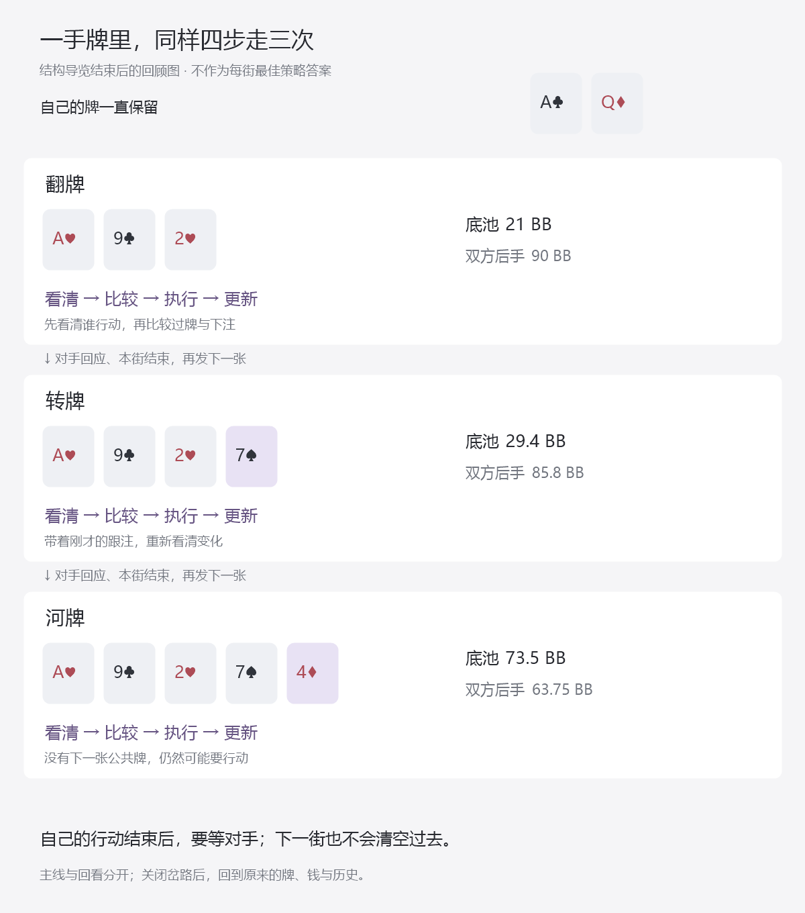

# 首次整手导览：逐屏试读，以及哪些内容还不能判策略

10月21日补充视角审查：首次17帧固定SB，S18明确另起一手换BB；观察对手、执行给定动作、结构判断分别标记。S18的下一行动者是待答内容，题面仍刻意不显示，不能把这个隐藏当成状态漏洞。详见末节及[视角核对记录](first-pass-perspective-evidence.json)。

总入口：[统一总纲](../../翻后教学系统_统一总纲.md)。本篇把[18停点候选](13_整手导览候选_公开线路与逐步账本.md)从作者分镜推进到可逐张展示的题面与教师答案；同时逐处检查策略依据。尚未制作页面，尚无学习者试读结果。

## 1. 先给出审查结果

目前有18个主线画面、4个独立回看分支，可以核对流程、当前牌力、执行给定动作的金额与终局。六处需要具体手牌策略的决定——双方在三条街各一次——**没有一处已经补齐精确策略发布所需的全部依据**。河牌AQ有公开来源的牌类方向，其余关键字段仍缺，不能把它升级为某个实体AQ的纯动作频率。

因此，这一份可以作为**结构试读候选**：让人知道一手牌怎样推进、什么时候重新思考、金额怎么变化。它不能代替正式策略首课，更不能代替最终面向NL50的完整训练。原目标保留，缺项逐处保留。

本轮也发现一个需要纠正的呈现风险：如果画面要求“按示范下注20%”，反馈只能说明是否执行了给定动作；不能随后显示成“你正确判断了AQ应该下注”。这两种任务必须由内容字段区分，不能仅靠末尾免责声明。

## 2. 学习者先听见什么

开场只说：

> 我们先跟着看完一手牌。每次轮到自己，都看清现在、比较选择、做出动作，再看发生了什么。这一次先练走完整条路；老师示范的下注不作为你的最佳策略考试。

中央保持一张桌、自己的两张牌、当前公共牌和池。顶部四步只突出当前一步。每屏只有一个问题，答错就解释当前这一小步，回到原处；不把人送去另一个章节。正确可继续，所有可作答处都有“我不知道”，按错题处理。

两个文件分别服务不同用途：

- [逐屏题面](first-hand-lesson-prompts.json)：每帧只带该时点能看到的牌、历史、金额和问题；S16前不提供对手实体底牌。
- [教师答案与准入审查](first-hand-lesson-packet.json)：独立保留正确答案、解释、账本定位、回看快照及六处策略缺项。

它们是作者研究内容，不保存用户成绩，不要求数据库。整份公开文件含后面的教学画面，展示时仍须逐帧；它不是防作弊载体，也不是已冻结的陌生测试。

## 3. 一次完整体验，具体怎样走

下表供作者与试读主持者使用，不能原样铺成用户首页。

| 画面 | 用户只做的一件事 | 这一步在脑中留下什么 |
|---|---|---|
| S01 | 点自己的SB座位 | 我在六人桌哪里 |
| S02 | 给定加到10，点新增9.5 | 总额含已贴的0.5 |
| S03 | 翻牌发出后，点先行动的SB | 加注者不自动后行动 |
| S04 | 判断AQ在A92上是“一对” | 先看自己的最佳五张 |
| S05 | 选择现在比较“过牌与下注” | 没有待补，先别进入跟弃 |
| S06 | 执行给定的20%，算4.2 | 给定动作也必须正确落地 |
| S07 | 观察BTN本次跟4.2 | 对手回应必须实际发生 |
| S08 | 7♠发出，带着前序回到看清 | 换街不换手、不清空过去 |
| S09 | 指出本轮比较要用当前范围、新牌、池和后手 | 不因翻牌下注就必须继续 |
| S10 | 执行给定的75%，算22.05 | 这次比例作用在29.4上 |
| S11 | 对手跟后，确认池73.5 | 本街结束才能发河牌 |
| S12 | 4♦出现，确认SB仍要行动 | 河牌出现不等于摊牌 |
| S13 | 确认仍要比较过牌与下注；随后观察示范执行全下63.75 | 河牌也不能省略比较；本次全下约为池86.7% |
| S14 | 确认仍须等待BTN | 自己没后手不等于赢了 |
| S15 | BTN实际跟完后，选择摊牌结算 | 全下被匹配后才进入对应终点 |
| S16 | 此时才揭AJ，比较Q/J踢脚 | 终局按完整五张判断 |
| S17 | 区分收回201与整手毛利润101 | 收回的钱含自己的投入 |
| S18 | 这手结束后换一个短局面，定位下一步 | 从当前行动识别分支，而不是记AQ故事 |

从S13到S14之间，必须实际展示本次给定的全下执行和行动交接，不能比较完直接跳到“对手跟了”。其余下注和跟注也各自有明确的画面间事件；全部13个非贴盲事件按原账本只播放一次，发牌只在对应跟注完成后发生。

S18采用已公开的C03结构候选，自己改为BB，面对BTN下注2。画面明确提示“另一手牌”，保留其2.5BB开池前序，收掉步骤名称；不伪装成上一手牌继续。它只检查行动与流程，不考AK是否应该跟或加，也不称冻结保留题。

这张图在整手回顾时显示。实际跟练仍逐帧呈现，不把三街所有问题同时摆在面前。

## 4. 不只一条下注到底：四个岔路怎样看

主线没有被下注或加注，需要独立回看。四支题面各自使用原状态副本，不接到主线后假装一手同时发生了互斥回应。

| 回看 | 冻结在哪里 | 另一条路发生什么 | 只考什么 | 关闭后回哪里 |
|---|---|---|---|---|
| B01 | S05，翻牌动作前，池21、双方90 | SB改过牌，BTN下注4.2 | SB现在待补4.2，进入面对下注 | S05原快照 |
| B02 | S07，对手回应前，SB已下4.2 | BTN改加到12.6 | 眼前池37.8，SB待补8.4 | S07原快照，仍等待本次主线跟注 |
| B03 | S14，自己已全下，等待BTN | BTN改弃牌 | 退63.75，匹配池73.5结算一次 | S14原快照，再回看主线回应 |
| B04 | S12，河牌动作前 | 改发4♥ | 三张红心让具体两红心组合可能成花 | S12的4♦原快照 |

回看提示先说“现在看另一条路”。关闭后显示“回到刚才那一步”，恢复牌、金额、已投、历史、行动者、来源版本和范围版本；不能只将筹码倒回去。当前候选尚无精确范围版本，不能在分支中伪造一个版本再带回主线。

脚本对四支分别复制、改变、核对600BB守恒，再恢复并检查快照哈希。它检查的是研究数据的副本与恢复，不等于真实UI返回行为已验证。

## 5. 策略准入：六处到底缺在哪里

六个节点现已另整理为[具体数据请求清单](41_首手六个决定具体需要取得什么策略资料.md)：牌面、池、双方后手、本街投入和前序已对齐；逐组合策略、EV、范围与后续仍为空。后续按该清单接收和核对，不因看见节点整体比例就通过逐手策略关。

| 决定 | 当前真正的证据 | 不能由此得出的答案 | 补到什么才能开放精确题 |
|---|---|---|---|
| S05，SB翻牌AQ | 公开链接记录20%线路；Nevir2.5有A高小注的一般讨论 | AcQd在A♥9♣2♥上100%下20% | 同配置初始范围、该组合动作/EV、替代方案和响应 |
| S07，BTN翻牌AJ | 这是作者选的合法跟注回应 | AdJs此时必跟 | 该手在匹配跟3bet范围内，并有对应翻牌响应 |
| S09，SB转牌AQ | 链接记录75%线路 | 先前下20%，现在AQ必下75% | 继承前序的双方范围及该组合方案比较 |
| S11，BTN转牌AJ | 作者选的合法跟注回应 | AdJs必跟75% | 经翻牌筛选后的实际权重与转牌响应 |
| S13，SB河牌AQ | 公开文章的牌类方向；两张静态原图已观察到牌面分区与节点整体尺寸比例 | AcQd精确纯全下，且所有其他方案均更差 | 匹配范围、实体组合频率和EV、完整逐手替代比较 |
| S15，BTN河牌AJ | 作者选的合法回应，随后可核对摊牌 | 因为最终只输AQ，所以AJ必跟或必弃 | 该线路的下注范围、AJ移除后的权益、合法回应及参考 |

对应机器记录在教师文件的policyGates。不能把“有一条合法线路”“有牌类方向”“有精确组合处方”三种证据用同一个绿色标记替代。

本轮还读取了同系列翻牌与转牌公开文章。它们主要分析其他具体牌面，不能仅因同是SB对BTN就补成本候选A92、7转牌的精确依据。[翻牌文章](https://blog.gtowizard.com/crush-3-bet-pots-oop-in-cash-games/)，[转牌文章](https://blog.gtowizard.com/mastering-turn-play-in-3-bet-pots-oop/)。

Nevir2.5 N5-L8的一般A高25%讨论，也不能直接替换本链接20%。只看钱，21BB池中两种下注为5.25和4.2，被跟后池分别31.5和29.4；后街已经不同。策略上对手回应也可能变。不能改完翻牌尺寸，还沿用旧后街并声称来源匹配。

## 6. 花色核对得到一个实际结论

公开河牌文章正文按字面给出A♠9♣2♥、7♠、4♦；解算链接给出A♥9♣2♥、7♠、4♦。二者不是全局改名花色后的同一牌面：前者翻牌三种花色，后者翻牌两种花色。枚举24种一致花色置换也不能对应。

更具体地，将河牌改为文中讨论的4♥：

- 按正文那套字面牌，桌上两张黑桃、两张红心，任何两张底牌都不能构成同花，实体同花候选为0。
- 按链接那套牌，桌上三张红心；固定自己A♣Q♦后，剩十张红心，两红心底牌有`C(10,2)=45`种实体同花候选。

所以，“只是花色不同，不影响解释”不能成立。此前只确认链接与两同花、第三张红心完成同花的描述在结构上相容，原图当时未成功读取。10月21日第9节已实际目视两张原图，颜色分区支持链接版；正文与链接仍不等价，逐组合策略仍未恢复。不能把后来看到静态图升级为已取得完整策略。

牌类方向、字面牌面及链接身份来自同一[公开河牌文章](https://blog.gtowizard.com/dominate-the-river-in-3-bet-pots-oop/)。这些核对不将NL500参考改称NL50，也不将作者选择的AQ/AJ摊牌冒称课程原例。

## 7. 反馈怎样避免“答对按钮却学错”

至少区分这些错因，纠正在原处发生：

- S04选“两对”：展示两张A配成一对，Q只有一张，不形成第二对。
- S06算5.25：说明算的是25%，本次给定20%；这是比例执行错误，不是策略判断错误。
- S11把51.45当跟后池：把对手本次22.05确实移入，再看到73.5。
- S14选“已经获胜”：把行动指针交给仍有后手的BTN，等其回应。
- S17选201利润：先将自己的100投入与总收回分开，再显示毛利润101。

用户答对并推进，不说明他已会独立判断下注；这一段明确是有提示跟练。S18也只能记为一个公开结构候选的反应，不能算整套架构已经独立掌握。

真实试读应由不熟悉扑克的成年读者逐帧完成，主持者先不口头补题；记录实际卡点和帮助，而不是由设计者想象读者已经明白。若只是在事实层卡住，补当前事实；若策略参考缺失，是作者内容问题，不能要求初学者反复答“资料不足”。

## 8. 本轮验收范围与下一步

`node scripts/research-nevir-first-hand-lesson.mjs`生成两份材料，读取现有账本而不另编金额。主验证另按18帧的明确时点表检查牌张暴露、池/后手、行动者与答案隔离；四支检查独立金额与恢复。花色冲突另按花色分区和组合公式复核，不以枚举器自己的输出作唯一证据。

该材料推进了“第一遍实际看什么、点什么、错了怎么解释”的可审阅程度。它没有完成六处策略依据，也没有真实读者结果。正式策略首课仍需逐处补齐匹配范围、动作与后续，随后接未见连续任务；最终目标还要按[五层验收](04_正确性与NL50验收方案.md)验证，不能凭这18个画面宣布达到NL50。

## 9. 10月21日：两张静态原图已实际看见，精确策略仍未取得

这次公开网页文本读取能列出图片链接，但直接图片读取失败；随后在浏览器打开已观察到的原PNG地址并取得可见截图，实际看见完整矩阵和右侧动作区。两图均来自[原文](https://blog.gtowizard.com/dominate-the-river-in-3-bet-pots-oop/)，不是根据文字重绘的示意。

[普通河牌原图](https://blog.gtowizard.com/content/wp-content/uploads/2024/12/gto-wizard-dominate-the-river-in-3-bet-pots-oop-image-4.png)中A、2同色，9、7、4分别为其它颜色；[完成同花原图](https://blog.gtowizard.com/content/wp-content/uploads/2024/12/gto-wizard-dominate-the-river-in-3-bet-pots-oop-image-7.png)中A、2、4同色。观察的是原图牌面颜色分区，没有把颜色块说成读到了精确花色字形；结合公开链接，它支持两同花翻牌与第三张同花河牌。正文版本仍不与链接全局等价。

右侧可直接读到的节点整体比例为：

| 原图节点整体动作 | 普通河牌 | 完成同花河牌 |
|---|---:|---:|
| 全下，标签87%池 | 57.5% | 37.8% |
| 61%池下注 | 0% | 0% |
| 35%池下注 | 7.4% | 4.3% |
| 10%池下注 | 0% | 35.0% |
| 过牌 | 35.1% | 22.9% |

两列分别合计100%。这些是该节点整个到达范围的动作比例，不能当作A♣Q♦这一手的频率，不能由单个类别色块的像素面积反解精确实体策略或EV。原文／链接配置为NL500，不是目标NL50，也不是用户课程已经采用的同一套范围。

原文公开解算链接另在浏览器打开，当前实际落到Login页面；未登录、未接受新条款、未取得逐组合数据。没有据此推断付费条件或所有人的可访问性。记录见[原图观察与限制](source-river-chart-visual-review.json)。图片没有另存为本地原文件，本轮观察来自浏览器截图，不虚构本地图片指纹。

这次补上“原图从未看见”的一个证据缺口，不改变六处精确策略仍为0通过。可以据此加强花色变化和节点尺寸变化的来源解释，普通动作题仍不能要求用户按本图精确判断AcQd100%全下。整手账本、18帧题面和原位返回保持原内容；更新来源身份与总装指纹后重新核对。

## 10. 首次跟练的视角与责任

S01—S17始终是SB的A♣Q♦。轮到BTN时，学习者是在观察本次给定回应，不切换成BTN，也不替BTN选择最优策略。S07与S11是观察对手金额或底池；S02、S06、S10是执行给定的自己金额。后者答对不证明会独立判断下注策略。S14仍需等对手回应，不能因为自己全下就再次展示自己的行动按钮。

对手实体底牌在S16摊牌前保持隐藏；候选范围图并不是实际看到了对手拿哪一手。摊牌后可以比较两家的最佳五张，但原动作判断仍使用行动前信息，不能让结果回写成当时已知。

S18是另一手BB对BTN，明确提示从SB换到BB、自己的牌换为A♠K♦。它要检查谁行动，故公开题面与位置标签不提前提供下一行动者。真实牌局必须有确定行动者，教学投影可以按本题目的收起这一结果，两者不能混淆。教师答案仍依据已观察历史确定BB回应；公开数据不是独立防作弊考试载体。

新加的perspective字段标记观看者、自己牌的拥有者、任务类别和对手牌可见性；S18不带actingSeat答案，第一遍所有帧均不标独立策略通过。未来渲染时不能根据actor自动把所有操作解释成学习者在行动，也不能把教师信息打包进公开任务。

11处深化入口已核对前后观看者与自己手牌，其中5处换座。不同手牌入口提示换座或仍坐原位但换手牌；回应模型对照核对牌与位置不变再提示换条件。关闭恢复原完整父题。这里只检查首次18帧与11个入口，不宣称169帧内部全部信息流通过，也没有真实界面或初学者结果。
