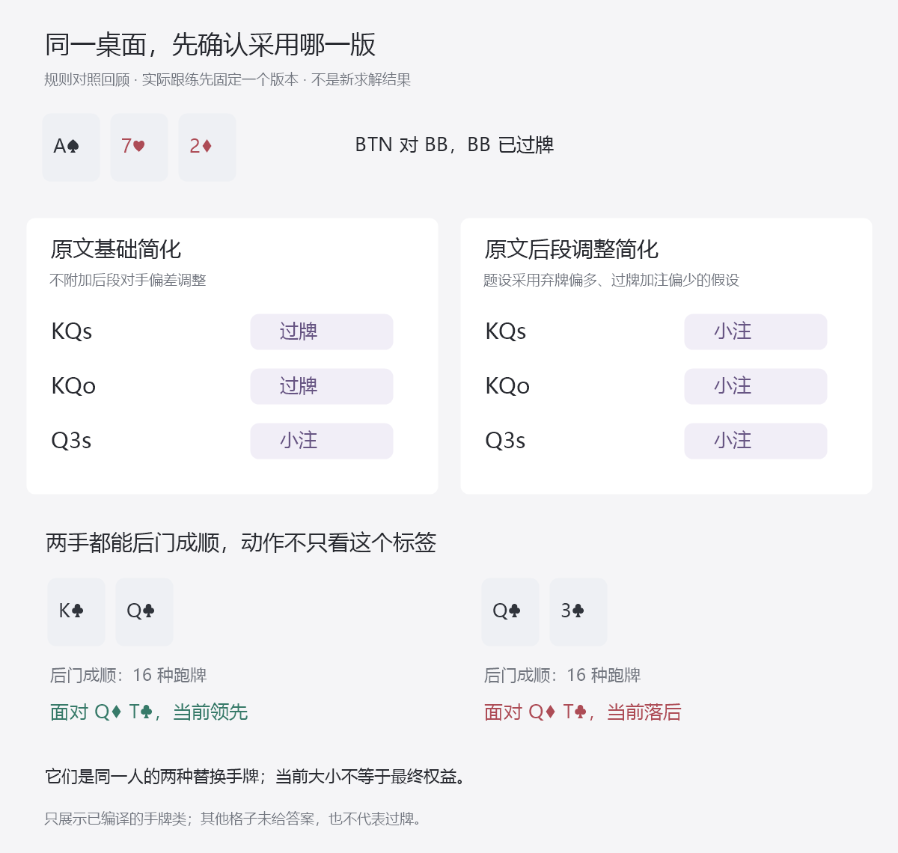

# 把原文简化编成可执行动作练习：A72的两种版本

总入口：[统一总纲](../../翻后教学系统_统一总纲.md)。本单元接在整手结构导览之后，进入“比较 / 无人下注”。它开始练有明确原文依据的动作，不再只练流程与金额。当前仍只制作研究内容，不修改软件。

## 1. 这一段终于可以明确练什么

Nevir2.1 §3.6在BTN开池、BB跟注的A72彩虹面，先给出基础简化：**KQ不下注，Q3下注**；随后改变对手假设，结尾允许采用约1/3底池的范围下注简化。

它们不是同一个版本里互相冲突的答案。练习必须先明确本题采用哪一版：

s表示同花，o表示不同花；实际作答显示实体牌，不要求靠字母猜。

| 当前采用的课程版本 | KQs | KQo | Q3s |
|---|---|---|---|
| 调整之前的基础简化 | 过牌 | 过牌 | 小注 |
| 题设明确采用后段调整与范围小注简化 | 小注 | 小注 | 小注 |

这里的确定动作，是**采用该条课程简化后的执行答案**。原笔记说调整模型接近100%，不等于已经取得每个实体组合的纯动作求解数据；本单元采用的是结尾另给的范围小注简化。不能把它标成已独立验证的GTO策略。

用户现有BTN开池图里KQs、KQo、Q3s均为100%开池，而Q3o不开池。所以正常发牌只取前三类，不为了练课程牌名，就随意给BTN发一手本基准已经弃掉的Q3o。Q3o本身不是非法扑克手牌，只是这套练习的正常进入范围不包含它。



这张表只展示本单元编译的手牌类；基础版其余格子未编入，不表示它们都过牌。调整版范围小注也不能被换成“所有A高牌面永远全打”。

## 2. 怎样讲清为什么不能只找一个下注标签

先固定A♠7♥2♦，看两种替换手牌：K♣Q♣、Q♣3♣。它们是同一人的两个对照情形，不是同时发给两家的底牌。

先不问下注。把对手的一组可能牌Q♦T♣翻出来，只比较当前五张：

- KQ当前击败QT：同是A高，自己的K踢脚更大。
- Q3当前落后QT：同是A高，对手的T踢脚更大。

原文讨论Q3下注希望赶走QTo等牌。现在学习者能看见这个对象为什么重要：同样赶走QT，两手牌在行动前与它的关系不同。用户BB图中QTo有50%跟注、50%加注；这个实体候选能够通过跟注进入，但**过牌后的权重与面对下注的响应仍未知**，不能直接继承50%或断言必弃。

也不能反过来教“赶走比自己差的牌没有价值”。KQ让QT弃牌仍可能剥夺未来权益。该例只解释为什么两手牌可以有不同的下注任务；整范围与后续的比较才决定收益，不能用一手QT证明KQ必过。

### 后门数量相同，课程动作也可能不同

KQ同样能靠后门成顺：后续J和T组成TJQKA；Q3可借4和5组成A2345。以自己当前已知五张为条件，物理未见牌中各有16种无序跑牌让它们成顺。

| 替换手牌 | 两张后续牌成顺的组合 | 两张后续牌成花的组合 | 两者重合 | 成顺或成花的并集 |
|---|---:|---:|---:|---:|
| K♣Q♣ | 16 | 0 | 0 | 16 |
| Q♣3♣ | 16 | 0 | 0 | 16 |
| K♥Q♥ | 16 | 45 | 1 | 60 |
| Q♥3♥ | 16 | 45 | 1 | 60 |

四例的物理无序跑牌总数均为`C(47,2)=1081`。这不是观察过BB行动后的真实条件概率，更不是获胜权益或下注EV。顺子和同花的重合也不能算两次。

这张对照用来拆掉两个错误：不是只有Q3有后门顺子；不是“只要有后门同花就下注”。本题中具体手牌的课程规则优先于一个泛化的下注理由；解释与完整比较的关系见[行动手册](01_逐层推理与行动手册.md)和[方案比较](16_下注尺寸怎样教成可比较的选择.md)。

## 3. 学习者怎样一步步练到动作

第一屏不出现两张大表和两个模式按钮。顺序如下，始终保留同一张桌面；只有明确说“换一种手牌”或“改变采用版本”时才变化。

| 顺序 | 屏幕上只突出什么 | 用户做什么 | 怎么接下去 |
|---|---|---|---|
| 定位 | BTN、BB、A72彩虹、BB刚过牌 | 指出现在轮到自己、没有待补 | 进入无人下注的比较 |
| 看对象 | 自己KQ，对照QT | 点当前哪手大 | 对手牌翻回，不保留透视 |
| 换自己 | 同桌改成Q3，对照仍是QT | 再点当前哪手大 | 看见“想让谁退出”的关系变化 |
| 对照后门 | 需要时展开JT与45两条成顺路径 | 亲手排列五个连续点数 | 收起牌路，回原决定 |
| 示范规则 | 显示本次采用基础版本，只开当前手牌的一行 | 跟着做KQ过牌、Q3小注 | 看行动与金额，仍回原桌 |
| 撤提示 | 保留版本说明和必要事实，收起动作高亮和规则行 | 对新花色实例直接点过牌、小注或不知道 | 答后给原文对应解析 |
| 改一个条件 | 手牌和牌面不动，明确改为后段调整版本 | 重新为KQ作答 | 看见规则变化来自假设和采用的简化版本 |
| 继续一手 | 播放BB这次真实选择的回应 | 跟、弃分别更新 | 本街结束才交给新牌更新层 |

“不知道”按错题处理，解析在当前层展开。正确可以继续，不增加长期记录。单次选错动作不能直接认定错因；可通过点五张、选版本或看当前对象定位到底误解了哪一层。

普通练习不会让用户临时猜老师这次想用哪版。版本由教学序列预先确定，并在当前题设中清楚可见。作者不能偷偷切到调整版，再将按基础版作答的人判错；也不能根据“NL10”“娱乐玩家”字样自动切换。

## 4. 代码怎样自动出题和判分

数据见[规则与计算记录](course-prescription-evidence.json)，题面见[不含答案的练习输入](course-prescription-prompts.json)。命令为`node scripts/research-nevir-course-prescriptions.mjs`。

规则执行只需要明确输入，不在作答时调用AI猜策略：

```text
确认是本单元的BTN对BB单加注、BB已过牌、轮到BTN
  → 确认A72彩虹与题设采用的课程版本
  → 确认实体牌合法且在本次选用的开池范围内
  → 基础版：KQ过牌，Q3小注；没有编入的手牌不发成普通动作题
  → 调整版：只有明确采用该段范围小注简化时，执行此条简化
  → 比较用户动作与本版本的课程执行答案
  → 执行给定金额，观察真实回应，再回更新层
```

生成器将20个合法KQ/Q3s实体组合与24种一致花色置换、两种明确版本组合，得到960个不重复题面：基础版384个过牌、96个小注；调整版480个小注。

**这仍只是一族A72来源规则的物理与版本变体，不是960个独立战略局面。**它们可以用于熟悉牌形和执行，但不能只靠换花色检验迁移，也不应把调整版做成无休止的“总是点下注”刷题。后续真实迁移必须加入有来源支持的新关系与连续历史。

十二项作者发布前检查已实际运行：Q3o不在当前发牌域；换成BB视角；变三人底池；BB先下注；变两同花；换A83；基础版手牌未编入；没有说明版本；换深度；变3bet底池；换开池尺度；改变当前金额。检查失败的输入不生成普通动作题，不把缺项抛给学习者，更不默认为弃牌或过牌。

## 5. 一次点击之后，钱怎么走

仍是六人100BB，BTN开2.5、BB跟、SB留下0.5，BB翻牌过牌。池5.5BB、双方97.5BB。

本算例规定1BB等于50个教学筹码，每人5000个。约1/3池为275/3个筹码，按最近整数取92个，即1.84BB。这是明确的离散执行约定，不声称等于原求解器的精确尺寸，也不是对实际平台币值或抽水规则的描述。

| 实际发生什么 | 动作后池 | 自己后手 | BB后手 | 下一步 |
|---|---:|---:|---:|---|
| 自己过牌 | 5.5 | 97.5 | 97.5 | 双方本街完成，进入更新 |
| 自己小注，BB尚未回应 | 7.34 | 95.66 | 97.5 | 等BB，不能立即发转牌 |
| BB跟1.84 | 9.18 | 95.66 | 95.66 | 更新真实跟注分支，再进入下一街 |
| BB弃牌 | 0，已结算 | 103 | 97.5 | 先退自己未匹配1.84，再给匹配池5.5 |

这些回应是作者选定的合法观察分支，不是从“Q3下注”推出BB一定弃，也没有生成虚假的BB跟注概率。四个分支均独立复核全桌600BB守恒。

本单项可以结束在“本街结束，回到更新层”的交接点；不能把单项练完叫整手结束。后续街需要自己的匹配依据，不把本A72翻牌规则延伸成任意转牌继续下注。

## 6. 原文依据与答案身份

| 来源定位 | 编译成什么 | 保留什么边界 |
|---|---|---|
| R06、R07，N1-L39 | 采用基础简化后KQ过牌、Q3下注 | 是课程执行规则，不是独立求解出的每手真实GTO频率 |
| N1-L37 | Q3与QTo等继续/退出对象的讨论 | 目标牌不等于必弃，当前牌力不等于最终权益 |
| R37，N1-L42 | 采用后段假设和最终范围小注简化 | 原始报告接近100%；最终采用的简化与原始求解频率分开 |
| 用户BTN开池图 | 普通发牌域保留KQs、KQo、Q3s | 不把Q3o未开池误判为扑克规则不合法 |
| 用户BB普通中图 | QTo可以按50%跟注进入 | 不是BB已过牌或面对下注时仍有50%概率的证明 |

[原笔记§3.6](<C:/Users/why/Desktop/笔记 Nevir/2.1- 翻后策略导论_中文笔记.md>)讨论的低级别主要是NL5—NL25。本单元不能因此宣称已验证适用于NL50。100BB六人是本项目的训练条件，该段未给全套原解算配置；这里没有假装恢复了来源中的所有范围、抽水和响应。

这轮新增一条明确来源复核R37，累计31条文本蕴含复核、6条待核实或隔离。新增复核证明原笔记有此条件简化，不证明讲师原始模型或实际盈利已经独立验证。

## 7. 怎样验收这一个单元

先检查能否在同一版本内准确执行，再检查是否看懂关系：

1. 收起动作答案后，KQ和Q3s能按当前版本作答。
2. 看到两手都可能后门成顺，知道不能仅凭后门决定动作。
3. 能指出QT当前相对于两手的不同地位，也知道这不是必弃或最终胜率。
4. 只有题设明确采用调整简化才改变KQ答案；不从玩家称呼自行切换。
5. 点击后能等对手回应，跟与弃不混到同一条路线。

这些还没有真实学习者作答。公开题库不作为冻结保留题，纯换花色不证明跨牌面迁移。完成本单元也不证明已经会完整比较所有动作、处理后街或达到NL50；[完整策略与迁移缺口](03_完整能力地图与资料缺口.md)继续保留。
