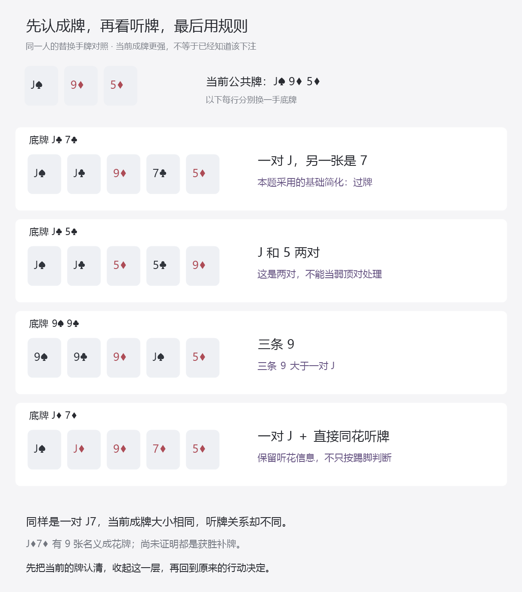

# 先认牌力，再用规则：弱顶对与组合牌怎样练

总入口：[统一总纲](../../翻后教学系统_统一总纲.md)。本单元仍在“看清 / 读自己的牌”和“比较 / 无人下注”之间往返，不新增一排牌型课程菜单。主要依据是Nevir2.1 §3.5的J95例子，接在[A72规则单元](21_把原文简化编成可执行动作练习.md)后。

## 1. 先把一个容易教错的门槛拆清楚

原笔记将J8放在价值下注一侧，并给出“J7及以下过牌”的简化。但代码不能只找手牌中的小数字，便决定动作。

在作者选用的J♠9♦5♦代表面上：

| 自己的替换手牌 | 当前真正成了什么 | 能不能直接套本单元的弱顶对过牌规则 |
|---|---|---|
| J♣7♣ | 一对J | 可以，属于本次编译的明确子集 |
| J♣5♣ | J和5两对 | 不可以，不再是单对J |
| 9♠9♣ | 三条9 | 不可以，不是弱顶对 |
| J♦7♦ | 一对J，另有直接同花听牌 | 本次不发布此组合的纯动作；单独保留组合牌参考缺项 |

“不可以套用这条规则”**不等于这些牌一定下注**。这里只排除错误引用，没有编造两对、三条和顶对带听花的完整动作表。

这也是对原文的保守取法：先限定在单对J、手中另一张不高于7、无直接听顺/听花的子集。原文没有逐项写出所有排除条件；本项目不声称这些条件就是讲师原始完整策略。

这是对照回顾图。实际跟练一次只展开与当前决定有关的一组，完成后收回原处。

## 2. 用户打开的是“看我的牌”，不是十个新菜单

当用户在一个当前决定上不理解手牌作用，展开原处的读牌层。保持原公共牌、底牌、位置和钱不动。

第一步只问：**现在是没有对子、一对，还是两对及以上？**每次只显示这一层的少量选项与“我不知道”。不要将高牌、顶对、中对、底对、三段口袋对子、听牌和阻挡同时列成十几个按钮。

第二步让用户直接点牌：哪两张组成这对，或者哪三张组成三条？如果是一对，再看它是自己的口袋对子、一张底牌配中公共牌，还是公共牌本身的一对。随后才解释顶对、中对、底对或口袋对在牌面中的位置。

第三步另加听牌层：是否只差一张就能成顺或成花？听顺和听花可分两小问，分别点出需要的牌。标记可以与成牌同时存在，不用听牌标签覆盖原有对子。

用J5或99作替换对照时，仅改变辅助层中的示例，不写回正在打的真实手牌。完成后收起读牌层，恢复原决定及其牌、钱与历史。用户不需要背十个内部分类名称，系统却需要把这些关系算对。

## 3. 底层分类已经细化到什么程度

本轮的事实分类器先计算当前五张的牌型，再辨认对子来源与相对位置，最后附加直接听牌和后门标记。它本身不选择动作。

对J♠9♦5♦固定翻牌，除去三张公共牌，49张牌能组成`C(49,2)=1176`种实体底牌。全部已枚举，并独立按组合公式核对：

| 当前角色 | 物理组合数 | 独立计数依据 |
|---|---:|---|
| 高牌 | 720 | 十个非公共牌点数中选两个，各四种花色 |
| 顶对J | 120 | 剩三张J，另一张取十个其他非公共牌点数 |
| 中对9 | 120 | 同样的点数/花色计数 |
| 底对5 | 120 | 同样的点数/花色计数 |
| 高于全部公共牌的口袋对子 | 18 | AA、KK、QQ各六种 |
| 位于J与9之间的口袋对子 | 6 | TT |
| 位于9与5之间的口袋对子 | 18 | 88、77、66 |
| 低于全部公共牌的口袋对子 | 18 | 44、33、22 |
| 两对 | 27 | J9、J5、95各三乘三 |
| 暗三条 | 9 | JJ、99、55各三种 |

本翻牌不存在当前已成的顺子、同花或更高牌型；这不表示它没有听牌。直接听顺144种、直接听花55种，同时听顺与听花9种；其中10种已有成牌且兼有直接听牌。

这些是所有合法实体底牌的**事实审查域**，不是声称1176手都来自用户BTN开池图，也不是1176张已求解策略题。进入普通动作练习时，还要筛选用户实际采用的翻前范围。

分类器另外核对18个诊断状态，覆盖单色成花、公共牌成对后的三条、公共牌自身的对子/三条、葫芦、四条、顺子兼听花、同花顺及低牌面超对等。两对、三条或听牌身份不会被一个“弱踢脚”字段覆盖。

## 4. 只差一个听牌标记，为什么也要看清

J♣7♣和J♦7♦在这个翻牌上的当前五张牌力向量相同：一对J，其他比较点数为9、7、5。但后者四张方片齐备，有九张名义成花牌。

所以，“现在都是一对J7”没有描述完两手牌。要把当前成牌与未来改善并排保留。九张名义成花牌不是已经证明的九张获胜补牌，仍需看对手实体牌和可能反超。

这不自动证明J♦7♦必须下注；它说明本项目不能仅凭一个短门槛，为缺少具体依据的组合牌补出纯动作。相应完整比较方法见[面对下注与加注](19_面对下注与加注怎样完成比较.md)。

同理，顺子和同花不能当成互斥分类。例如8♠7♠6♦上拿T♠9♠，当前已成顺子，还兼有直接听花。读牌时应看见两个事实，不能为了选一个标签把另一个抹掉。

## 5. 这一轮能实际发布的动作子集

本例明确采用原笔记的J95基础简化，尚未加入后段对手偏差调整。只对当前单对J、另一张不高于7、无直接听牌且通过用户BTN开池图的手牌执行过牌。

按当前用户图，普通发牌能保留J7s、J6s、J4s；J5s虽然允许开池，在J95上已成为两对，会在牌力层被排除。J3s、J2s不通过当前开池图，不发进这组普通动作题。

J4s翻前50%开池，也不意味着翻后50%过牌。题设已经观察到它走进本节点，本题按所采用的翻后简化执行；翻前权重保留用于来源和采样，不搬成后街动作频率。

在作者选用的相同花色关系下，每个固定牌面有六个普通子集组合。全局换花色后得到72个不重复物理题面。去重会合并那些只交换未出现花色、实际上生成相同牌面的重复记录。

本单元另有13项作者拦截检查，实际核对了J5、J9两对，99三条，77口袋对，J7带直接花听，J8、AJ的精度边界，未进入范围的J3s，面对下注、3bet底池、不同版本、重复实体牌及不同牌面。被拦截的内容不生成普通纯动作题，不把作者缺的参考当成学习者答错。

## 6. J8、AJ和“有方片就打”怎样处理

J8在原文属于价值下注方向，但没有完整逐组合频率。本段AJo同时出现“总是”和“偶尔过牌”，已有审查保留其主要下注的精度，不能统一涂成100%。

因此，现阶段它们可用于讲清强弱顶对与原文方向，不能和明确简化动作共用一个纯动作判分表。若将来取得完整参考或明确采用的新简化，再发布对应动作；不能为了让每个按钮都有答案而偷偷补100%。

原文K7/K8的方片讨论还有一个内容制作问题：缺完整花色与同花身份时，“有方片”没有唯一对应后门听花。已具体计算以下四种事实：

| 公共牌 | 自己底牌 | 方片关系 |
|---|---|---|
| J♠9♦5♦ | K♦7♣ | 三张方片，后门听花 |
| J♠9♦5♦ | K♦7♦ | 四张方片，直接听花 |
| J♦9♥5♥ | K♦7♣ | 两张方片，不是方片后门听花 |
| J♦9♥5♥ | K♦7♦ | 三张方片，后门听花 |

这说明生成器必须保留完整实体花色和同花身份，不能只识别字面“方片”。原图未取得，不据此认定原讲师有误；相应K7/K8精确动作继续未开放。事实题仍可用这些状态练识别，不向用户连续抛“资料不足”的策略题。

## 7. 从单项走到同一个比较入口里的混练

现在将三个已有原文规则的情境接在同一个“比较 / 无人下注”入口，保持BTN对BB、BB已过牌，使用各例的基础简化，未加入人群调整：

| 来源情境 | 普通动作范围 | 动作精度 |
|---|---|---|
| A72彩虹 | KQ、Q3s | 采用原文基础简化后执行过牌/小注 |
| T85彩虹 | Q7s的后门同花有/无 | 采用原文条件简化，执行下注/过牌 |
| J95本代表面 | 已审查的弱顶对无直接听牌子集 | 采用保守编译的过牌子集 |

前两项有480、96个物理题面，本次新增72个，共648个来源规则题面；来源情境族是3个，不能把648当成648种原理。

题面只给当前牌、位置、必要历史与采用基础简化的说明；不显示“现在考A72”“这是弱顶对章”或正确规则编号。每次仍只有过牌、下注、我不知道。看不清时，用户自己打开当前读牌层，完成后回同一个决定。

采样先选情境族，再在该族内选实体题，避免A72数量较多就淹没另外两族。均衡练习不叫真实牌局出现频率；原始题库顺序也不是已经执行的学习序列。

下注的后续金额要使用所调用的来源：T85原段讨论66%，不能静默换成导入表的67%；A72约1/3的离散执行约定仍单独保留。本混练先考动作，不要求通过一个全局“下注金额”按钮覆盖不同来源尺寸。

数据分别为[手牌事实与J95子集](j95-hand-role-evidence.json)、[混练教师依据](mixed-course-prescription-evidence.json)、[不含答案和情境族标签的题面](mixed-course-prescription-prompts.json)。它们没有保存学习者成绩，不要求数据库，也不是冻结的陌生测试。

## 8. 这一段怎样学完才算过

先检查事实，再检查规则调用，不用一个最终动作掩盖所有错因：

1. 看到J5，知道已是两对；看到99，知道三条9大于一对J。
2. 当前五张相同的两手J7，能另指出一手带直接听花。
3. 在所发布的弱顶对子集中，准确执行采用的简化。
4. 到混练中能根据真实牌面和手牌调用已学规则，不靠章节标题或颜色猜。
5. 不把J8/AJ的方向误读为纯频率，也不把K7的“有方片”当成所有牌面的下注算法。
6. 读牌补练完成后回原决定，做完动作后保留实际回应，才进入更新。

脚本`node scripts/research-nevir-hand-roles.mjs`生成事实、规则子集和混练题面；主验证用与牌力枚举器不同的点数/花色公式复核1176手，并核对直接听牌类别和诊断状态。新图已打开检查。脚本校验不等于真实学习验证，当前没有学习者完成数据。

这一轮新增两条来源文本复核与一条花色元数据待核实项，累计33条文本复核、7条待核实或隔离。依据追到[原笔记§3.5](<C:/Users/why/Desktop/笔记 Nevir/2.1- 翻后策略导论_中文笔记.md>)及[命题记录](source-claims.json)。原表5个待补节点数量未因此改变。完整范围、后街策略、独立迁移与NL50目标继续待验证。

## 9. 10月21日：当前有对子兼听花，怎样只算一次赢面

这里补2.4面对下注时“既有当前赢面，又有改善”的一个完整给定全下模型。原J95笔记只支持先区别对子与听牌，并没有提供以下范围、前序或跟注处方；不能把本节回贴成课程中J♦7♦的纯动作。用户翻前图也不改，不宣称这手一定属于其SB加注图。

### 先给完整条件，免得未来费用藏在背后

作者指定合法六人100BB历史：BTN开2.5，SB加到10，BB弃、BTN跟，池21；翻牌J♠9♦5♦，SB下30、BTN跟，池81、双方60；转牌2♣，SB过、BTN全下60。自己SB拿J♦7♦，眼前池141，还需60，跟完池201。前序是已发生的教学假设，不作为推荐打法。

对方当前候选明确给定：A♥A♣两份、9♣8♣一份、5♣5♥一份。份额是作者的条件权重，不是从这段历史猜出的真实频率；不假称已从用户完整范围推导。无抽水，合法河牌均匀发出。当前面对有效全下只有跟／弃，匹配后无后街下注，所以能完整比较这个决定，不靠“以后保证没人下注”的额外假设。

### 先比牌，再分四块，最后才比较价格

自己同时有一对J和四张方片，当前赢98、输AA和55。只看当前领先组占25%，不能据此当成最后赢面，也不能直接加“九张方片的概率”。

逐个固定候选后，各有44张合法河牌。获胜集合另以具体牌张规则复核：

| 当前对手候选 | 自己赢的河牌 | 会教错的地方 |
|---|---:|---|
| AA | 14张：9张方片、2张剩余J、3张非方片7 | 改善不限于成花；两对也可能赢 |
| 98 | 40张；仅8♥、8♠、9♥、9♠输 | 已经领先也可能被反超；其余赢的结果不能再额外计一次 |
| 55 | 8张：名义9张方片去掉2♦ | 2♦让对手成葫芦，自己成花仍输 |

按AA的两份权重统一分母，结果分成四个互斥部分：当前领先后赢40份、领先后输4份、当前落后后赢36份、仍输96份，共176份。这是统一尺度的权重，不是176张河牌、176种独立实体组合或多副牌。

可视化先只显示“现在领先／落后”两段，再将每段展开成“最后赢／输”两小段；一次只展开当前正在解释的一段。最终赢面为`(40+36)/176=19/44≈43.18%`。也可从当前领先44份中扣被反超4份，再加改善36份。公式可收在详情里，初学者先亲手把互斥结果放进四格，不背“对子加听牌”的一个固定百分比。

### 14帧怎样接成一次实际体验

原听牌段结束后回看D06的“怎样合并赢面”，明示换成这手有对子兼听花的新模型，默认一次只看一帧：

| 帧 | 眼前只做什么 |
|---|---|
| F01 | 确认一对J与听方片可以同时存在 |
| F02 | 分别比较AA、98、55，找到当前领先组 |
| F03 | 预演2♦对55，点出对手葫芦比自己同花大 |
| F04 | 预演9♥对98，看到自己从领先变成落后 |
| F05 | 将结果分到当前领先／落后与最后赢／输四格 |
| F06 | 合并不重叠的40与36份，得到最终赢面 |
| F07 | 确认补60后池201，而不是把141当最终池 |
| F08 | 在给定完整比较下选跟：EV约+26.795，弃为0 |
| F09 | 此时才实际补60，双方有效全下匹配 |
| F10 | 确认仍须发第五张，不能用四张公共牌结算 |
| F11 | 实际发8♠；不保留预演的2♦或9♥ |
| F12 | 此时才亮9♣8♣，比出其两对赢自己一对 |
| F13 | 结算整手−100，区别当前决定损失60 |
| F14 | 保留事前判断，不因这一次被反超改写模型EV |

跟注价格为60/201约29.85%，给定最终赢面约43.18%，从当前计`201×19/44−60≈+26.795BB`。这是该给定条件下的最佳跟弃比较，不证明现实对手真的按这个范围全下，也不推广到还有未来下注、加注或抽水的另一局面。

F08提供了完整结果，是答案支持下的跟练，不算独立算出策略。预演不扣钱、不发进实际历史，只有F09才执行跟注。实际失败分支是作者挑选的正概率演示，不是随机样本，不能拿这一次结果估计胜率。错误或不知道时保留首答，原处拆解后可继续；没有强制刷到全对的门禁。

### 怎样回去，以及目前证据到哪里

关闭此层恢复原D06的AsQs、原候选、原43/154赢面与题面；不能把本例19/44留到原听牌模型。两段都已经完成的回顾不重放实际下注或结算，下一处回顾仍按原路径选择D13，再进入明确改变回应的半诈唬加注段。

`node scripts/research-nevir-made-plus-draw.mjs`枚举3组各44个候选／河牌配对，以手工获胜集合核对14／40／8，核对四块份额和终局收益两种计算，生成[数学证据](made-plus-draw-evidence.json)。`node scripts/research-nevir-guided-made-draw-sequence.mjs`生成[14帧题面](guided-made-draw-sequence-prompts.json)与[教师包](guided-made-draw-sequence-packet.json)，核对延后揭牌、600BB守恒和完整父帧恢复。

这是2.4的一个可复算有限模型与逐帧段，不把新的作者范围当课程真值，不替代完整NL50策略或真实学习者试读。当前赢面兼改善的更多牌型、价格、范围和后街仍需系统覆盖，并用未曝光题检验独立调用。
