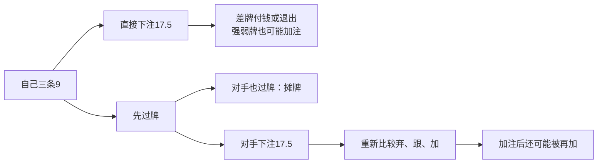

# 强牌也要比较：从先过牌到跟注、价值加注和再加

2026年10月20日。总入口：[统一总纲](../../翻后教学系统_统一总纲.md)。本篇补35项审计中的1.6、2.1、2.5、3.2、3.4的局部完整比较。它是作者设计的明确有限模型，不是新增GTO表、目标级别验证或已实施软件。

## 1. 先把原课程的意思讲明白

Nevir2.7§3.5讨论：在所述对手会对过牌过度攻击的条件下，强牌可以通过先过牌获得对手额外投入。不能简化成“遇到常规玩家就慢打”。需要看他实际会不会下注、什么牌下注、面对自己的加注如何回应。

GTO Wizard的[Slow-Playing](https://blog.gtowizard.com/slow-playing/)也把被动打法的收益与代价放在一起：是否诱发更多投入、是否错失建池，以及前街的免费改善风险。其例子不能变成本课程的纯动作表。

[River Refinements](https://blog.gtowizard.com/river-refinements-when-your-opponent-wont-check-raise/)进一步说明强牌过牌与对手取值、加注回应互相影响。该文主要实验是40BB锦标赛，本篇100BB现金桌的数值均由下述作者模型独立给定，未移用其频率。

## 2. 用户先只看这一手，不看四张模型表

六人100BB，SB对BTN的3bet底池。BTN开2.5、SB加到10、BTN跟，BB留下1BB死盲；翻牌K♠9♥2♦，SB下7、BTN跟；转牌3♣双方过牌；河牌7♥，SB先行动。

SB拿9♣9♦，当前是暗三条9。池35，双方后手83。前序只是合法给定历史，不声称此前各动作最优。先让用户拼五张，再打开三类关系：

| 对手候选 | 具体牌 | 当前谁大 |
|---|---|---|
| KK | K♣K♦ | 对手三条K更大 |
| 77 | 7♣7♦ | 自己三条9更大 |
| AK | A♣K♥ | 自己三条大于对手一对K |
| QQ | Q♣Q♦ | 自己更大 |
| QT | Q♥T♣ | 自己更大 |

原型先用少量明牌教胜负，再盖住实际对手底牌，保留题设给出的候选。起始相对质量1:2:3:1:3均为作者给定，不是实体组合数量、实战概率或从前序自动推导出的完整范围。

## 3. 先分清两条路线怎样赚钱

当前只比较过牌和下注17.5。其他合法首注尺寸不在此模型里。先用筹码演示一个分支，确认之后才逐项加回来：

模型对直接下注的回应固定：KK和77加到45，AK跟，QQ一半跟一半弃，QT弃。注意KK与77都加，但一个赢自己、一个输自己；看见加注不能直接把全部候选叫坚果。

先过牌时，对手KK和77都下注17.5，QQ过牌；AK和QT是否下注，用来做条件对照。若自己过牌后加到45，KK/77再加全下83，AK跟，QT弃。若自己直接加到全下83，KK跟、AK/QT弃，77按题设版本跟或弃。所有概率在作答前给足，不让用户猜作者心里怎么设。

## 4. 第一个关键变化：较差牌会不会自己投钱

只改变AK/QT面对自己过牌的动作，其余相同。模型逐个信息状态选择同一个动作，不能看到隐藏底牌后分别挑最优再平均。

| 给定回应版本 | 自己先过牌EV | 自己直接下17.5 EV | 限定菜单内选择 |
|---|---:|---:|---|
| AK与QT都过牌 | 39.8 | 45.925 | 直接下注 |
| AK与QT都下注17.5 | 58.55 | 45.925 | 先过牌 |

这不是“主动型玩家一定诱捕”。用户亲手看到的差别是：AK/QT原本可能不再付钱，过牌是否实际诱发它们投入。已经愿意付款的价值端、损失和后续也全部计入，所以不是看到对手会诈唬就自动得结论。

表中收益均从河牌起点计算，包含取得当前底池的结果；不是净赢率，也不是每百手收益。河牌没有未来反超，不能将本表直接用在翻牌：前街还须加入免费改善、后续筹码与建池机会。

## 5. 对手下注了：不是只剩抓诈

在第二个版本，SB过牌、BTN下注17.5后，QQ已不在当前下注分支。留下KK、77、AK、QT，比例1:2:3:3。

用户先点：赢哪些取值牌？77和AK；赢哪些诈唬？QT；输谁？KK。这样才看见“能赢一部分价值牌”与“只能赢诈唬”是不同关系，不把三条只当普通抓诈牌，也不认为有价值就必须加。

| 当前选项 | 从河牌起点计算的条件EV |
|---|---:|
| 弃牌 | 0 |
| 跟17.5 | 402.5/9≈44.722 |
| 加到45，保留对手后续 | 550.5/9≈61.167 |
| 直接全下83 | 52 |

这里加到45可以让AK跟更多钱；全下会赶走AK，所以大一点并不自动收得更多。跟注还保留对手最初投入，但金额少于加注端。对手KK/77随后全下时，用户仍要处理新的跟弃，不是把这一步跳过。

加到45后面对全下83：眼前池163，还补38，跟后201，价格38/201。该分支只剩KK与77，比例1:2；当前赢面2/3。在本模型可跟，但不能把该结论套给其他全下范围。

## 6. 原来是价值下注，被加后还要换对象

从原河牌快照回看另一路：SB先下17.5，BTN加到45。眼前池97.5，SB还补27.5，跟后125。原来会付款的AK/QQ不在这个加注分支，不能继续拿它们作跟注理由。

在基本版本里，KK与77按1:2加注，77又会跟全下；跟27.5和再加83都可比较，再加能从较差77多收钱。

然后只改变77面对自己全下的回应，使它改为弃牌。其余原始权重、加注行为、自己的牌与价格保持不变：

| 被加到45时的版本 | 跟27.5 EV | 再加全下83 EV | 本节点选择 |
|---|---:|---:|---|
| 77会跟全下 | 115/3≈38.333 | 51 | 再加 |
| 77会弃全下 | 115/3≈38.333 | 77/3≈25.667 | 跟注 |

本表仍从河牌起点算。此处弃牌的起点收益为−17.5；如果只看当前决定，就全部加回已投入17.5，以当前弃牌为0。选择不变，口径不能混。

再给强加注版本：当前起始KK质量从1增至8，其他组不变。观察加注后KK:77＝8:2，自己只赢20%；价格是27.5/125＝22%。跟注相对当前弃牌为`20%×125−27.5＝−2.5`，在这套菜单里弃牌更好，即使自己原来持三条且为价值下注。

这一支可能不是起点最优选择，但如果已经下过17.5，就必须处理当下加注，不能倒回去假装自己一开始过牌。对照回放会重置原快照，真实历史则保持已经发生的动作。

## 7. 具体怎样逐层教，不一次给完所有表

下面的原则已进一步落成[16帧可主持脚本](29_从整手导览到深入一处_逐帧学习脚本.md)和独立题面/教师答案，具体到每帧问什么、显示什么、正确怎样继续、错答怎样原位补。它接原导览回看，但明确是另一手模型；未冒称覆盖本篇所有支线或整个35项。

1. 只选一手对手候选，先比五张，明确三条9能赢谁、输谁。
2. 放回少量候选，用一条直接下注分支看新增付款与损失；先不讲慢玩术语。
3. 保持原牌钱，改看先过牌：对手过牌时直接结算，下注时再打开比较层。
4. 只改变AK/QT下注与否，预测哪些投入多了；再揭示整体差额。
5. 到面对下注，重新筛选下注候选，点出可赢价值与诈唬，然后比较跟/加。
6. 遭再加，停在原桌面重算价格；完成后接实际回应，不跳到新例。
7. 从原快照回看直接下注被加的支线，只改77跟全下与否，再比较跟与再加。
8. 收起目标高亮和动作建议，用给定新权重慢慢完成当前比较；公开四版本不充当陌生保留题。

用户只看到当前一步，表格是作者解析与按需回看材料。信息不足由作者发布前解决；不把“缺依据”当用户反复必答项。对就轻反馈继续，错和不知道停解析，可选局部补教并回原决定，首答错误不抹去。

## 8. 算法和来源分别证明到哪里

[教师树与逐节点收益](value-trap-tree-evidence.json)、[给足输入而不含答案的任务包](value-trap-tree-prompts.json)把起点、四个版本、限定菜单与对手全部响应分开。`node scripts/research-nevir-value-tree.mjs`用后向比较在每个公共历史节点选择统一动作，核对实体牌与六个五张牌力向量、合法金额、概率质量、270次终局筹码守恒，以及手工分解的八个起点EV。

这棵树含四个当前选择：过牌/下注；面对下注的弃跟加；面对加注的弃跟再加；面对全下的弃跟。但首注仅17.5、加注仅45与83，对手策略也固定；没有求均衡、没有覆盖全部合法尺寸、没有取得真实当前范围。五项能力因此从只有设计推进到有限比较材料，仍没有完整匹配目标策略或真实迁移证据。

原课支持要研究的条件方向，外部文章支持机制交叉核对；本例具体底牌、质量、响应与数值全部是作者模型。它不把河牌算例改名为完整多街首课，也不证明NL50能力。
