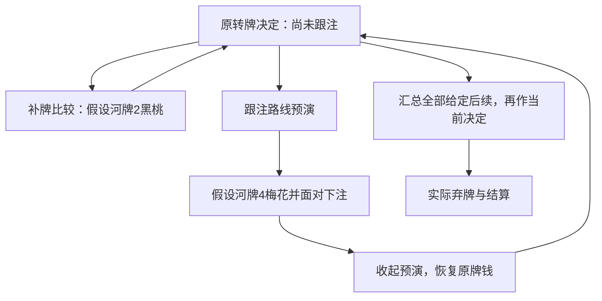

# 前街听牌：先看补牌，再看跟注以后

2026年10月20日。总入口：[统一总纲](../../翻后教学系统_统一总纲.md)。接[第一段河牌深入](29_从整手导览到深入一处_逐帧学习脚本.md)，本篇补前街有未来行动时的连续跟练。使用既有[防守有限树](19_面对下注与加注怎样完成比较.md)，不新造策略模型，不修改软件。

## 1. 接在原路线的哪里

首次整手导览完成后，从原S18的“面对下注”结构停点进入回看。先明确换手：“刚才只认出该回应下注，现在换一个条件完整的教学例，看看怎样比较。”

新例为SB对BTN，六人100BB的3bet底池，翻牌双方过牌，转牌K♠7♠2♦3♦，SB拿A♠Q♠，SB过牌、BTN向21池下注10.5。当前池31.5，SB后手90、BTN79.5，SB待补10.5。

位置、手牌与参考都不同，不能拿下面的弃牌答案去判原S18中BB的顶对。该原停点是公开结构候选，也不充当陌生策略测试。每次只开一段深入，不强迫首次导览同时做完全部内层。

## 2. 用户要真正看懂的区别

> 没显示的黑桃不等于必胜补牌；补牌后的胜出份额不等于这次跟注的完整收益；跟注以后还可能要再作决定。

Nevir2.5讨论被再加而失去权益的风险，2.4讨论转牌与后续范围。本例具体候选、质量、未来下注和EV仍是作者给定，不是原课程或真实人群数据。

候选为KK＝K♥K♦、KJ＝K♣J♣、JT＝J♠T♠，当前质量4:16:1。对每个具体候选，扣除双方手牌与四张公共牌，还有44张合法河牌；只看自己与公共牌时未知牌是46张。两个条件不同，不能混分母。

## 3. 三层嵌套，但真实决定始终留在原处

2♠与4♣是不同的假设河牌，不会连续发到同一手。预演用明确文字和虚线框区分，不只靠颜色；可以返回，不能将预演付款写进真实账本。真实执行只有原决定确认后发生。

## 4. 可以直接逐帧展示的脚本

| 帧 | 用户眼前只突出什么 | 直接问什么 | 要看见的连接 |
|---|---|---|---|
| D01 | 原池21、对手10.5、眼前31.5 | 跟注还补多少？ | 补10.5，跟后42，价格25% |
| D02 | 自己和公共牌共四张黑桃 | 已经成花了吗？ | 还没有；当前A高，带直接听花 |
| D03 | 只按已知牌列出未显示黑桃 | 还有几张没显示？ | 9张不是9张必胜牌，也可能被对手占用 |
| D04 | 独立假设2♠、对手KK | A高花能赢吗？ | 自己同花仍输KKK22葫芦 |
| D05 | 收起假设，恢复原四张公共牌 | 能把对手直接当成只有KK吗？ | 不能；原候选仍是三组，真实牌钱没变 |
| D06 | 三组的完整跑牌比较 | 整体自由摊牌份额是哪项？ | 胜出7/12/38张，按4:16:1为约27.92% |
| D07 | 单独标“保证河牌免费摊牌” | 此假设下+1.227能说明什么？ | 只说明该假设下跟优于弃，不推广实际未来 |
| D08 | 换回题设真正压力树 | 跟后一定不再下注吗？ | 对手可能继续，先读响应，不偷换版本 |
| D09 | 打开跟注路线预演 | 付10.5后池是多少？ | 预演池42、双方79.5；原决定仍没执行 |
| D10 | 预演4♣，自己过、对手下21 | 只赢JT占1/21时，跟注EV是多少？ | 跟后84，当前跟注EV−17，只在该河牌菜单内比较 |
| D11 | 在预演里河牌弃牌 | 先前跟的10.5退回来了吗？ | 没退；未来可以弃，不表示原跟注免费 |
| D12 | 关闭预演，回原转牌 | 真实自己还剩多少？ | 恢复90、池31.5，4♣从真实桌面移除 |
| D13 | 整个给定未来树的合计 | 本菜单现在选什么？ | 弃0、跟−7/44、加到30为−30、全下约−33.877 |
| D14 | 这次实际在转牌弃牌 | 对手未匹配的10.5怎么处理？ | 先退款，再收匹配池21，对手最后111、自己90 |
| D15 | 明确当前与整手基点 | 整手100到90，净变化多少？ | 整手−10；当前弃牌增量0，不是没付过翻前钱 |
| D16 | 从原快照另开版本，JT质量1改4 | 给定完整比较后选什么？ | 此版本改为跟注，不把前面的弃牌背成普遍指令 |

D06和D13给了计算支持，不能计为无提示求出策略；D16也是公开对照，不是陌生保留题。这16帧是作者初稿，未证明是最佳难度或帧数。

## 5. 哪些地方尤其不能讲错

九张未显示黑桃中，J♠T♠在JT候选里已被占用；在KK候选里虽都可能发出，2♠、3♠却让对手成葫芦。因此“可能成花”“实际可发”“最终获胜”是不同集合。

对KJ，除黑桃以外，A也可能让自己领先；对JT，自己当前已经领先，不是非得成花才赢。不能把所有候选都当成自己正落后于一对K。

自由摊牌27.92%大于25%，给出正跟注EV27/22；压力树中的完整跟注EV却为−7/44。这个反转来自明确指定的全部未来响应与同一可见信息下的继续策略，**不是从4♣这一张不利河牌推出来**。

−7/44约−0.159，是给定精确模型的较小差额。它演示不能忽略未来，不证明现实粗略范围有这个精度；真实参考有误差或动作接近时，应按实际精度接受并列，不把本例的小差额变成普遍苛刻判分。

## 6. 把未来展开，但不制造假后果

D09—D11始终标“跟注路线预演”。它教会看完整后续，不表示用户已经选错跟注。关闭后回D12，自己仍有90，真实公共牌只有四张。D13才确认原动作，D14实际弃牌后没有再发河牌。

如果用户在D13提出跟注，先按本题给定菜单解析；想体验其后果时另开有依据的预演，不把它偷偷接成已经发生的真实历史。D16则重置版本，只改质量，其余响应保持；该版本跟注成为模型内最佳，不能接在刚才弃牌终局上继续。

本树规定河牌自己先过，再比较跟弃，没有评估河牌主动下注或加注。这是任务菜单限制，不是现实非法。不能把“现在题目不考加注”教成“河牌不能加”。

## 7. 错答怎样补，不能一律再刷同花题

- 把听花当成花：只点当前四张黑桃，补第五张的比较另开预览。
- 把成花等同赢：看2♠与KK的一组五张，再回原转牌；不把KK当成实际已知底牌。
- 只用27.92%判跟：核对它默认河牌如何行动，再打开一次后续承压。
- 看过4♣就断言所有跟注都错：恢复所有河牌合计，不让单一结果代替方案比较。
- 预演后以为只剩79.5：显式恢复原快照，区分假设路线与真实付款。
- 记成有听花就弃：用D16的给定权重变化重新比较。

正确轻反馈继续，错误和不知道停解析，可直接下一帧或打开一小步帮助。首答不被补教抹去；实际单元当次计数隔离，不保存长期档案或数据库。

## 8. 材料和验收边界

[逐帧题面](guided-draw-sequence-prompts.json)与[教师答案/返回快照](guided-draw-sequence-packet.json)分开。`node scripts/research-nevir-guided-draw-sequence.mjs`读取已有防守树，核对16帧、失效补牌五张、原份额与两种未来EV、预演恢复、退款与600BB守恒，并验证另一版本只改权重。它不重新声明这棵有限树是均衡或目标范围。

本段将原先分散的读牌、价格、未来压力、更新和执行接成可主持的前街学习序列。它没有补成完整匹配的三街策略首课，也没有真人试读结果。其余能力仍需按相同标准补序列，不能以两段16帧当全部教学完成。
