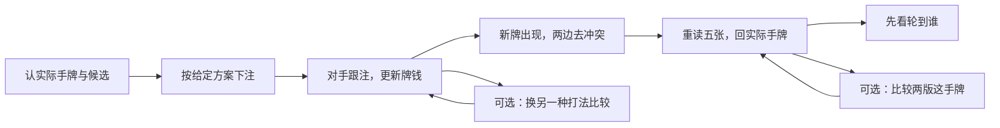

# 新牌之后怎样接着想：默认一条路，深入后回原处

2026年10月21日。总入口：[统一总纲](../../翻后教学系统_统一总纲.md)。使用已有[自身范围模型](28_自己的范围怎样更新与结果怎样回看.md)，本篇补逐帧组织，不新增数学策略模型，不改软件。

## 1. 这一段到底教什么

> 对手跟了，不是重新开始一手牌。把自己和对手实际留下的候选带过来，去掉与新牌冲突的牌，重新看自己的五张，再等该行动的人。

用户知道自己实际拿Q♣3♣；“自己的范围”是在不同发牌情况下，自己还可能用哪些其他手牌走同一条线，不是此刻同时拿着一大堆牌。

从原首次导览S08的转牌停点回看时，明示换成另一手模型。原S08为SB拿AQ，本例为BTN拿Q3，不交换角色，不把新例动作贴回原路线。完成后恢复原快照。

## 2. 为什么不把14个画面顺着排给用户

素材有14帧，默认只走11帧。另两处是按需展开的小层，关闭后回原帧解析，不再判一次分，也不提前发牌。它们不是三个首页入口。

第一次先看实际变化。版本比较与完整权重都可以以后打开，不要求初学者先懂联合分布公式，才允许继续。

## 3. 默认11帧，问的都是当前能指出的事

共同模型：BTN对BB，翻牌A♠7♥2♦，BB已过；自己Q♣3♣，池5.5、双方97.5。窄总体仅含KQ与Q3s，给定宽打版本在这20手里都下注。对手候选与响应来自作者模型，不是已恢复的真实BB过牌策略。

| 帧 | 直接问用户什么 | 当前展示与下一步 |
|---|---|---|
| U01 | 自己实际拿哪两张？ | Q♣3♣固定在中央；候选不是实际手牌 |
| U02 | 这份窄总体包括哪两组？ | 只显示KQ、Q3s，不展开169格 |
| U03 | 按给定宽打版本下注后，KQ还可能在这条线吗？ | 仍可能；这是执行题设，不考下注最优性 |
| U04 | 自己示范下1.83以后，等谁行动？ | 池7.33，自己95.67，等待BB |
| U05 | BB跟1.83后，池多少？ | 池9.16、双方95.67，本街完成 |
| U06 | 自己是否只剩Q3s？ | 不是，两组有非零质量；可选打开另一打法比较 |
| U09 | Q♥发出，含Q♥的候选怎样处理？ | 双方各自含Q♥的都划掉；真实Q♣3♣仍在 |
| U10 | 自己现在成什么牌？ | 一对Q，亮出Q、Q、A、7、3 |
| U11 | 面对AT和76，谁大？ | 输一对A、赢一对7；自己改善不等于赢全部候选 |
| U12 | 给定实际Q♣3♣，对手Q♥T♦还可能吗？ | 不可能；回实际手牌这一行，可选比较两个版本 |
| U14 | 新牌发完，BB还没行动，下一步呢？ | 先观察BB；不是立即替BTN选下注 |

U03→U04播放“按给定方案下注1.83”，不能暗示用户已独立找到最优下注。U04→U05真实播放BB跟注，本例给定响应发生后才改变范围。U06完成后才发Q♥；途中开关比较层，不反复发这张牌。

## 4. 第一处可选层：另一种打法怎样改变自己留下什么

在U06边上只有一个轻按钮“看另一种打法”。

- U07：把版本切为只有Q3s下注的精选示意，问这条下注线还能有KQ吗？答案不能。
- U08：关闭比较，恢复实际Q♣3♣、宽打版本、三张公共牌、池9.16、双方95.67。

然后回U06解析态，原首答和分数保留；用户继续才走U09发转牌。不能把精选版本中KQ被排除的结果留在宽打主线里。

两种版本在这个例子里都能带着实际Q♣3♣走到此处，所以比较的是整批候选的组成，不是改掉已经发到手里的两张牌。

## 5. 第二处可选层：整体变了，这手牌也一定变吗

在U12可点“比较两版这手牌”，进入U13。模型固定了对手的响应，不假设他识别两种整体版本并调整。给定实际Q♣3♣后，两版在Q♥转牌上对手AT、76、KJ比例都为16:4:1。

这里只要求知道“整体版本变了，不代表这手牌的每个条件都必然变”。关闭回U12同一转牌快照与解析，不重答计分；继续走U14。第一遍可以完全不打开这一层。

这个保持对照防止把“条件改变就必须换按钮”学成新口诀；它不表示真实对手永远不调整，也不说明整批范围对后续策略无用。

## 6. 哪些数字留在作者层，不铺给初学者

原联合模型71个合法配对、候选间共享牌限制和权重已经核对。宽打版被跟后自己的KQ/Q3s显示质量404:102，新牌后249:63；这些是统一缩放的权重，不是实体牌数。

默认只画两组候选的留下与移除。用户需要看权重时再展开；第一遍不要求算404或249。给定实际Q♣3♣后的条件分布与整批候选边际图分开，不让用户对自己已知手牌再取一次整体平均。

前后金额600BB守恒，新牌发出不收新费用。1.83是本例明确的作者执行金额，约三分之一，不等于33%在其他整数单位里的取整值；不能与[求解输入候选](31_完整参考怎样取得_现有范围的求解输入与准入.md)的1.82静默混用。

## 7. 必须停在“BB未行动”这个准确时点

U12的候选图属于新牌已发、BB尚未作转牌动作的状态。模型没有提供BB此时过牌或下注的逐手概率，因此不能直接挂“BB已过牌”的标签，也不能用原图替过牌后范围。

U14检查流程即可：BB若下注，BTN之后面对下注；BB若过牌，BTN之后比较过牌与下注。具体哪个最佳，仍需匹配参考。本段不通过反复让用户答“资料不足”结束，而是作者不发布超出支持的策略题，用户已经完成的更新与定位仍可明确结束。

## 8. 错误后如何保持通顺

把候选当实际牌时，只保留真实Q♣3♣并标出旁边是“可能走这条线的其他手牌”；把Q♥只从对方移除时，同时点自己的Q♥3♥候选，说明公共牌不能重复出现在任何一方；把一对Q当最大时，用AT这一组重比五张。

这些对照都是候选演示，不揭开实际对手底牌。诊断补完回原帧，首答错误保留；正确自动继续，错误可直接下一帧或选补一步，不强制额外闯关。模式当次统计隔离，不保存长期进度或数据库。

## 9. 可使用材料与验证边界

[单独题面](guided-update-sequence-prompts.json)含明确导航：默认11帧，两处可选块；不得直接按原数组把14帧当强制线性课程。[教师答案和返回快照](guided-update-sequence-packet.json)保留每个问题、两次局部恢复以及原S08恢复。

`node scripts/research-nevir-guided-update-sequence.mjs`核对实际手牌五张、AT/76胜负、两版条件分布、金额、11+3帧无遗漏与可选块返回哈希。它不重算新GTO策略，不证明真实页面已实现或初学者已掌握。

至此新增的是一个更新学习段，与既有河牌价值段、前街听牌段一起逐渐补齐顺序。三段仍不等于全部35项教学序列，更不替代正式整手策略参考和真实试读。
