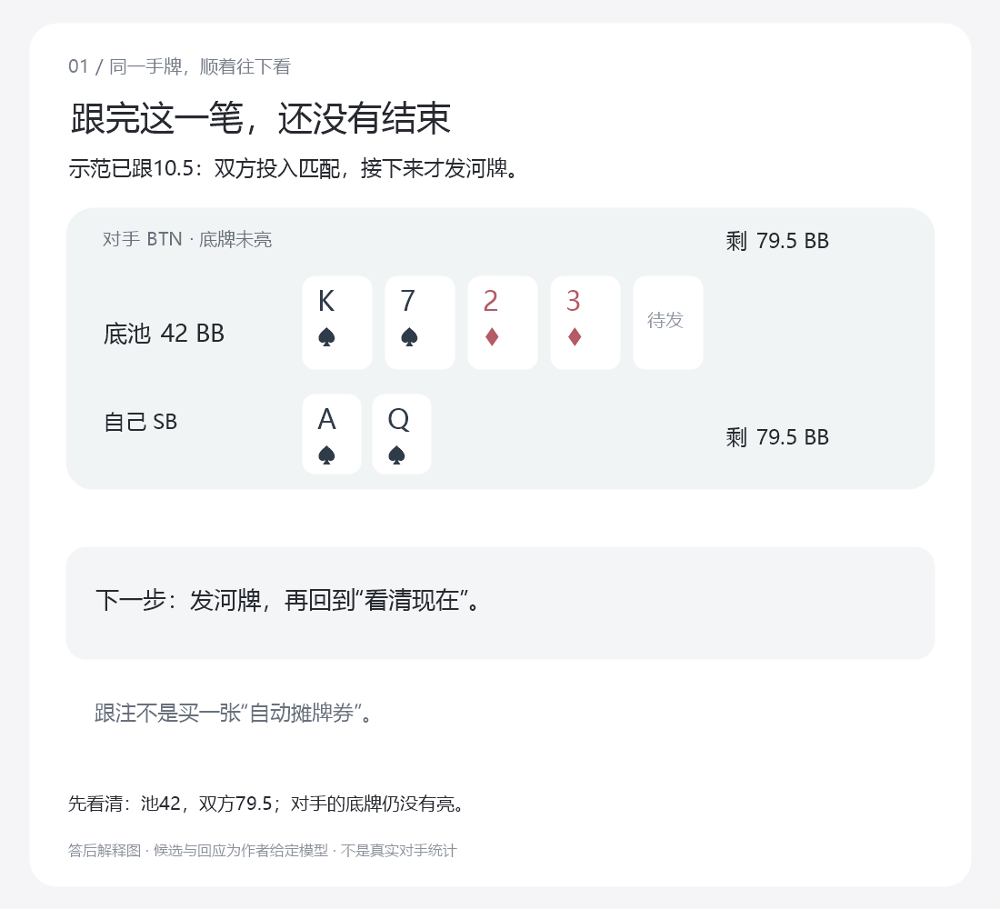
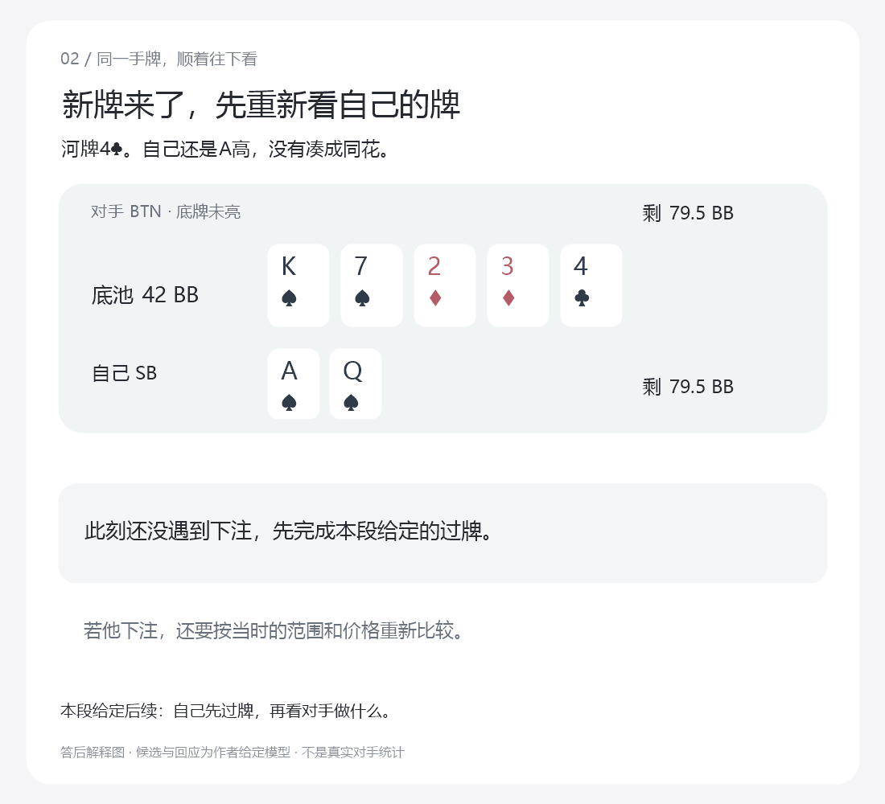
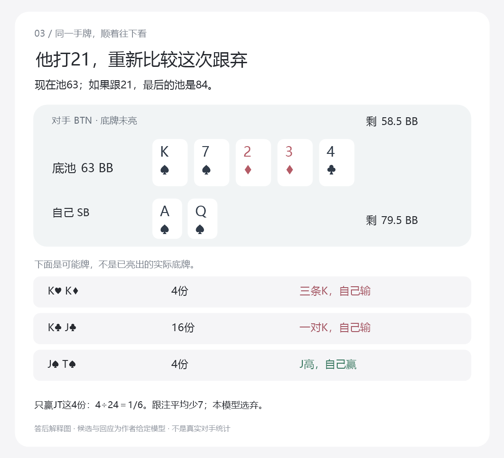
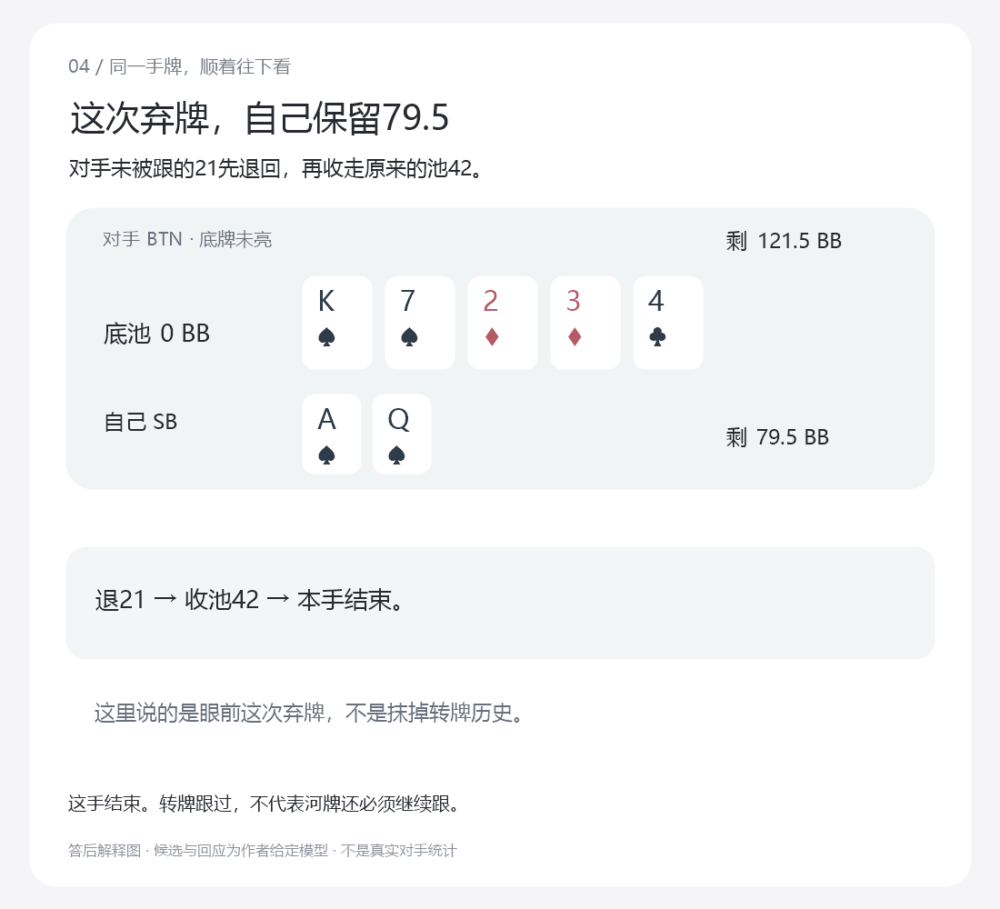
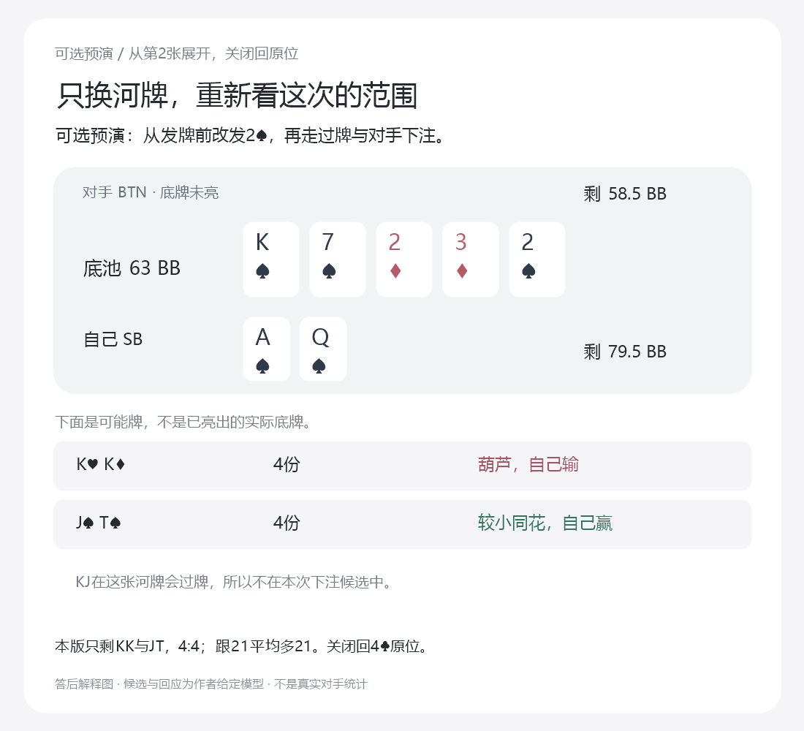
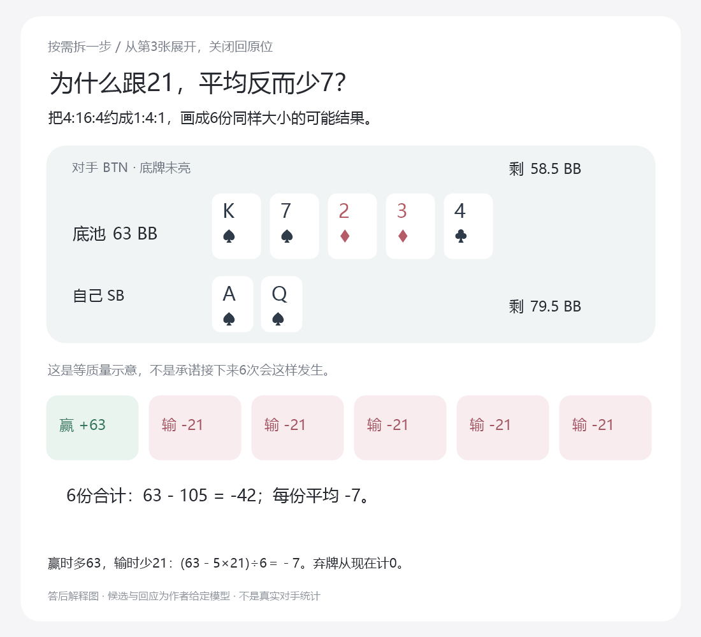

# 转牌到河牌：给初学者的逐张图文试读稿

2026年10月21日。接[统一总纲](../../翻后教学系统_统一总纲.md)。这是可以逐张展示的纸面教案，不是软件截图或已实施课程。默认4张，另2张按需打开；不把6张一起铺给学习者。

## 先给主持人说明白版本

这一段采用已有转牌模型中JT质量为4的版本，KK／KJ／JT为4:16:4；不是[迁移合同第16节](23_怎样检验真的教会了_顺序试读与迁移合同.md)讲的4:16:1压力版。此版本转牌跟注在给定菜单中较高，因此主线示范跟注。不能把两个版本的转牌答案、2♠河牌比例或跟弃结果混用。

给学习者的开场只说：**“接着这手牌往下走。你每次只回答眼前一步，不用背一整棵树。这一段的对手候选和回应由题目给定。”** 原起点是SB拿A♠Q♠，转牌K♠7♠2♦3♦，对手下注10.5进原池21。示范跟10.5后开始下面的图。

图片是答后解释材料，含答案和提示，不可直接当隐藏答案的独立测试。需要先作答时使用[分离题面](visual-river-lesson-prompts.json)，给足当前牌钱、候选、比例和响应，收起教师参考及这些解释图。当前范围由程序更新后给出，仍属于帮助，不证明学习者自己会筛选。

## 默认主线：一次只打开当前这张

### 第1张：跟完以后，还没有结束

主持人只问：“双方现在都跟齐了，接下来是发河牌，还是马上摊牌？”

答后指出：还有筹码，而且公共牌只有四张；本街结束，发河牌，下一街仍可能继续行动。不要讲整个范围理论，也不要此时再考10种牌型。

### 第2张：先重看自己的牌

发出4♣。主持人只问：“自己的同花现在成了吗？”

没有成。可以点出仍然只有四张黑桃；最终五张还只是A高。若不会数，原位选出最佳五张再回来，不重开一套读牌课程。本段后续预先限定自己先过牌，不把这个给定动作包装为所有合法选择里的最优答案。

若学习者问“换一张河牌呢”，从这里进入可选预演A；关闭后恢复第2张的4♣、池42、双方79.5、原题和参考，不能留着预演的池63或KK／JT范围继续主线。

### 第3张：对手下注以后，才比较这次的跟弃

自己按给定方案过牌，对手打21。主持人先保证学习者看见池63和待补21，再问：“只按给定候选，现在哪些自己赢、哪些自己输？”

自己赢JT，输KK和KJ。允许拆开指出五张；不要把不知道谁大误诊成不会判断诈唬。必要输入都清楚以后，再问本题跟弃并即时反馈。显示这张图后的继续属于已帮助学习，不能回填成首次独立正确。

若只是不能理解“平均少7”，进入可选拆解B；关闭后回同一张图和同一个待补21，不自动扣款、弃牌或重新出题。

### 第4张：明确弃牌以后，这手结束

主持人只问：“自己弃掉之后，剩下的钱是多少？”

79.5。对手未匹配的21退回后，再收走原池42。自己这一步没有再投入21。先前转牌跟注的历史保留，但不能用“已经跟过”迫使自己现在继续。

这里没有揭示对手实际拿哪手，不能从图上推断“对手这次一定在诈唬”或“一定有KK”。当前解释依据是动作前给定的候选分布，不是事后知道的手牌。

## 可选预演A：只换河牌，重新走这一小段

从第2张打开，使用发河牌前的完整锚点，改发2♠，重新执行自己过牌和对手下注21。不是同一手发了两张河牌，也不是在4♣已经下注后把公共牌偷偷换掉。

现在自己成花；但KK成葫芦仍赢自己，JT成较小同花仍输自己。KJ在这张牌按本模型会过，所以对手实际下注后不再保留它。当前KK与JT为4:4，跟21的当前平均收益21，高于弃0。它和4♣的弃牌不同，不是因为“中了就跟”的口诀，而是读牌与下注范围一起变了。

不要将此处4:4移植到压力版4:16:1；那一版2♠下注以后是4:1，跟21平均收益−4.2，反而应弃。作者可以用它检查参考绑定，但第一次不默认再加一张图让初学者同时记两个版本。

关闭预演恢复第2张完整父快照，包括4♣、池42、原模型、原参考和已曝光身份。然后才继续主线对手打21，不重复扣除一次转牌跟注。

## 可选拆解B：平均少7到底是什么意思

从第3张打开，不改变任何牌和筹码。将当前4:16:4约成1:4:1，画成6份同样大小的可能质量：赢的一份拿到当前池63；输的五份各多付21。先看每份结果，再看合计，最后才出现除以6。

赢时净多63而不是84，是因为84里有刚由自己补入的21。输时从现在只少21，不再把转牌已经投入的钱重复扣一次。总和63−105＝−42，分6份平均−7；弃牌从现在计0，所以本题弃更高。

六格代表相对质量，不是6手互不相同的实体组合，更不是保证随后实际玩6次刚好赢1次输5次。还不理解“平均”时，先用这张图练等质量加权；不要让他先背EV字母或概率术语。

关闭回第3张的解析，首答和已经看到的帮助不重置。继续下一步或明确示范弃牌，才进入第4张结算。

## 试读只观察这些，不能代填通过

一次试读先观察是否能跟住主线：跟完还没结束；新牌先重读；看到下注再比较；明确选择后正确执行或结算。能否算−7、能否推断真实对手范围、能否独立做未知整手，是另外的问题，不能混成一个对错分数。

遇到错误，先确认他具体指哪张牌、哪笔钱、哪组候选，再在原位补一步。若他不能解释下一步去哪里，才回外层路线。不要为了让演示顺畅就不断替他说出答案，再宣布他懂了。

本稿目前没有真实试读者。图文的字、牌和数字已由作者逐张打开检查，不等于零基础读者已经看懂。后续应让实际成年初学者说出自己看到什么、准备做什么，而不是让他评价图片好不好看。

## 作者生成和核对

`scripts/research-nevir-visual-river-lesson.mjs`从已有执行器取实际状态：核对转牌跟注参考、4♣河牌跟−7／弃较高、2♠河牌跟+21、完整父快照恢复及六格算式；不是手工写几张不相干的筹码截图。数据见[教师与快照包](visual-river-lesson-packet.json)、[数值核对](visual-river-lesson-verification.json)。

`scripts/render-nevir-visual-river.ps1`将同一批状态渲染为6张1100×1000的静态解释图；[图像审阅记录](visual-river-image-review.json)绑定图片指纹。它们是文档插图，未改应用、未实现交互按钮、未新增学习者保存机制。未曝光连续评估、完整策略覆盖和NL50能力仍无通过证据。
