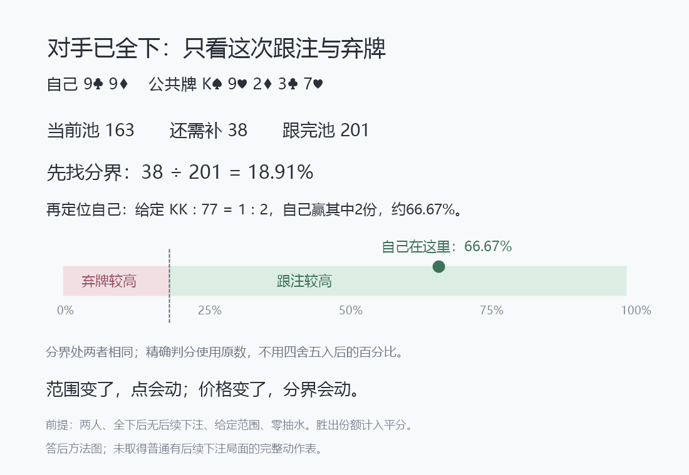

# 把翻后变成可执行的条件地图

2026年10月21日。接[统一总纲](../../翻后教学系统_统一总纲.md)。本稿解决一个实际要求：还没熟时，用户能沿固定路线找到有依据的动作，不必临时手算整棵树。仍只补文档与作者计算，不改应用。

## 1. 一张桌面，按当前条件进入一张有边界的图

翻前图把位置、前序与简化版本固定后，手牌可以定位到格子。翻后仍可以这样组织，但条件还必须带上公共牌、实际历史、当前投入、未来是否还会行动，以及采用的范围和响应参考。缺这些条件，同一手牌不对应同一个动作。

因此用户不是面对几十张表自己挑。外层仍是看清→比较→执行→更新：系统按实际局面定位当前关系，用户在这一层用图理解、核对或作答，执行后再按真实变化更新。作者后台管理条件地图，不把它平铺成首页。

“条件地图”应同时有三种内容身份：可以直接执行的明确课程简化；完整给定模型或匹配参考支持的方案；只说明物理关系的解释图。它们的界面可以统一，判分身份不能合并。

## 2. 先把一个能精确闭合的分支做清楚

两人底池，对手已经全下，自己只有跟或弃；跟注后不再发生下注。给定当前条件下的最终胜出份额后，可以精确比较当前跟弃。

“胜出份额”包括平分：赢一次占1，平分占相应份额；如果还没发完公共牌，还须按合法跑牌与当前候选计算。不能拿当前领先比例、名义补张比例或牌型等级替代。

记当前可争夺池为P，本次还需补C，跟完后池为P+C，自己的最终胜出份额为e。当前比较为：

`弃牌EV＝0；跟注EV＝e×(P+C)－C。`

所以分界是`C/(P+C)`。e高于它，跟较高；低于它，弃较高；相等，两项并列。这是当前收益，不重复扣掉之前已付的钱。

公式这里按零抽水、两人单一可争夺池计算。若对手超出自己可匹配的金额，超出部分不归自己争夺，应先排除未匹配退款再确定P和C；有其它仍在行动的玩家、边池或不同抽水结算，不能直接采用本张图的数值。

## 3. 用户看到的是分界与自己在哪一边

已有价值例V13：自己9♣9♦，河牌K♠9♥2♦3♣7♥，对手全下后池163，自己还补38。题设当前只有KK、77，比例1:2；自己输KK、赢77。

先找价格：38÷201≈18.91%。再找自己：赢2份，共3份，e＝2/3。点在分界右边，跟较高；精确当前EV为96。用户无需先理解求解器内存、数组或所有隐藏路线。

这张是答后方法图，已经画出位置与结论，不计独立正确。独立练习收掉正确位置和较高动作提示，保留必要牌钱与有依据的范围，让用户自己完成当前关系；按[撤帮助教案](37_怎样撤掉帮助而不把初学者丢进猜题.md)逐项交还。

色条长度表示胜出份额的数值区间，不是建议跟注的频率，也不是现实题目落在各区的比例。显示18.91%便于看，但精确评分保留38/201，不用显示舍入值造出假并列。

## 4. 这张图教的是变化关系，不是“有三条就跟”

同牌、同价格，仅把KK:77改为8:2，自己e变为20%，点仍在分界右边，但当前跟注只多2.2，距离边界明显变近。它与1:2时的+96不是相同强度的结论。

继续改变候选，点可能移到左边；改变待补与最终池，分界也会移动。完整的区间辨别见[条件边界教学](34_从题设答案走向实际判断_条件边界教学.md)：有些区间内动作始终相同，有些跨过分界。没有精确或足够稳健的输入时，不凭这张图虚构唯一标准答案。

这能迁移到另一种街数，但仍要匹配前提。例如已有转牌加到30后面对对手全下：当前池141、自己补60，跟后201；给定当前范围的最终胜出份额30%，分界60/201≈29.85%，当前跟注比弃多0.3。这里还要发河牌，但双方跟齐后没有后续下注，所以最终权益会实现，公式成立。

这不表示30%一律该跟，也不表示真实范围能估到0.3BB的精度。原模型的具体候选、脏补牌和全部合法河牌已给定，现实估计误差仍需处理。

## 5. 进入其它分支时，明确这张图能做哪一小步

| 当前局面 | 这张价格图的用途 | 还不能跳过什么 |
|---|---|---|
| 两人，对手全下，只有跟弃且跟后无下注 | 给定最终权益后，完成当前两个合法动作的比较 | 当前范围与权益的依据、退款及结算口径 |
| 河牌面对普通下注，跟后行动结束 | 可以精确比较跟与弃这一对方案 | 还可能有加注；跟比弃好不等于跟比所有动作都好 |
| 转牌或翻牌面对普通下注，跟后仍可能继续下注 | 不能用原始自由摊牌权益直接得出跟注EV | 未来行动、范围、收益及加注替代方案 |
| 自己先行动，考虑下注或过牌 | 不能用它直接决定下注 | 对手弃／跟／加、过牌替代收益和后续 |

已有压力版反例的自由摊牌权益约27.92%，即时价格25%，但真实给定未来中的跟注EV约−0.159。把它塞进全下价格图会选错，因为跟后还有河牌下注，权益并非免费实现。这就是先匹配分支的实际意义。

若作者明确给定后面总是过牌的受限模型，可以在那个模型下使用自由摊牌计算；也须保留“采用给定后续”的身份，不能升级成所有合法对手回应下都成立。

## 6. 普通决定怎样变成可以查、可以用的结构

对于尚有下注、加注和未来街的决定，不能靠一个牌型标签给答案。作者先取得当前配置的策略或完整给定模型，再将每个已支持节点做成可以查的关系：当前有哪些方案；每项使用哪个金额；其比较依据与误差；执行后接哪些回应及新决定。

用户慢想时的外层动作保持固定：

1. 看清当前实际局面，确定无人下注、面对下注、面对加注或对手全下；保留真实历史，不只认一张牌面。
2. 在比较层匹配已采用的课程或参考条件；已知例子直接定位，卡住才展开候选、价格或后续。
3. 使用这张图支持的关系：全下可以比较权益与价格；其它节点读对应方案与后续，不能擅自用同一条价格公式代替。
4. 选动作并放对金额；实际回应后更新，回原四步循环。图表只是当前比较的一层，不另起一套思考体系。

这不是要求学习者每次重新枚举全部范围或推导整张图。已经匹配的可靠处方可直接执行；慢想时再展开其依据。尚无匹配参考的普通节点，在作者侧保持不开放，不把“判断资料不足”变成学生日常练习的终点。

## 7. 后台怎样避免把不同条件误贴成同一张图

同一个“顶对”“三条”或同一组公共牌不能作为完整索引。作者至少绑定：座位与相对位置、翻前角色、起始范围版本、真实前序、当前街与实体牌、池和后手、双方本街投入、动作与后续树、抽水及证据身份。可以压缩等价输入，但必须有已验证的映射，不能只凭表面相似合并。

13×13矩阵只用于定位手牌类。需要时继续展开实体花色；某类内部因移除、听牌或前序不同而动作不同，就不能把它整格染成一个确定动作。未支持的部分留空或关闭，不为了完整外观填答案。

父层恢复同样绑定这些字段。V13关闭比例预演必须回1:2原参考；H10关闭另一条历史必须回原A路线；全下图关闭后也不能把“只有跟弃”的菜单留在本来允许再加的普通下注局面。

后端可查询不等于现实范围已知。若实际牌局中候选与频率需要估计，仍须学习其来源和偏离依据；本项目当前还没有完整匹配的这类输入，不能用一个漂亮的索引结构宣布已经解决实战。

## 8. 放在现有课程哪里

这张分界图作为V13解析中的轻量方法图，不新建“全下图课程”。先看补38与跟后201，再指出分界和自身位置，随后回当前跟弃。更深的候选比例变化仍按原8停点条件边界层处理，彼此不自动嵌套。

在S18面对再全下的局部段，可以回用同一个关系，但换成当前141／60和已算终局权益。遇普通翻牌／转牌下注则留在完整未来比较段，界面不出现一个误导用户的全下公式推荐。

这一叶子的结构可以完整解释和执行；它不代表整个翻后已压缩成一张图。其余分支仍须补完整参考和示范—撤帮助—新例—连续执行，不能拿一个闭合分支替代用户要求的系统全面。

## 9. 本轮已经核实的材料

`node scripts/research-nevir-allin-map.mjs`读取原价值与防守数据，核对4条来源全下记录（只有2个不同河牌权益情形）、1条转牌再全下记录，以及普通下注不能照套的反例；结果见[图卡计算依据](allin-map-evidence.json)。它没有生成新策略、增加教学题量或求解未知范围。

`scripts/render-nevir-allin-map.ps1`按同一数据渲染1100×760图卡，已打开目视检查数字、文字和分界。它是文档中的静态答后解释图，不是已实现的界面控件。没有真人试读，完整翻后覆盖与NL50目标仍未验证。
