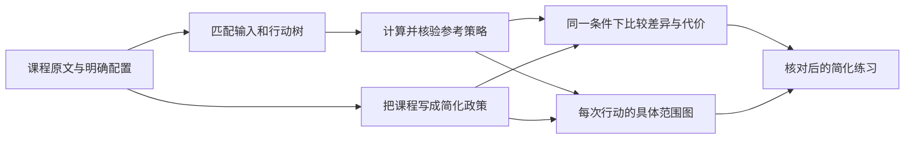
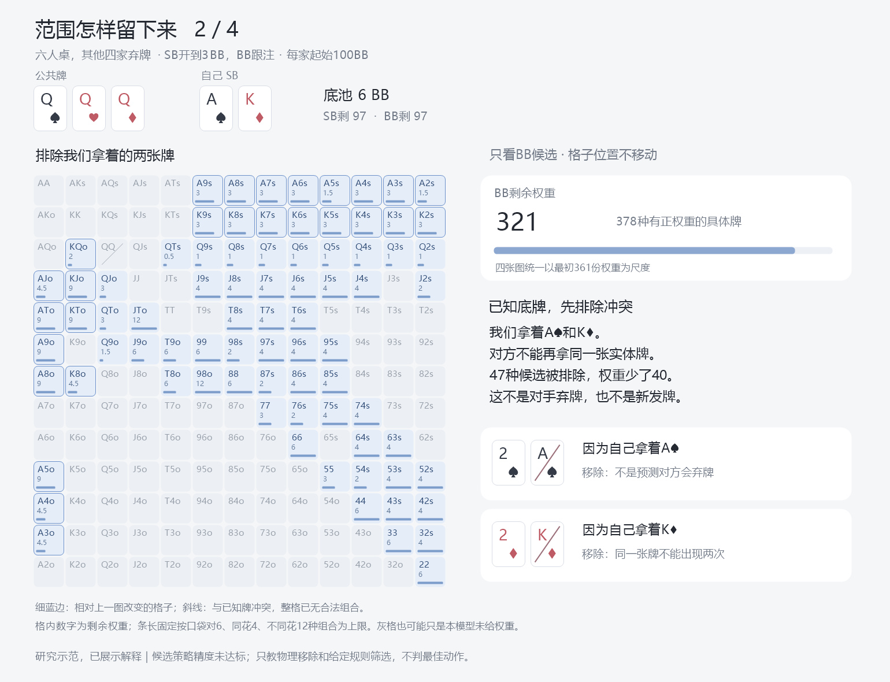

# 开源仓库能力审查：从GTO参考到课程简化训练

2026年10月21日。根据用户指定的[gto-wizard/equity-calculator](https://github.com/gto-wizard/equity-calculator)与[b-inary主页](https://github.com/b-inary)，核对相关代码、接口、测试与已有本地证据。本轮只做研究与隔离计算，不把依赖接进应用。后续为研究程序补了固定的存储依赖并构建求解、读取程序，未改变产品依赖或安装界面。总入口：[统一总纲](../../翻后教学系统_统一总纲.md)。

## 1. 先回答你的逻辑是否可行

可行，而且比仅凭笔记出题更有依据：**课程给出易执行的简化；匹配配置下的完整参考用于检查它省了什么、为什么省、代价在哪里；训练仍教核对后的简化，并能展开看具体范围变化。**

但仓库给的是计算工具和代码，不等于已经附带你课程对应的完整策略数据库。尤其GTO Wizard这个仓库只公开了胜率计算器，不能把组织名称当作商业产品全部GTO解已经开放的证据。b-inary有真正的翻后策略求解引擎，但需要我们提供双方范围、牌面、筹码、抽水、行动选项，再实际求解并核对输出。

因此正确链条是：

“参考策略”和“简化政策”保留不同版本；不能把课程的0／50／100直接称作求解器原频率，也不能从简化图唯一反推出其原始GTO。

## 2. 这轮实际上读到了哪一版

| 对象 | 固定提交／材料 | 检查范围 |
|---|---|---|
| equity-calculator | `1d34a02c8e67fa5274d10620a74b6844472028fb` | 14份源文件、构建配置或测试；包括C++核心、Python导出、翻前表索引、独立参考与CI配置 |
| desktop-postflop | `0c15f97f204e5533b09cd83fda5939c110a98e75` | 9份文件；包括求解结果接口、范围、节点导航、基础矩阵和新牌报告 |
| postflop-solver | `9d1509fe5077d019825f833eed04b16d342dfda1` | 已有固定本地源码及隔离小树运行证据；本轮再读7份核心文件与示例 |
| wasm-postflop、poker-cfr、holdem-hand-evaluator | 作者仓库当前公开说明 | 辅助定位用途；本轮没有运行它们或核验其全部实现 |

下载的源码按Git blob身份与固定目录树逐项核对，避免依赖会改变的main链接。文件清单、哈希、固定源码链接与证据见[能力审查底稿](repository-capabilities-evidence.json)。Git克隆最初连接失败，随后通过GitHub只读API取得上述选定文件；不是完整克隆，也不是新胜率扩展已编译成功。

## 3. GTO Wizard胜率计算器已经做到了什么

### 它回答的是“如果发到最后，分到多少池”

公开接口输入为具体手牌列表、公共牌，详细接口另外接受死牌；输出每家的单独获胜概率、平局概率与平均分池份额。德州扑克按七张中最佳五张比较；同时实现了4／5／6张底牌奥马哈。我们的课程只需德州扑克，不能因库支持其他玩法就加入训练。

详细输出的`win`、`tie`、`equity`不同。多人平局时，平局事件概率不是每人分到的份额；训练计算跟注收益应使用分池权益，不能把“赢或平的概率”当作权益。代码依据：[eqcalc.cc](https://github.com/gto-wizard/equity-calculator/blob/1d34a02c8e67fa5274d10620a74b6844472028fb/src/eqcalc.cc)，具体输入与输出由[Python包导出](https://github.com/gto-wizard/equity-calculator/blob/1d34a02c8e67fa5274d10620a74b6844472028fb/eqcalc/__init__.py)确认。

普通路径枚举合法跑牌，不是蒙特卡洛抽样。源码还有一个README概括未充分区分的分支：单挑德扑、无公共牌、无死牌时，读取预先枚举的翻前胜负表。[holdem_preflop.h](https://github.com/gto-wizard/equity-calculator/blob/1d34a02c8e67fa5274d10620a74b6844472028fb/src/holdem_preflop.h)按整体换花色及交换两手压缩为47008类，记录胜负计数；它不是47008条下注策略，也不是169格开池／防守表。本轮核对了索引与调用代码，未下载并独立重算全部表行。

### 它没有直接做到的部分

- 公开函数没有“带权重范围”的参数；输入的每手是每位玩家的一副具体底牌，不是一位玩家的多个候选。
- 没有底池、下注历史、未来动作树或对手回应政策输入，因此不直接计算下注／过牌／加注的策略频率和完整行动EV。
- 不自动推断现实玩家范围，也不解释某次过牌为什么留下哪些牌。
- 本轮没有取得商业GTO Wizard的预求解库、课程原解或任何私人策略接口。

这些判断依据是实际函数签名与导出，不是根据项目名猜测。外层可以遍历合法范围并加权调用它，但必须自己处理组合权重、双方撞牌、前序筛选和条件分母；不能把“范围功能已完成”算在这个库头上。

### 对我们具体有何帮助

适合作为读牌、跑牌、权益与分池计算的候选组件，也可用作现有评估器的交叉核对来源。听牌教学需要逐张跑牌结果时，还要另外组织明细；一个最终权益数字不等于已经列出所有干净补张。

但它没有替我们回答“权益30%所以应该下注多少”。未来下注、弃牌收益和被加注后的选择都不在静态权益里。对手全下、只剩跟或弃且结算条件明确时，权益才能直接接进跟注收益公式；前街一般局面不能如此替代完整策略。

### 集成前仍需确认的事实

这是C++核心加Python绑定，构建配置要求C++23与CMake3.28以上，涉及pybind11；不是现成React组件或已验证的浏览器WASM包。已读[构建配置](https://github.com/gto-wizard/equity-calculator/blob/1d34a02c8e67fa5274d10620a74b6844472028fb/CMakeLists.txt)与[CI](https://github.com/gto-wizard/equity-calculator/blob/1d34a02c8e67fa5274d10620a74b6844472028fb/.github/workflows/test.yml)，后者是Linux容器构建测试，不能当作本机Windows打包已通过。

源码有输入拒绝、独立Python枚举对照、翻前表及释放GIL等测试。这是值得继续验证的证据，不是本项目已跑过整套测试。当前扩展尚未在本机编译或执行。

另外，本次固定目录树没有发现许可文件，GitHub许可元数据为null，包配置也未提供明确许可。可继续阅读和研究；实际复制、修改与分发集成的许可条件尚未确认，不能先登记为可直接复用的依赖。这是当前集成状态，不要求用户现在处理。

## 4. b-inary这几个相关仓库各做了什么

| 项目 | 实际职责 | 对本项目的作用 |
|---|---|---|
| [postflop-solver](https://github.com/b-inary/postflop-solver) | 两个仍在牌局中的玩家之间的翻后策略求解库 | 核心候选：在指定范围和行动树下产生策略、行动EV及后续范围 |
| [desktop-postflop](https://github.com/b-inary/desktop-postflop) | Vue＋Tauri的桌面求解与分析界面 | 参考范围显示、具体组合、新牌报告与逐节点导航 |
| [wasm-postflop](https://github.com/b-inary/wasm-postflop) | 同一引擎的浏览器版 | 浏览器运行路径的参考；本轮未验证目标浏览器性能 |
| [holdem-hand-evaluator](https://github.com/b-inary/holdem-hand-evaluator) | 德扑手牌牌力评估 | 读牌／摊牌判断候选，不给下注策略 |
| [poker-cfr](https://github.com/b-inary/poker-cfr) | 较早的CFR研究，含Kuhn、单挑推弃和翻后全过的翻前模型 | 算法说明参考，不能代替本课程完整翻后引擎 |

前三个项目标明开发暂停，且核心相关代码标AGPL许可；牌力评估与早期CFR仓库各有自己的许可。具体集成按选定组件核对，不把同一作者所有仓库视作一份相同授权。[引擎说明](https://github.com/b-inary/postflop-solver/blob/9d1509fe5077d019825f833eed04b16d342dfda1/README.md)还提醒接口可能在不改版本号时变化，因此固定提交比只写版本0.1.0更可靠。

### 真正的翻后引擎能输出哪些有用数据

本地已读的[CardConfig](https://github.com/b-inary/postflop-solver/blob/9d1509fe5077d019825f833eed04b16d342dfda1/src/card.rs)、[行动树配置](https://github.com/b-inary/postflop-solver/blob/9d1509fe5077d019825f833eed04b16d342dfda1/src/action_tree.rs)与[解释接口](https://github.com/b-inary/postflop-solver/blob/9d1509fe5077d019825f833eed04b16d342dfda1/src/game/interpreter.rs)覆盖：双方加权范围、公共牌、起始池与后手、抽水、各街下注／加注选项、逐手动作频率、逐手逐动作EV、到达权重、动作历史和后继牌。节点锁定允许指定某些手牌的动作政策，用于研究课程或对手倾向。

它可以支持六人桌背景下剩余两人交战；不是六名仍在底池中的玩家同时求解。源码另有弃牌者bunching处理，但现有本地参考候选未启用该功能，不能宣称六人所有影响已包括。

算法用Discounted CFR近似求解，并返回可利用度指标。结果仍依赖输入、有限动作树、迭代精度和数值处理。README的“无抽象”不能读成它包含所有现实下注金额：它保留实体手牌／利用花色同构，与作者仍要指定有限下注选项是两件事。未提供的尺寸不能被当作已经比较过。

## 5. 已有本地运行证据，和还没取得的东西

前面的研究已经构建并运行固定引擎，核对小型河牌、机会节点、行动筛选后的转河、换花色映射及只过牌的双机会导出。它证明某些接口、索引、金额和条件概率能对上，不证明那些锁定政策最优。详见[31号参考路径](31_完整参考怎样取得_现有范围的求解输入与准入.md)。

我们还准备了从用户简化翻前图出发的BTN对BB、100BB、A♠7♥2♦参考请求，完整树已构建，但没有开始策略分配与求解。已记录的策略存储估计约5.19GB还不是进程峰值，最近记录的可用内存预算不足。这是本项目当前状态，不是引擎永久不能解决。

该请求还是零抽水研究配置，且从用户简化范围出发；即使之后求出，也只能称作“在这些给定起始范围下的翻后参考”。不能说恢复了课程未提供的原始范围和原始GTO解，更不能直接改名NL50参考。

原首手SB对BTN的六个精确策略节点仍未取得完整参考。两张公开河牌图和总动作频率不够恢复每个具体底牌的频率、EV与全部后继。仓库有代码没有自动填上这些来源缺口。

## 6. 两个已经查出的集成陷阱

### 不能拿桌面显示数据直接当精确判分依据

[桌面结果接口](https://github.com/b-inary/desktop-postflop/blob/0c15f97f204e5533b09cd83fda5939c110a98e75/src-tauri/src/solver.rs)会舍入输出，并把小于0.0005的到达权重截为零。[基础矩阵](https://github.com/b-inary/desktop-postflop/blob/0c15f97f204e5533b09cd83fda5939c110a98e75/src/components/ResultBasics.vue)也含按当前最大格缩放的显示方式。它们可以用于看图，但不能据此判某分支在数学上绝不发生。

我们的研究和答案应从原始引擎数据独立导出，保留原数、实际可达性与零支持身份；显示时才舍入。图的前后比较另外固定尺度，不能每一步都重新拉满。

### 锁定模型显示“误差0”，不证明简化无损

固定引擎的[utility.rs](https://github.com/b-inary/postflop-solver/blob/9d1509fe5077d019825f833eed04b16d342dfda1/src/utility.rs)在最佳回应计算时也尊重锁定限制。因此锁定条件下的收敛指标，不能直接作为完全自由偏离时的可利用度证明。

已有真实导出就能核对：`all_bet`锁定模型返回指标0，但在根节点拿Q♠Q♥，锁定过牌的当前EV为503.5单位，另一允许动作下注182的EV为526.75单位，差23.25单位，即0.2325BB。根处该手占兼容质量2/3，只改变这一手的第一步、保持给定后续，就有约0.155BB的根期望改进。这不是新的最佳回应完整求解，已经足以否定“锁定误差0所以课程无损”。另一既有锁定配置也有同类反例，数值在底稿中。

今后评估简化需要独立政策评估路径：固定被评估政策，对偏离者开放原参考树中的动作，不能把受检动作继续锁死。现有API还禁止求解完成后直接解锁，所以不能写一个“求完再调用unlock”的假流程。最初审查时这项适配尚缺，后续第11节已补已有小河牌菜单的独立核算；完整课程树的适配与验证仍未完成。

## 7. 怎样具体研究“课程到底简化了什么”

每条课程规则先整理成一张作者对照记录，不新增用户配置页面：

| 要核对的项目 | 要回答的问题 |
|---|---|
| 输入 | 同样位置、翻前角色、起始范围、完整历史、牌面、筹码和抽水吗？ |
| 下注尺寸 | 是把多个尺寸收为一个，还是只给主尺寸而没有说明用哪些手下注？ |
| 频率 | 是从混合改成纯动作／50%，还是原文根本没提供准确频率？ |
| 手牌分组 | 哪些实体组合被合并？阻挡、后门和摊牌价值差异是否还影响选择？ |
| 牌面分类 | 是严格换花色同构，还是教学上合并了本来不等价的牌面？ |
| 未来政策 | 当前动作之后，面对跟注、加注和新牌是否还有明确做法？ |
| 对手假设 | 原课是否从基础策略改为针对某种过度弃牌／少加注的调整？ |
| 代价与边界 | 与固定参考相比损失多少？开放偏离后可利用程度怎样？换什么条件会失效？ |

把这些因素分开研究，否则换了范围、换了对手、删了尺寸，却把所有差异都解释成“课程把GTO四舍五入”，会得出错误原理。

只比较一个节点时，可用原后续政策下的逐动作EV考察该处频率改动。但把多个节点一起简化后，后续范围和价值也变了，必须重新评估整条政策。重新求一个删掉尺寸的树，回答的是受限游戏中的解；要衡量删动作的代价，还要回到较完整的共同参考树比较，不能因为删完后又收敛，就宣布无损。

已有[42号后续政策反例](42_简化教学怎样不改错答案_后续政策与当前选择.md)证明：仅删除过牌后的加注，就可能改变前一步过牌／下注的最佳选择。因此教学可以逐层收起解释，动作与未来政策不能暗中被删改。

## 8. 用你笔记里一个真实规则说明怎么落地研究

[21号课程规则](21_把原文简化编成可执行动作练习.md)整理了Nevir2.1的BTN对BB、A72彩虹例：基础版KQ过牌、Q3下注；后段改变对手假设后采用约1/3池的范围小注简化。这不是同一条件下两份互相矛盾的答案。

研究时分以下步骤，而不是先让计算器给一个胜率就判课程对错：

1. 从原文固定基础版与调整版各自的条件；未知的对手策略保留未知，不擅自补成“全过牌”。
2. 冻结匹配的双方起始范围。用用户当前图重算是另一种明确研究基准，不冒充原课程隐藏配置。
3. 在包含目标小注及合理对照动作的声明树中求基础参考；保留实际整数金额与精度，不把33%与精确1/3混为一谈。
4. 分别看KQ与Q3的动作EV、被哪些更差／更好牌跟、哪些牌弃、被加注后怎样继续，展示逐动作范围图。胜率组件只负责其中的实体牌权益计算。
5. 若有明确的调整条件，在同一基础配置上改变对应响应，另立版本并评估课程范围小注政策。不能同时偷偷换牌、换范围、换抽水。
6. 再检查相邻牌面、不同具体花色和边缘组合，确定规则适用边界；没有参考的部分不开放精确题。

这给出可实施的研究顺序，尚未取得该例完整匹配解，也没有算出课程简化损失。不能把以上步骤写成“验证已经通过”。

## 9. 完全融入系统，应该融入哪几层

**作者研究层：** 翻后求解器产生匹配参考；权益组件候选交叉核对实体牌结果；另设课程政策编译与比较，保留双方后续、误差定义和条件版本。重计算放在作者准备阶段，避免让初学者每道题等待整棵翻牌树求解。

**教学层：** 同一张桌面顺序推进，当前一步需要时才展开“这些牌为什么留下／这个下注赶走谁／加注后如何继续”。完整版参考默认隐藏，核对后的课程简化才是主要可执行内容，不把分析软件全部控制项搬给用户。

**练习层：** 题面来自合法且正支持的范围与路线；动作答案按本题明确的课程版本判定。答后可原位查看课程简化、参考支持及差异原因；课程没有明确规则或参考不足的节点继续关闭。0／50／100的精确频率题不替换成抽随机数执行。

**图表层：** 每次行动后展示对应拥有者与视角下的实体范围变化。课程政策产生的路线与基础参考的路线分开重算，不能用基础GTO后验冒充课程简化后的后验。默认当前图，按需看前后与花色明细，遵循[43号图表合同](43_行动后范围怎么变_具体图表与开源参考.md)。

本轮另已将已有引擎18个小树节点投影为公开双方范围及已知底牌条件下的对手范围，核对16条行动边。一个实际例子是：IP按底牌下注后，OOP公开范围里AA占比由1/3变1/2；但若IP已知自己拿Q♦Q♣，其所见对手AA占比前后均为1/2。这是撞牌和观察视角造成的差别，不能用一张未标视角的图同时代替。见[范围视角核对](engine-range-view-evidence.json)。它仍是两套小型锁定模型的数据转换验证，不是新增完整策略覆盖。

静态参考与课程数据是软件内容，不需要学习者数据库。答题对错与本轮计数仍按原要求留在内存，不引入账号、长期进度或保存机制。

## 10. 当前选择与下一步

优先继续使用已构建的b-inary翻后引擎作为作者侧参考计算候选；桌面版用于借鉴范围与节点表达，逐项重做适合新手的教学流程；GTO Wizard胜率库作为物理权益与交叉验证候选，先补许可与本机验证，不直接替代策略引擎。早期poker-cfr不作为当前翻后训练主干。

下一步应该先完成一个配置清楚、双方范围完整的课程对照案例：基础参考、课程简化、差异评估、前后范围图、示范后撤帮助和连续使用，全部接成一条可复核链。不能用更多参数变体替代完整参考，也不能在同一篇报告里从“工具可用”跳到“所有课程已科学验证”。

[46号出题合同](46_完整参考怎样变成顺序教学与练习_35项出题合同.md)已将这一中间环节细化到35项候选关系、操作、有效对照和禁止推论，区分当前动作EV与整套政策、物理事实与策略原因、边缘抽题与根分布。它是声明规格，不是选择器实现，也没有替本稿取得完整匹配参考。

这轮完成的是固定版本能力审查、源码证据与接入研究路径。新权益扩展运行、完整课程求解、简化政策的自由偏离评估、真实初学者迁移以及NL50标准均未验证。

## 11. 后续补证：怎样真正测出锁定政策允许偏离时的收益

新增[独立评估脚本](../../scripts/research-nevir-unlocked-policy-evaluation.mjs)与[复算数据](unlocked-policy-evaluation-evidence.json)。只使用既有两套9节点小河牌树，读取每个分支的实际行动和逐手策略；不读取引擎EV作为收益计算输入，也不重新运行锁定求解。

先逐条历史重建投入，以最佳五张确定摊牌；弃牌时按匹配投入结算并退回未被跟的部分。起点净收益之和恒为起始底池550单位，双方收益不是假定相加为零；比较偏离增益时，该共同常数消除。100单位为1BB，前街已投不重新扣除。

计算分两层：按导出政策执行到终点，得到基线；固定对手整条政策，在自己所有原有决策点自由选择本树允许的动作，得到最佳回应。自己知道底牌与完整公共历史，不能偷看对手底牌再选。对手做出动作后按其逐手频率筛选候选，自己的选择不能替自己制造对手新信息。

另用穷举交叉检查：每方有两个决策节点、各两种私有手牌，每处两个动作，共16套完整纯策略。每套策略先固定所有信息集的选择，再对三个合法底牌配对求期望；不允许逐个隐藏底牌配对单独取最大。递归最佳回应与两方各16套穷举最大值吻合。两模型合计30个终点实体配对的收益总量、24个有支持的当前行动EV也通过核对。

| 既有模型 | 原锁定指标 | OOP自由偏离相对其原政策的增益／BB | IP自由偏离相对其原政策的增益／BB | 原菜单内可利用度／BB |
|---|---:|---:|---:|---:|
| all_bet | 0 | 0.155000 | 1.213333 | 0.684167 |
| split_by_own_hand | 0 | 0.761667 | 0.606667 | 0.684167 |

两方偏离增益相加为本树的NashConv，此处可利用度定义为该和的一半；不是双方同时换成各自最佳回应后打一局的收益。两边结果相同不代表两套原政策相同，它们分配给不同一方的改进空间不同。数字按原河牌根分布加权，不是bb/100实战收益，更不是NL50资格线。

这项核算仅放开原有限菜单的约束：树里只有过牌、一个下注尺寸、弃牌与跟注，没有加注、后续发牌、抽水或bunching。它不能衡量对方改用本树没包含的尺寸会怎样，也不能替正式A72三街树或课程简化判定。

另一项必须保留的边界是未走到的后续：原锁定根不下注，但导出仍明确给出了主动下注后对手各手怎样回应。独立核算在偏离后使用这些已导出的完整政策行，重新计算可达性，不读取原零支持EV当答案。它们在此定义一套完整的固定政策，不证明该政策在原未达分支最优或符合现实。正式课程若没有相应后继，必须报告政策缺失，不能用默认各半跟弃来填平。

这轮由此补上“参考导出→独立结算→固定政策收益→原菜单内自由偏离→独立枚举复核”的局部链条。**课程政策本身的自由偏离评估仍未完成**，新胜率扩展也没有因此被运行或取得许可。下一步将这种方法接到完整参考，不能将方法通过当作课程已经通过。

## 12. 评估简化时，不能只看一个总体数

整体质量要在固定根范围及其合法联合质量下计算；具体容易出错的手牌还要看条件损失、后继完整性和规则边界。只看平均值，可能掩盖低频但严重的错误；只看某个罕见例子的最大损失，也不能代表整条策略平均表现。两者分别报告，不预设某个小数就等于可接受或达到NL50。

训练抽题可以按用户要求提高边缘牌比例，但评估策略的权重不能跟着变成抽题比例。训练中的70%边缘题，是为了多练难点；不是现实牌局有70%边缘牌，也不意味着本轮错题比例可以换算成实际收益。题目对错照常即时反馈，后台研究的策略质量另按声明的牌局分布计算，无需增加用户数据库或长期成绩记录。

同样，课程规则若只说明主尺寸，不能因为该尺寸在被删成只剩一个下注选项的树里获得100%使用，就证明它优于其他尺寸。是否保留这条简化，需要明确共同对照树、参考精度、后续政策和损失边界，再决定教学如何解释。

## 13. 从读代码到实际完整范围验证：另立SB对BB的QQQ案例

本节是后续实测记录，更新时以[当前运行状态](sb-bb-qqq-run-state.json)为准。这里的新案例没有替换原BTN对BB的A72请求，也不是把原树缩小后冒称完成。原A72仍单独保留，尚未取得策略。

原笔记2.7第8、13—14行涉及盲位单次加注，并用QQQ说明有些牌面可以高频持续下注。它没有给出完整求解配置或逐手纯动作答案。我们据此建立另一个明确的研究问题：**在用户自己的SB开池与BB面对SB开到3BB的跟注范围下，QQQ上有哪些牌选择过牌、小注、大注或全下？观察对方回应后，留下的牌具体是什么？**

输入取自现有图表，不编造跟注范围：SB用`open-SB`的加注权重，BB用现有`bbMap.SB[3]`映射的`bb-小盲紧`跟注权重。原始六人桌各100BB，其他四家弃牌；底池6BB，两家各剩97BB。翻牌明确为Q♠Q♥Q♦，在SB第一次行动前起算，不强迫SB先过牌。

| 项目 | 这份单独声明的配置 |
|---|---|
| SB翻前／翻牌后实体手数 | 574／487；权重质量558／471 |
| BB翻前／翻牌后实体手数 | 488／425；权重质量418／361 |
| 合法双方实体配对 | 187926对；乘积权重总质量154515 |
| 翻牌可选下注 | 双方均有33%、67%与全下；根实际金额1.98、4.02、97BB |
| 转牌、河牌下注 | 75%与全下；两街都保留 |
| 加注 | 2.5倍与全下；不删除后续加注以迎合课程 |
| 抽水、弃牌者信息 | 作者明确的零抽水、无bunching假设 |
| 已建成的完整图 | 三街抽象行动历史2559个；压缩策略存储估计2597630848字节 |

[请求](reference-request-sb-bb-qqq.json)和[构图独立复核](sb-bb-qqq-preflight-verification.json)分别保留。912个根实体权重、相容质量与2559条抽象历史的金额已核对；这一步不等于策略求解或收敛。

另已把原课“超对优势和更多葫芦”的说法拆成可数的当前牌型，见[结构计数](sb-bb-qqq-structural-profile.json)。**QQQ上，AA／KK现在已经是葫芦；Qx是四条。**教学不能让初学者以为AA此时仍只有一对，也不能因为SB有更多强葫芦就说BB没有更强牌。

| 当前已经成的牌 | SB公开边际占比 | BB公开边际占比 |
|---|---:|---:|
| Qx四条 | 5.69% | 5.21% |
| AA／KK组成的葫芦 | 2.49% | 0% |
| 其余口袋对组成的葫芦 | 12.99% | 12.10% |
| 无口袋对、无Q的三条 | 78.82% | 82.69% |

比例按双方现有范围、具体三张公共牌及合法撞牌关系共同条件化，不是单方实体手数直接除总数，也不是学习者拿到某手之后所见对手范围。该明确输入下，SB的葫芦合计约15.48%，BB约12.10%，SB还有BB跟注范围没有的AA／KK；这是支持原文某部分结构描述的证据。**它没有计算未来权益，也不能单独推出“所以每手100%下注”。**要教会这条原因，先让人看见具体哪些组合多了／少了，再看完整行动参考和后续回应；不能把“范围优势”当作一条无条件按钮口诀。

随后已真正启动无节点锁定的两线程求解，进程10788，观察句柄44550；启动时物理空闲6706036736字节，保护预算4023622041字节，另外要求512MiB余量。每步前检查物理空闲及进程峰值，设置2000次迭代／1200秒停止条件，不因观察超时另开重复求解。误差目标0.006BB是这份有限树的全局引擎指标，不是每手动作误差，也不是NL50标准。**目前本节没有登记求解通过；是否结束、停止原因和实际精度必须从运行文件核对。**

为防止只算出几个截图就声称能接训练，研究程序设计为保存完整声明三街政策，再另进程载入，读取根、SB过牌后、两种下注后、转牌与河牌上的选定节点。已实际运行的小型存储往返校准保持了策略与EV，见[小模型校准](storage-roundtrip-verification.json)；完整QQQ文件的载入与独立核对尚待这次求解结束，不能提前据此登记成功。

待运行的[完整文件读取程序](../solver-probe/src/bin/sb_bb_qqq_reload.rs)和[实体范围／终局独立复算程序](../../scripts/verify-nevir-sb-bb-reference.mjs)已编写，读取程序已编译。计划逐边核对“原权重×实际逐手动作频率”，新牌移除、两人撞牌条件化和选定终局权益；这依然不是第二套独立完整均衡求解器，也不独立证明引擎总体可利用度正确。

研究依赖现增加了固定的bincode 2.0.0-rc.3及对应derive。此前小模型证据保留当时锁文件与二进制的历史哈希，不能把旧运行说成已用新锁文件重跑。已将此前锁文件按原SHA256精确归档为[历史锁文件](Cargo-before-storage.lock)，见[依赖身份记录](solver-lock-history.json)；恢复校验失败时脚本会拒绝归档，而不是保留一份近似版本。新QQQ运行另记录当前版本，不改动固定引擎源码。

这个例子能验证“完整范围与三街参考→行动后具体范围”的数据链，并提供一个课程提及的OOP SRP研究点。QQQ很特殊，**即使最终收敛，也不能代表A高、连接、两同花等牌面已覆盖，更不能推出整类牌面统一动作。**要判断课程的高频小注怎样简化、损失多大，还需按明确政策评估，区分基础均衡与对手倾向调整。课程没有明确的逐手政策之处，不用本例频率擅自补成课程答案。

## 14. 第一轮完整树运行已结束：可以验证什么，仍不能发布什么

本节更新第13节的进行中状态，保留前文作为研究过程记录。第一轮进程已实际退出，观察句柄44550返回退出码0。运行240次迭代后触发1200秒上限，保存结束总耗时约1216秒；进程峰值工作集2548580352字节，完整三街政策文件1261830677字节。

**引擎报告指标0.053396BB，未达到预设0.006BB。**不能因成功生成文件，就将它登记为足够精确的策略参考或开放0／50／100判题。原A72仍未求解，原课程配置仍未恢复，NL50参考与真实学习效果均未验证。见[第一轮输出](sb-bb-qqq-reference-result.json)。

随后另一进程实际载入完整文件，并读取14个选择节点：翻牌根、SB过牌／两种下注后的回应、全过进入A♣转牌与2♣河牌的路径、下注跟注后的转牌等。[重新载入数据](sb-bb-qqq-reload-export.json)与[独立复核](sb-bb-qqq-reference-verification.json)显示：

- 根与SB过牌后的策略、EV均保持引擎原有f32位值；核对时不是显示舍入后“差不多”。
- 12768个实体到达权重／相容质量按动作逐手相乘及新牌移除核对；4362个有支持决定行与198个无支持行区分。
- 750个有支持终局手牌，按另一套最佳五张评估及具体对手权重独立重算。双精度数学结果与引擎最大差约0.00008797筹码单位，即0.00000088BB；按已读源码的f32胜负存储和偏置还原顺序重算，750行全部吻合。这里是终局数值核对，不是完整行动EV或收敛指标的独立证明。

两个初始检查的失败也保留解释：JSON读取有f64最低位差异，改为核对引擎实际使用的f32位值，见[比较明细](sb-bb-qqq-reload-comparison.json)；另一检查在接近零收益时使用了不合适的相对容差，随后查读终局计算路径，加入独立f32重放并记录绝对误差。没有修改原引擎、原文件或放宽策略收敛目标。

现已实际生成[28个公开范围和28个已知自己底牌的对手范围](sb-bb-qqq-range-views.json)。矩阵保留169格和具体花色，参考之外的零权重不被说成现实中不可能。跨新牌的相容质量不等于路线概率，不能漏掉机会分母；这些图仍是候选参考的作者数据，不是课程答案或已实现的界面。

### 14.1 已经可以做一次有限的“简化是否损失”诊断

[根政策比较](sb-bb-qqq-root-policy-diagnostics.json)只改变SB翻牌第一步，两人的后续仍完全固定为候选政策。原候选在此根约6.66%过牌、51.35%下注1.98、41.99%下注4.02，不用这些数字冒充原课程或已经精确收敛的GTO。

| 作者假设：只替换这一步 | 相对原候选的根期望差／BB |
|---|---:|
| 全部过牌 | −0.024784 |
| 全部下注1.98 | +0.000217 |
| 全部下注4.02 | +0.002782 |
| 全部全下97 | −5.436892 |
| 每手频率投到最近的0／50／100网格 | +0.001365 |

数字不是bb/100或整手从发牌开始的净利润。小幅正差在未充分收敛、固定对手和固定后续下很正常，**不能推出“简化比GTO更强”或“全范围小注无损”**。此诊断也没有让对手重新优化，没有简化后续所有节点，未计算新政策的完整可利用度；0／50／100投影只是敏感性测试，不是选定的教学政策。正式判断仍需更高精度参考、完整政策和允许偏离的评估。

### 14.2 用实体范围说明：为什么总体多弃5点，仍不足以填出逐手答案

[条件弃牌率边界研究](sb-bb-qqq-fold-identification.json)固定“SB下注1.98，BB回应”这一候选分布，明确假设总体多弃**5个百分点**；这不是恢复了课程原始测量，也没有擅自解释笔记里所有“5%”的口径。允许每种BB底牌只增加弃牌概率，仍保证每手概率合法。

所有允许的分配方式都能把公开总体弃牌率从18.65%提高到23.65%，但已知SB具体底牌后，结果并不唯一：

| SB自己拿的具体牌 | 原候选所见弃牌率 | 同一总体增量下，可能达到的条件弃牌率 |
|---|---:|---:|
| A♠K♦ | 20.17% | 20.17%—26.16% |
| A♥2♥ | 18.65% | 18.65%—24.48% |
| Q♣A♣ | 20.33% | 20.33%—26.37% |
| 2♠2♥ | 16.87% | 19.27%—22.44% |

上下界由有容量限制的线性分配计算，分别保留达到边界的逐手变化及相等的对偶证书，不是从几份人为挑选案例猜范围。这里不要求现实对手知道我们的牌：每套达到边界的策略都只是按BB自己的牌决定；我们拿走哪些牌，改变哪些BB候选实际能出现。

这正是“阻挡”接到操作前判断的一种直观入口：**先在图上划掉与自己底牌冲突的组合，再看增加的弃牌是否仍落在剩下的候选里。**不能给所有底牌统一加5点，不能仅凭总体统计就宣布所有垃圾牌都该下注。该边界尚不含下注被跟、被加注及后续收益，因此也不输出动作答案。

教学应先呈现一个已明确的具体回应版本，让学习者实际筛范围并比较；只有总体倾向、没有逐手响应依据时，就教“还缺哪项信息”，或明确按课程处方执行，不能由程序猜出完整人群策略后再按猜测罚错。这一原则接回[46号合同](46_完整参考怎样变成顺序教学与练习_35项出题合同.md)，不新增平铺菜单。

## 15. 下一轮质量计算已启动，第一轮数据保留

第一轮真实退出、文件载入及局部独立核对完成后，已另立第二次质量尝试：[准备记录](sb-bb-qqq-quality-attempt-v2-preparation.json)、[当前运行状态](sb-bb-qqq-run-state-v2.json)。实际进程23560，观察句柄34376，已返回迭代进展；不是观察超时后重复开进程。

第二轮保留相同输入指纹、全部范围、三街菜单、两线程与0.006BB目标；仅把计算上限从1200秒延长为7200秒，仍有逐步内存保护和2000次迭代上限。启动空闲6761246720字节，保护预算4056748032字节，另外要求512MiB余量。原v1文件与输出不覆盖，原A72不变。

这次延长是为了补足已明确失败的精度要求，而不是降低通过线。新一轮完成前，上一节的候选诊断不能升级为正式课程判题；即使下一轮指标达到目标，还须重做载入／范围／数值核对，并继续取得匹配课程配置、完整简化政策与独立偏离评估。当前未修改应用，也没有真实学习者或NL50验证。

## 16. 把完整范围接回一条能顺着看的教学

新增四张作者图稿，从现有完整BB输入出发，始终只显示BB这一张矩阵、同一块QQQ和自己A♠K♦。它们是范围运算的纸面示范，不是精度已通过的策略课；第4张使用明确给定的候选跟注规则，练计算关系，不考该规则是否最优。

| 顺序 | 用户此时看见、操作什么 | 这一步学会什么 |
|---|---|---|
| [第1张：输入清单](figures/qqq-range-sequence-1.png) | 先摆出BB输入图，425种具体牌、361份权重；明确还没排除自己手里的牌 | 范围是候选与权重，不是真实底牌；这是计算起点，不是已算完的后验 |
| [第2张：自己拿走哪些牌](figures/qqq-range-sequence-2.png) | 点A♠或K♦，只划掉冲突的那张实体牌；矩阵固定不移动 | 少47种候选、40份权重，剩378种、321份；是物理冲突，不是对手弃牌 |
| [第3张：下注但未得到回应](figures/qqq-range-sequence-3.png) | 看SB投入1.98，底池和后手变化，BB矩阵与上一张完全相同 | 自己已知底牌时，自己的动作不能替自己制造对手新信息；对手怎样看我们是另一视角 |
| [第4张：对手跟了](figures/qqq-range-sequence-4.png) | 观察BB跟注，按每手给定跟注频率重新筛，剩351种、约207.52份 | 进入哪条分支看具体回应规则；合法手牌离开跟注分支，不等于它物理上不可能 |

第2张示范如下；实际教学按需一张张切换，不能把四张和四套解释同时平铺：

图中格子条长采用固定的口袋对6／同花4／不同花12上限；总条长固定以最初361份为尺度，不能每张重新拉满。很小但为正的值显示“<0.1”，不伪装成0。只在整格与已知牌冲突、已无合法组合时画斜线；灰色也可能仅表示输入图没有给正权重，不能混同物理不可能。四张最终图已实际打开检查，见[图稿复核](qqq-range-image-review.json)。

### 16.1 补题只补当前这一项，不加一场理论考试

[三道纸面题](qqq-range-lesson-prompts.json)与[教师键](qqq-range-lesson-teacher.json)分开：第一道点出与自己底牌冲突的候选；第二道判断对手尚未回应时是否应删牌；第三道保留每手给定跟注频率，让用户判断哪手离开跟注分支。每题都有“我不知道”，按原要求计错、解释后继续，不提交实际扑克动作。

这三道题是在已看示范之后检查物理事实与给定规则，不能计作未见迁移、范围估计或最佳行动通过。若要检查真实独立使用，必须换未曝光且参考充分的局面，并在没有提示“这题考阻挡”的情况下，让学习者主动指出要更新什么、随后如何比较当前动作。不能因他会点A♠就声称会诈唬。

### 16.2 只在原任务需要时展开，关闭以后真正回去

[作者分镜包](qqq-range-lesson-packet.json)与[核对结果](qqq-range-lesson-verification.json)将它挂到首次导览回看S09的可选解释中：先关闭原历史深入层、回到S09，再作为同级小段打开，不从H10再套一层。开始时明确换成另一手SB对BB、自己A♠K♦，不把原AQ偷偷改牌；结束恢复原S09的完整牌钱、前序、教师参考、首答与曝光身份，不重复下注或发牌。

已核对1700个实体权重、507个独立点数／花色类计数、四帧600BB账本、自己的动作不改变已知私牌对手范围及三题键。它新增一个作者绑定，当前六个补充入口仍默认不自动插入，首次18帧、原169帧与最多两份返回快照保持不变。这不代表已实现导航、初学者能看懂或35项已教完；QQQ也仍只是一个牌面族，不能用这四图代替完整课程。

## 17. 完整路线验证的准备与小树实测

第二轮仍在计算。[独立版本的读取与复核准备](sb-bb-qqq-v2-validation-preparation.json)已生成五份程序，Rust读取程序已实际编译；它们读写v2独立文件，v1政策、图稿和证据不覆盖。当前没有宣称已读取尚未完成的v2结果。

另新增[策略路线采样程序](../solver-probe/src/bin/policy_rollout_probe.rs)和[独立重放结算程序](../../scripts/verify-nevir-policy-rollouts.mjs)。前者从引擎读取每个行动者自己的逐手政策、推进实际历史，记录牌与行动；后者不读引擎终局收益，重新核对待补金额、加到总额、弃牌未跟注款、发牌与最佳五张结算。两边根收益之和为起始底池；这是当前根之后的期望，不是从发牌开始的净利或bb/100。

先在已保存的两家各两种候选、三种合法私牌配对、9节点河牌小树上实际校准。五种固定检查条件各5000次，共25000条路线、50000次行动金额重放，含20674次弃牌后未跟注款处理；另在同一小树穷举全部合法私牌配对与政策分支，独立算五个期望。引擎与独立穷举最大差约0.000153BB；抽样均值与期望的差另行报告，不把一次抽样差当成策略损失。见[校准结果](policy-rollout-calibration-verification.json)。

联合抽双方时，按各自初始权重独立抽取、撞牌则整对重抽；固定自己某手时，只重抽条件化后的对手。不能先按单方权重抽自己、再强制给自己配一个合法对手，并把它当成联合分布，否则会漏掉“这手牌有多少相容对手”的权重差。校准还核对了五组条件下实际配对分布。

统计报告采用预定样本量、固定种子；区间参考[Maurer与Pontil的定理4](https://arxiv.org/pdf/0907.3740)，缩放有界收益，并对两侧与各固定检查条件分配误差概率。该定理要求独立抽样；程序使用可复现伪随机数，不证明其严格IID。当前校准区间半宽约0.39—0.54BB，显然不能认证0.006BB的求解目标，也不通过挑种子或反复抽到通过来缩窄结论。

**这次实测只有河牌，没有发牌或全下补牌。**完整三街的前向抽样程序虽已编译，仍须在v2真实完成并通过节点复核后执行；目前没有完整三街抽样结果。即便以后抽样相符，也只能说明给定政策的路线与收益在该检查分辨率下相容，不是独立最佳回应、完整可利用度或课程简化损失证明。

## 18. 能否直接装进训练器，要检查后续是否齐全

[导出闭合检查](sb-bb-qqq-export-closure.json)实际逐节点审查了这14个选择导出。完整作者政策文件约1.262GB，而选择导出约1.764MB；二者职责不同，不能因为小JSON能读取，就声称它已包含全部连续练习。

| 这份选择导出的边界 | 实际核对结果 |
|---|---:|
| 已选决定节点 | 10个 |
| 这些决定允许的行动边 | 35条，其中25条没有对应后继导出 |
| 已选发牌节点 | 3个 |
| 这些节点有正支持的具体新牌边 | 146条，其中143条没有对应后继导出 |

这是导出缺项，不是完整二进制策略文件缺少这些分支。四张图稿只教已明确的计算链，三道事实题也不执行扑克动作，因此不因此失效；但不能把它们扩成任意行动、任意新牌都能继续的策略训练。

### 18.1 新牌也必须按题目的条件生成

在给定候选政策的翻牌双方过牌后，公开视角下下一张K♣的概率约1.82%，2♦约2.17%，不是每张都约2.04%（1／49）。该精确计数来自合法私牌配对及其到达质量，仍只描述此明确模型，不是某个真实玩家群体的测量。

生成路线可以先抽一对合法私牌，再从排除公共牌和双方底牌的牌堆均匀发牌；也可直接使用已核对的条件新牌分布。前者在翻牌后每个具体配对剩45张、转牌后剩44张；这不意味着学习者知道对手哪两张。已知自己两张而不知道对手时，后台对所有支持的对手候选加权求和。

常用的9／47等均匀未知牌近似并没有被普遍推翻：若条件确实是其假定的均匀未知牌，仍可这样计算。这里不能把均匀近似偷偷代替已经给定的加权范围和行动条件；否则新的题面分布与用于判分的参考不一致。首次教学仍先教“谁拿走了哪些牌”，45／49及条件求和只在需要时展开，不把后台公式平铺给初学者。

### 18.2 静态课包与完整连续路线，不能混成一个发布状态

作者应按实际任务登记支持范围，学习者无需看见这些后台类型：

- **事实小练：** 明确给出牌或回应规则，检查冲突、牌力、价格或筛选。它不因借用某份候选响应就自动成为最佳策略考试。
- **课堂示范：** 允许固定一条公开说明的演示路线；预选的后续牌不能假装随机实战或证明普遍盈利。
- **单步策略练：** 当前所有被判分动作必须有匹配的完整后续价值依据；若作答只是提案，须与真正执行动作分开。
- **连续路线：** 学习者真正执行的动作及可能发到的新牌，需要对应后继、范围更新和参考身份闭合；缺项时停止该路线的策略判分或回到明确的教学模式，不能默认对手弃牌、编一个回应，或把作者缺资料记成学习者错误。

完整参考保留在作者计算层。发布前可从中编译声明范围内的小课包；若产品要开放包外连续路线，则另需经过验证的完整树查询路径与资源安排，不能把1.262GB每牌面的研究文件直接当作轻量页面素材。当前两种产品路径均未实现，不能用14个节点替代完整系统，也不能以此缩减原35项、原A72或首次六处策略要求。

## 19. 第二轮全树参考已经完成：对照链可以开始落地，但仍不是课程答案

第二轮 QQQ 参考已由无锁定、两线程的完整声明三街树实际完成。状态文件记录 1,050 次迭代、引擎指标 0.00590477BB，达到本轮预设的 0.006BB 停止线；二进制、结果和运行状态分别保留在 `sb-bb-qqq-reference-v2.bin`、`sb-bb-qqq-reference-result-v2.json` 与 `sb-bb-qqq-run-state-v2.json`。这只证明**这一个 SB 对 BB、QQQ、这组范围与行动菜单**取得了一个达到内部目标的候选参考，不能外推到 A72、其他位置、其他牌面或课程全部节点。

独立重载没有把“文件能打开”当成验证：根和翻牌过牌后的策略／EV保持原引擎的 float32 位值；实体到达权重 12,768 行、支持决策 4,248 行、无支持决策 312 行，另有 413 个终局手牌数值检查。终局独立复算的最大双精度差为 0.0000396 个内部单位，按引擎的 float32 算术顺序重放全部吻合。独立复核仍明确标记 `fullIndependentBestResponseVerified=false`、`coursePolicyQualityVerified=false`，所以它是参考层质量证据，不是“GTO正确性已证明”或可直接发布的判题键。

同一份完整策略又做了 80,000 条固定样本的三街前向回放，独立检查了 398,446 次行动账本和 54,352 次弃牌后未跟注款的返还。联合抽样、已知 SB 具体底牌、已知 BB 具体底牌四组均落在预先写定的经验区间内；这证明“从策略取动作→发合法新牌→继续行动→独立结算”的链条相容。它没有证明求解误差、最佳回应、课程简化损失或学习效果，且固定种子伪随机不等于形式化 IID 证明。输出见 `qqq-policy-rollouts-v2-verification.json`。

这次实测把训练器真正需要的范围图接口说清楚了。每个动作节点都应保存同一份可追溯快照：

1. `R_before`：当前行动者在本节点的实体组合及原始权重；
2. `p(a | hand, node)`：该手牌在参考策略中采取每个动作的频率；
3. `R_after(a)`：进入某一动作分支后的条件范围，逐手权重为 `w(hand) × p(a | hand,node)`，再除以该分支总质量；
4. `Δ`：上一张图与当前图的物理冲突、动作筛选、公共牌移除三类变化分别着色；
5. `successors`：下一张公共牌的合法条件分布以及每张牌是否有已验证的后继节点。

这样用户才会看到“下注后谁留下、跟注后谁留下、转牌改变后哪些组合重新获得动作”，而不是只看到一个孤立的百分比。若当前节点缺少后继动作或新牌路径，界面必须停在解释模式，不能继续猜对手行为。导出闭合审查已经发现 35 条决策边有 25 条没有选定后继、146 条具体发牌边有 143 条没有选定后继；完整二进制有这些信息，不等于当前轻量 JSON 已经把它们全部导出。

### 19.1 两个仓库在最终系统中的分工

`gto-wizard/equity-calculator` 的公开 README 明确给出的是“枚举全部跑牌的精确权益”，输入是具体手牌、公共牌和死牌，输出含 win、tie 和分池权益；它没有下注策略、范围到达权重或行动树。因此它适合放在**牌力／权益层**：验证摊牌结果、计算跟注价格与所有合法跑牌、复核我们的独立结算；不能拿 47,008 个翻前类别误称为策略表，也不能由 equity 反推下注频率。公开仓库当前没有确认的许可证文件，正式集成前仍需先解决授权与 Windows 构建验证。

`b-inary/postflop-solver` 是**作者侧参考策略层**：在明确的双方加权范围、牌面、底池、后手、抽水、下注／加注菜单和发牌树上求解，并提供逐手动作频率、EV、到达权重、行动历史及后继牌。它还实现了六人桌最多四个已弃牌玩家的 bunching 计数，但一个正在求解的节点仍是两名尚未弃牌的玩家；“六人桌背景”不等于六个活跃玩家同时求解。仓库 README 目前标为 development suspended，并采用 AGPL-3.0，不能把源码直接复制进一个闭源发布的 EXE 而跳过许可证评估。

`wasm-postflop` 与 `desktop-postflop` 的价值主要是**交互表达和运行形态**：前者说明同一引擎怎样在浏览器中运行，后者展示 Vue＋Tauri 桌面壳、节点导航、范围／组合查看和结果图，并说明桌面版更适合较大内存计算。它们的界面结果会舍入或截断很小的到达权重，不能直接作为数学判分数据；我们的训练器应读取作者侧精确课包，再自行画简化后的单步图。`holdem-hand-evaluator` 只解决牌力排序；`poker-cfr` 主要是 CFR 算法、Kuhn／推弃／简化翻前示例，适合学习求解思想，不是这套翻后三街课程的主引擎。

因此，集成顺序应固定为：**先用 b-inary 引擎在作者侧生成完整参考 → 用 equity-calculator 与独立最佳五张代码复核权益 → 用同一节点编译课程的简化策略 → 对每个动作生成前后范围图与后继闭合清单 → 再把这些声明过的课包交给浏览器／桌面训练器**。用户端不需要看到求解器的参数森林，也不应在答题时临时求解；它只执行已验证的顺序教学。当前本地没有改应用或引入任何上游依赖，完整 A72 与其他课程节点仍待按同一桥接协议取得参考与简化损失评估。

## 20. 2026-10-22公开页面复核

这次重新查看了仓库公开主页，补充的是“当前公开状态”，不替换前面按固定提交做的源码审查：

- [gto-wizard/equity-calculator](https://github.com/gto-wizard/equity-calculator)仍按权益、跑牌和摊牌事实组件处理；公开仓库页面不能证明它提供完整下注策略。
- [b-inary/postflop-solver](https://github.com/b-inary/postflop-solver)、[wasm-postflop](https://github.com/b-inary/wasm-postflop)和[desktop-postflop](https://github.com/b-inary/desktop-postflop)的公开页面标注了“Development suspended”。这只说明上游公开项目当前暂停开发，不等于固定提交的源码事实失效，也不等于它已经适合直接作为训练器运行时。
- [holdem-hand-evaluator](https://github.com/b-inary/holdem-hand-evaluator)继续只作为牌力事实评估器；[poker-cfr](https://github.com/b-inary/poker-cfr)继续只作为算法和小模型回归参考。

这次页面复核不会改变本报告的接入边界：公开主页、README、界面截图和开发状态都不能替代固定提交、完整输入指纹、匹配策略快照、动作后范围、后继图或课程差异账本。机器结果中的 `publicPageReview` 只记录这些观察，不把页面状态升级成运行时或NL50证据。
