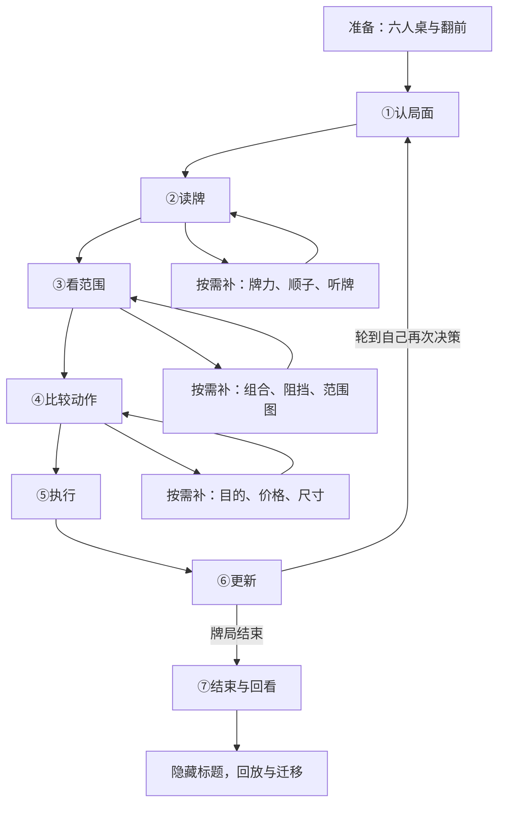

# 主线、首遍体验与嵌套教学

上层：[产品定义](../01_产品与总结构/01_产品定义.md)。子层：[基础能力](02_翻前与读牌.md)、[翻后原理](03_翻后原理与分类.md)、[具体教案](04_练习编排与教案.md)。

## 1. 主结构：进入一手牌，然后循环七步

准备区只做三件事：确认桌面与位置 → 按最终翻前图行动 → 带着行动历史和双方起始范围进入翻后。

“更新”后通常回到①，不是每做一个动作都立即结算。同一街对手加注也会回到①；全下未发完牌时自动走完合法发牌再结算。只有行动真正结束才进入⑦。首遍可用一条已核对的较短三街线路，但不能为了流程好看而编造对手动作。

## 2. 每一步的教学与执行要求

| 步骤 | 白话问题 | 中心视觉 | 学习者操作 | 交给下一步 |
|---|---|---|---|---|
| ①认局面 | 现在轮到谁？继续要补多少？ | 小桌子、简短历史、底池与待补金额 | 点行动者，确认免费行动／面对下注／面对加注 | 当前街次、位置、角色、行动状态、合法动作和价格 |
| ②读牌 | 我现在最大的五张是什么？还有什么可能变化？ | 公共牌与底牌，可高亮最佳五张 | 首遍选牌型；基础薄弱时展开比大小或听牌短练 | 牌面属性、当前牌力、改善与反超事实 |
| ③看范围 | 他一路这样打，到这里还可能有什么？ | 范围图与最近一次过滤 | 对照前后，指出减少或保留的一组牌 | 行动前范围、已知牌冲突、行动筛选依据或缺失标记 |
| ④比较动作 | 我下注想留下谁、赶走谁？不下注会怎样？ | 两个合法选项与一个当前比较 | 先选目的或比较对象，再选课程动作 | 动作、尺寸政策、理由、答案身份 |
| ⑤执行 | 现在放多少筹码？ | 动作按钮和筹码账本 | 选规定动作／金额，查看执行后账本 | 新底池、各方后手、行动权、历史 |
| ⑥更新 | 对手回应或新牌，让什么变了？ | 一次事件与一张变化图 | 先看回应，再看新牌；不同时播放两种变化 | 新范围、公共牌、行动者和真实下一节点 |
| ⑦回看 | 结束了吗？刚才的依据对不对？ | 摊牌最佳五张／弃牌终局与决策回放 | 核对结算；区分输赢和决策质量 | 本轮错误层与下一练习入口 |

七步是一套检查顺序，不要求熟练快练每题都点七次。跟着学显式走完整；专项只回答当前一个问题；连贯练默认压缩已掌握步骤，仍可一键展开慢想卡。

## 3. 首遍逐屏脚本

下表是显示顺序，不是13个独立专题。第11屏的循环会按实际牌局重复，帧数随线路长度变化，不再硬性要求“任何首课恰好13帧”。

| 顺序 | 用户看到和做的事 | 教师说明／反馈 | 需要的数据 |
|---|---|---|---|
| 1 建立目标 | 六人桌与一条折叠路线，点“开始” | “先看一手牌怎么走，卡住可以在原地补。” | 课包场景 |
| 2 认位置 | 标出按钮位和自己；点当前行动者 | “位置说的是这条街谁先说话。” | 座位、按钮、历史 |
| 3 读翻前图 | 两张实体牌，点对应格子 | 高亮行列，不先用答案颜色提示该选什么 | 原图与格子映射 |
| 4 按图行动 | 选择完整动作／频率组合 | “这里练的是这张图的规定，不随机挑一个动作。” | 最终图动作向量 |
| 5 带范围入场 | 收起单手高亮，展开双方可能的牌 | “刚才行动的可能不只这一手牌。范围就是所有可能与各自份量。” | 双方起始范围、历史 |
| 6 认翻后局面 | 翻牌后再次确认行动者、底池、后手 | “前面发生的事保留，街次和行动权重新确认。” | 真实后继状态 |
| 7 认自己的牌 | 点出牌型，需要时选五张最大牌 | 先展示具体牌，再补牌型名称 | 独立牌力计算 |
| 8 看对手留下的牌 | 动作前范围 → 已知牌移除 → 已发生行动过滤 | “不可能的牌直接划掉；只是少做这个动作的牌份量变薄。” | 加权范围与响应 |
| 9 比较选项 | 在过牌与下注，或弃／跟／加之间作一个局部判断 | 先示范一个比较，再请用户完成另一个，避免全空白猜题 | 完整当前动作菜单与答案依据 |
| 10 执行动作 | 点课程动作，筹码进入底池 | 显示新增投入、总投入和接下来轮到谁 | 合法金额计算 |
| 11 看回应 | 对手跟注／加注／弃牌的单次动画 | 范围图先变，再决定继续当前街或发下一张牌 | 后继与事件顺序 |
| 12 循环及结束 | 转牌、河牌仍沿七步；结束后比大小或收池 | “顺序一样，输入变了。输掉这一手不代表上一步选错。” | 连续参考或明确停止 |
| 13 结构回放 | 隐去标题，把几张白话步骤卡按顺序点出；再定位一个变化 | 只验证结构，不将提示后重答当独立掌握 | 首答和未曝光结构题 |

首课策略部分必须选已有完整依据的课包。A72目前可作准备／物理事实示范，QQQ有参考候选；任何一个都不能仅因方便就被宣布完整首课。策略缺失时本段在对应步骤收束，标“本段只练到这里”；完整首遍路线的正式验收必须等完整课包。

## 4. 如何嵌套，才不会越补越乱

打开子练习时，保存父题的节点、底牌、公共牌、历史、范围视角、首答、当前焦点和计分身份。子层只覆盖中心内容，顶部显示“比较动作 › 看阻挡”，提供“回到原题”。一次只开一个补习层；层内可用前／后两步展示过程，不再套出第三层窗口。

子练习可以使用独立对照牌，但必须标“对照实验”；关闭时主牌局恢复原牌，不把对照牌写进历史。题库查资料、设置抽屉和教学子层不能同时打开。

答错后先展示本题正确答案与一个主要解释。若用户点“这一步没懂”，按其选择进入读牌／范围／价格／课程边界子练习。补完回父题；已经曝光的重答不再次记分。用户也可直接下一题，系统用下一道同构题检验。不能靠强制反复点击制造掌握。

## 5. 首遍以后如何推进

| 阶段 | 本轮增加／减少什么 | 独立检查 |
|---|---|---|
| 完整示范 | 显示步骤、关键变化和理由，不要求盲猜 | 用户能指出当前层 |
| 补一步 | 只留一个中间结果让用户完成 | 必要事实可见，答案不预填 |
| 自己做 | 去掉答案提示，仍可看路线 | 陌生同机制题首答 |
| 条件对照 | 改一个独立条件，比较派生变化 | 先指出受影响层，再判断 |
| 混合与间隔 | 在当前会话隔几题回访，同构题交错 | 不靠上一题颜色和位置作答 |
| 连续执行 | 新线路中自己调用七步 | 范围、金额、行动权连续 |

推荐进阶是教学建议，不是永久解锁。无保存约束下不能声称跨天记得掌握情况；用户下次可选“跟一遍／直接练”，需要时做短定位检查。本产品不为了间隔学习增加自动提醒或长期学习档案。

## 6. 教学依据与设计推断

示范与练习结合、图文结合、提取和解释性问题参考[IES实践指南](https://ies.ed.gov/ncee/wwc/PracticeGuide/1)。把这些方法组织成七步扑克循环、子层恢复和会话内推荐，是本项目设计推断，须真实试读验证。原则不是“越少信息越好”，而是当前判断所需输入齐全、无关说明按需展开。研究和具体支持范围见[来源索引](../05_交付与依据/02_来源与决策.md#3-外部学习依据)。
